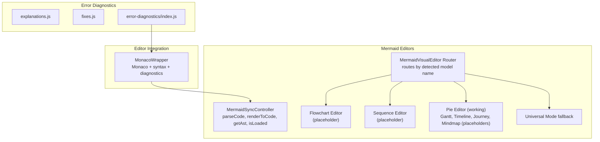
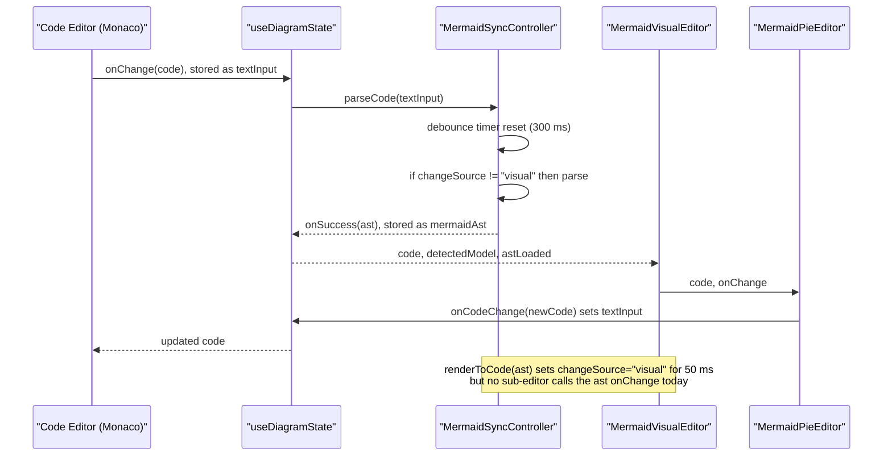
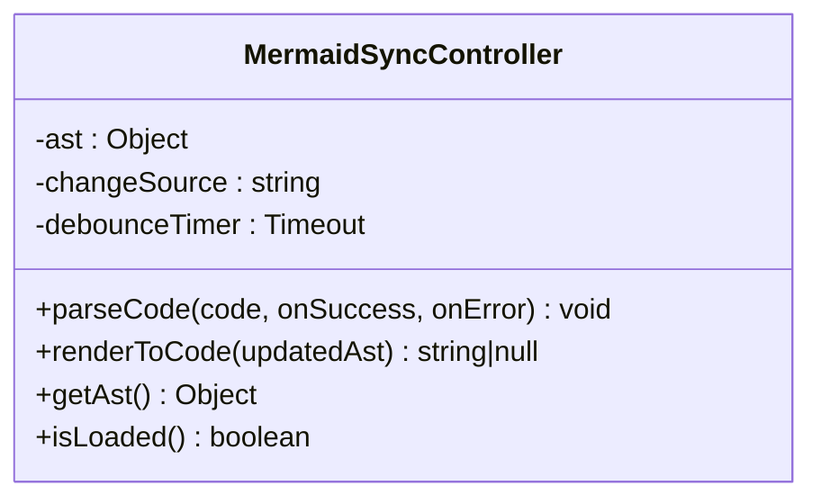
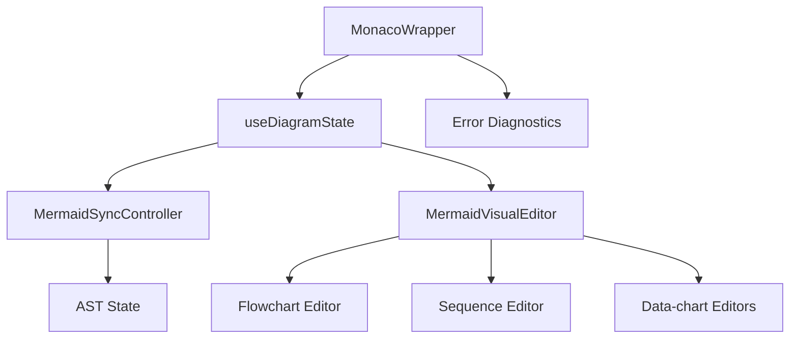
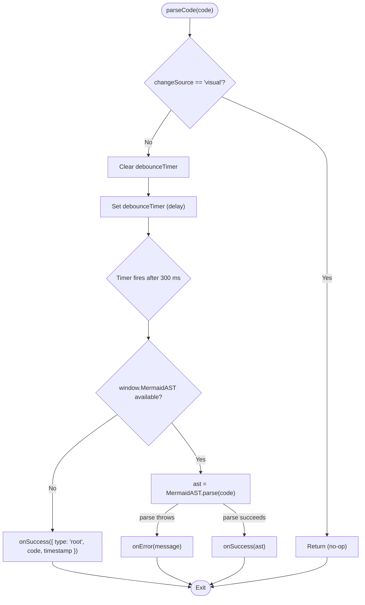

# Bi-directional Synchronization

<cite>
**Referenced Files in This Document**
- [mermaid/utils.js](file://js/components/editors/mermaid/utils.js)
- [MermaidVisualEditor.jsx](file://js/components/editors/mermaid/MermaidVisualEditor.jsx)
- [MermaidEditors.jsx](file://js/components/editors/mermaid/MermaidEditors.jsx)
- [MonacoWrapper.jsx](file://js/components/editors/MonacoWrapper.jsx)
- [explanations.js](file://js/error-diagnostics/explanations.js)
- [fixes.js](file://js/error-diagnostics/fixes.js)
- [index.js](file://js/error-diagnostics/index.js)
</cite>

## Table of Contents
1. [Introduction](#introduction)
2. [Project Structure](#project-structure)
3. [Core Components](#core-components)
4. [Architecture Overview](#architecture-overview)
5. [Detailed Component Analysis](#detailed-component-analysis)
6. [Dependency Analysis](#dependency-analysis)
7. [Performance Considerations](#performance-considerations)
8. [Troubleshooting Guide](#troubleshooting-guide)
9. [Conclusion](#conclusion)

## Introduction
This document explains the synchronization system between code and visual editors for Mermaid diagrams. It focuses on the Mermaid AST-based synchronization controller, including change detection, loop prevention, debouncing, and the parseCode and renderToCode methods. It also covers error handling and the current state of the visual editors: the code-to-AST direction is live, while the visual-to-code direction currently works only through the pie editor, which writes code directly.

## Project Structure
The synchronization system spans several modules:
- A controller (`createMermaidSyncController` in `mermaid/utils.js`) that manages AST state, change source tracking, and debounced parsing. The `useDiagramState` hook owns the controller and calls `parseCode`.
- A router (`MermaidVisualEditor`) that selects the sub-editor from the detected model name.
- Sub-editors in `MermaidEditors.jsx` that receive the code and write changed code back. They do not receive the AST.
- An editor wrapper that integrates Monaco with syntax highlighting and diagnostics.
- Error diagnostics that explain and fix common syntax issues.

**Diagram sources**
- [mermaid/utils.js](file://js/components/editors/mermaid/utils.js)
- [MermaidVisualEditor.jsx](file://js/components/editors/mermaid/MermaidVisualEditor.jsx)
- [MermaidEditors.jsx](file://js/components/editors/mermaid/MermaidEditors.jsx)
- [MonacoWrapper.jsx](file://js/components/editors/MonacoWrapper.jsx)
- [explanations.js](file://js/error-diagnostics/explanations.js)
- [fixes.js](file://js/error-diagnostics/fixes.js#L1-L403)
- [index.js](file://js/error-diagnostics/index.js#L1-L303)

**Section sources**
- [mermaid/utils.js](file://js/components/editors/mermaid/utils.js)
- [MermaidVisualEditor.jsx](file://js/components/editors/mermaid/MermaidVisualEditor.jsx)
- [MonacoWrapper.jsx](file://js/components/editors/MonacoWrapper.jsx)
- [explanations.js](file://js/error-diagnostics/explanations.js)
- [fixes.js](file://js/error-diagnostics/fixes.js#L1-L403)
- [index.js](file://js/error-diagnostics/index.js#L1-L303)

## Core Components
- MermaidSyncController: central state machine for AST, change source, and debounced parsing.
- MermaidVisualEditor: routes to a sub-editor based on the detected model name (for example "Flowchart" or "Pie Chart"), or shows the Universal Mode fallback.
- Editor components: `MermaidPieEditor` reads and rewrites code; the other sub-editors are placeholders.
- MonacoWrapper: integrates Monaco editor with syntax and diagnostics.
- Error diagnostics: explanations and quick fixes for common errors.

Key responsibilities:
- parseCode(code, onSuccess, onError): converts code to AST (code→visual).
- renderToCode(updatedAst): converts AST back to code (visual→code).
- detectSpecificModel(code, type) in `utils.js`: identifies the diagram model name for routing. `useDiagramState` calls it, not the controller.
- Debounce and changeSource tracking to prevent sync loops.

**Section sources**
- [mermaid/utils.js](file://js/components/editors/mermaid/utils.js)
- [MermaidVisualEditor.jsx](file://js/components/editors/mermaid/MermaidVisualEditor.jsx)
- [MonacoWrapper.jsx](file://js/components/editors/MonacoWrapper.jsx)
- [explanations.js](file://js/error-diagnostics/explanations.js#L12-L229)
- [fixes.js](file://js/error-diagnostics/fixes.js#L11-L296)
- [index.js](file://js/error-diagnostics/index.js#L13-L145)

## Architecture Overview
The synchronization pipeline operates in two directions:
- Code→Visual: `useDiagramState` calls parseCode on every text change. parseCode debounces the code (300 ms), checks changeSource, and parses to an AST.
- Visual→Code: renderToCode sets changeSource to visual, renders AST to code, and resets changeSource after 50 ms. `App.jsx` passes the controller's renderToCode to the visual editor's `onChange`, but no sub-editor calls `onChange` today. The pie editor calls `onCodeChange` with new code instead.

**Diagram sources**
- [mermaid/utils.js](file://js/components/editors/mermaid/utils.js)
- [MermaidVisualEditor.jsx](file://js/components/editors/mermaid/MermaidVisualEditor.jsx)
- [MermaidEditors.jsx](file://js/components/editors/mermaid/MermaidEditors.jsx)
- [MonacoWrapper.jsx](file://js/components/editors/MonacoWrapper.jsx)

## Detailed Component Analysis

### MermaidSyncController
The controller encapsulates:
- AST state: current parsed AST.
- changeSource: tracks origin of changes ('visual' | null).
- debounceTimer: delays parsing to coalesce rapid edits.
- Methods:
  - parseCode(code, onSuccess, onError): debounced (300 ms) AST parse with changeSource guard.
  - renderToCode(updatedAst): sets changeSource='visual', renders AST to code, resets changeSource after 50 ms.
  - getAst(): accessor for AST.
  - isLoaded(): checks MermaidAST availability.

Change detection and loop prevention:
- parseCode returns early if changeSource is 'visual'.
- renderToCode sets changeSource to 'visual' and resets after a short delay to allow subsequent code changes.

Debounce implementation:
- parseCode clears and restarts a timer before parsing.
- The delay is 300 ms, chosen to balance responsiveness and stability.

Error handling:
- parseCode catches exceptions and invokes onError with message (`useDiagramState` logs the message to the console).
- When `window.MermaidAST` has not loaded, parseCode calls onSuccess with a placeholder `{ type: 'root', code, timestamp }` node.
- renderToCode catches exceptions, resets changeSource, and returns null.

Timing mechanisms:
- renderToCode schedules changeSource reset after 50 ms to allow next code change to proceed.

Conflict resolution:
- changeSource prevents infinite loops by blocking code→visual→code cycles.
- Debounce ensures only the latest code is parsed.

**Section sources**
- [mermaid/utils.js](file://js/components/editors/mermaid/utils.js)

#### Controller Class Diagram

**Diagram sources**
- [mermaid/utils.js](file://js/components/editors/mermaid/utils.js)

### Visual Editor Router
The router selects the sub-editor by matching the detected model name:
- Flowchart → MermaidFlowchartEditor
- Sequence → MermaidSequenceEditor
- Pie → MermaidPieEditor
- Gantt → MermaidGanttEditor
- Timeline → MermaidTimelineEditor
- Journey → MermaidJourneyEditor
- Mindmap → MermaidMindmapEditor
- others → the Universal Mode fallback panel, which says structure editing is best done via code

While `astLoaded` is false, the router shows a "Loading visual editor..." spinner. The router wraps the sub-editor in an `EditorToolbar` titled "<model> Editor" with the sub-title "Visual Mode (Beta)". The preview is separate: the preview panel renders the diagram, not the visual editor.

**Section sources**
- [MermaidVisualEditor.jsx](file://js/components/editors/mermaid/MermaidVisualEditor.jsx)

### Flowchart Editor
`MermaidFlowchartEditor` is a placeholder. It shows a "Flowchart Editor: interactive node editing coming soon" note plus the "Code-Only Editing" message from `VisualEditingNotAvailable`.

Key behaviors:
- Receives `code` and `onChange`, and does not call `onChange`.
- Does not read the AST, and does not edit nodes or edges.

**Section sources**
- [MermaidEditors.jsx](file://js/components/editors/mermaid/MermaidEditors.jsx)

### Sequence Editor
`MermaidSequenceEditor` is a one-line placeholder that returns the "Code-Only Editing" message.

**Section sources**
- [MermaidEditors.jsx](file://js/components/editors/mermaid/MermaidEditors.jsx)

### Data-Chart Editors (Pie, Gantt, Timeline, Mindmap, Journey)
These editors live in `MermaidEditors.jsx`:
- Pie: reads the slices from the code with regular expressions (`title ...` and `"label" : value`), lets the user edit the title, labels and values and add or remove a slice, and writes the regenerated code through `onChange`. This is the only working visual editor.
- Gantt, Timeline, Journey, Mindmap: placeholders that return the "Code-Only Editing" message.

**Section sources**
- [MermaidEditors.jsx](file://js/components/editors/mermaid/MermaidEditors.jsx)

### Monaco Integration
MonacoWrapper integrates Monaco editor with:
- Language registration for Mermaid, PlantUML and LikeC4.
- Error providers (quick fixes and hover explanations) for Mermaid, PlantUML, XML and Structurizr.
- Content change handling and cursor position reporting.

Monaco emits onChange(value), which updates `textInput` in `useDiagramState` and triggers synchronization.

**Section sources**
- [MonacoWrapper.jsx](file://js/components/editors/MonacoWrapper.jsx)

### Error Diagnostics
Error diagnostics provide:
- getErrorExplanation(code, message): human-readable explanations.
- getFixSuggestions(errorText, diagramType, line): quick fixes for common errors.
- parseError(errorText, diagramType): structured error info with markers.
- toMonacoMarker/toMonacoCodeAction: Monaco-compatible error markers and actions.

These integrate with Monaco to show squiggly underlines and quick fixes.

**Section sources**
- [explanations.js](file://js/error-diagnostics/explanations.js#L12-L271)
- [fixes.js](file://js/error-diagnostics/fixes.js#L11-L366)
- [index.js](file://js/error-diagnostics/index.js#L13-L276)

## Dependency Analysis
- MermaidSyncController depends on window.MermaidAST for parsing and rendering.
- MermaidVisualEditor depends on the detected model name to route to the correct editor.
- Editor components depend on the code they receive, and persist changes by calling `onChange` with new code.
- MonacoWrapper depends on Monaco editor APIs and error diagnostics modules.
- Error diagnostics modules are shared across editors and Monaco integration.

**Diagram sources**
- [mermaid/utils.js](file://js/components/editors/mermaid/utils.js)
- [MermaidVisualEditor.jsx](file://js/components/editors/mermaid/MermaidVisualEditor.jsx)
- [MermaidEditors.jsx](file://js/components/editors/mermaid/MermaidEditors.jsx)
- [MonacoWrapper.jsx](file://js/components/editors/MonacoWrapper.jsx)
- [explanations.js](file://js/error-diagnostics/explanations.js)
- [fixes.js](file://js/error-diagnostics/fixes.js#L1-L403)
- [index.js](file://js/error-diagnostics/index.js#L1-L303)

**Section sources**
- [mermaid/utils.js](file://js/components/editors/mermaid/utils.js)
- [MermaidVisualEditor.jsx](file://js/components/editors/mermaid/MermaidVisualEditor.jsx)
- [MonacoWrapper.jsx](file://js/components/editors/MonacoWrapper.jsx)
- [explanations.js](file://js/error-diagnostics/explanations.js)
- [fixes.js](file://js/error-diagnostics/fixes.js#L1-L403)
- [index.js](file://js/error-diagnostics/index.js#L1-L303)

## Performance Considerations
- Debounce delay: parseCode uses a fixed delay to batch rapid edits and reduce parsing overhead.
- AST caching: controller maintains AST in memory to avoid repeated parsing until new code arrives.
- ChangeSource gating: prevents redundant parsing when visual edits trigger code updates.
- Preview: the preview panel, not the visual editor, requests the rendered diagram.
- Monaco providers: error providers are registered once, guarded by a flag.

[No sources needed since this section provides general guidance]

## Troubleshooting Guide
Common synchronization issues and resolutions:
- Infinite loop between code and visual:
  - Cause: visual edits trigger code updates and vice versa.
  - Resolution: changeSource blocks parseCode when set to 'visual'; ensure renderToCode resets changeSource promptly.
- Parser not loaded:
  - Cause: window.MermaidAST unavailable.
  - Resolution: check isLoaded() and wait for the library to load. The visual editor shows a loading spinner until then, and parseCode passes a placeholder root node to onSuccess in the meantime.
- Stale preview:
  - Cause: the preview panel has not re-rendered after a code change.
  - Resolution: check the preview panel error message; rendering is handled by `useRemoteRenderer`, not by the Mermaid visual editor.
- Error markers not appearing:
  - Cause: Monaco markers not set or error diagnostics not invoked.
  - Resolution: ensure parseError and toMonacoMarker are used; Monaco provider registration is required.
- Quick fixes not offered:
  - Cause: error text does not match known patterns.
  - Resolution: extend getFixSuggestions with additional patterns or improve error extraction.

**Section sources**
- [mermaid/utils.js](file://js/components/editors/mermaid/utils.js)
- [MermaidVisualEditor.jsx](file://js/components/editors/mermaid/MermaidVisualEditor.jsx)
- [MonacoWrapper.jsx](file://js/components/editors/MonacoWrapper.jsx)
- [explanations.js](file://js/error-diagnostics/explanations.js#L237-L271)
- [fixes.js](file://js/error-diagnostics/fixes.js#L332-L366)
- [index.js](file://js/error-diagnostics/index.js#L261-L298)

## Detailed Component Analysis

### parseCode Method (Code → Visual)
Behavior:
- If changeSource is 'visual', return immediately to prevent loop.
- Clear existing debounce timer and schedule new one.
- On timeout, check MermaidAST availability. If the library is missing, call onSuccess with a placeholder root node. Otherwise parse the code to an AST and call onSuccess(ast).
- On error, call onError with message.

Debounce flow:

**Diagram sources**
- [mermaid/utils.js](file://js/components/editors/mermaid/utils.js)

**Section sources**
- [mermaid/utils.js](file://js/components/editors/mermaid/utils.js)

### renderToCode Method (Visual → Code)
Behavior:
- Set changeSource to 'visual' and update AST.
- Attempt to render AST to code via MermaidAST.
- Reset changeSource after a short delay to allow next code change.
- On error, reset changeSource and return null.

Timing and reset:
- The 50 ms delay ensures subsequent code changes are not blocked by the 'visual' flag.

**Section sources**
- [mermaid/utils.js](file://js/components/editors/mermaid/utils.js)

### Editor-to-Code Updates
- Pie editor regenerates the whole pie code (the `pie` line, title and slices) from its own state on every edit.
- Flowchart, sequence, Gantt, timeline, journey and mindmap editors do not change code.

The pie editor's change reaches `onCodeChange`, which sets `textInput` and feeds back into the sync loop. Because this path does not use renderToCode, the changeSource guard is not set for it, and parseCode re-parses the new code after the debounce.

**Section sources**
- [MermaidEditors.jsx](file://js/components/editors/mermaid/MermaidEditors.jsx)

### Error Handling and Diagnostics
- parseError extracts line/column and assigns error code.
- getErrorExplanation provides human-readable explanations.
- getFixSuggestions proposes quick fixes.
- toMonacoMarker and toMonacoCodeAction integrate with Monaco.

**Section sources**
- [index.js](file://js/error-diagnostics/index.js#L13-L145)
- [explanations.js](file://js/error-diagnostics/explanations.js#L237-L271)
- [fixes.js](file://js/error-diagnostics/fixes.js#L332-L366)
- [index.js](file://js/error-diagnostics/index.js#L261-L298)

## Dependency Analysis

**Diagram sources**
- [mermaid/utils.js](file://js/components/editors/mermaid/utils.js)
- [MermaidVisualEditor.jsx](file://js/components/editors/mermaid/MermaidVisualEditor.jsx)
- [MermaidEditors.jsx](file://js/components/editors/mermaid/MermaidEditors.jsx)
- [MonacoWrapper.jsx](file://js/components/editors/MonacoWrapper.jsx)
- [explanations.js](file://js/error-diagnostics/explanations.js)
- [fixes.js](file://js/error-diagnostics/fixes.js#L1-L403)
- [index.js](file://js/error-diagnostics/index.js#L1-L303)

**Section sources**
- [mermaid/utils.js](file://js/components/editors/mermaid/utils.js)
- [MermaidVisualEditor.jsx](file://js/components/editors/mermaid/MermaidVisualEditor.jsx)
- [MonacoWrapper.jsx](file://js/components/editors/MonacoWrapper.jsx)
- [explanations.js](file://js/error-diagnostics/explanations.js)
- [fixes.js](file://js/error-diagnostics/fixes.js#L1-L403)
- [index.js](file://js/error-diagnostics/index.js#L1-L303)

## Performance Considerations
- Debounce delay: parseCode uses a fixed delay to batch rapid edits and reduce parsing overhead.
- AST caching: controller maintains AST in memory to avoid repeated parsing until new code arrives.
- ChangeSource gating: prevents redundant parsing when visual edits trigger code updates.
- Preview: the preview panel, not the visual editor, requests the rendered diagram.
- Monaco providers: error providers are registered once, guarded by a flag.

[No sources needed since this section provides general guidance]

## Troubleshooting Guide
Common synchronization issues and resolutions:
- Infinite loop between code and visual:
  - Cause: visual edits trigger code updates and vice versa.
  - Resolution: changeSource blocks parseCode when set to 'visual'; ensure renderToCode resets changeSource promptly.
- Parser not loaded:
  - Cause: window.MermaidAST unavailable.
  - Resolution: check isLoaded() and wait for the library to load. The visual editor shows a loading spinner until then, and parseCode passes a placeholder root node to onSuccess in the meantime.
- Stale preview:
  - Cause: the preview panel has not re-rendered after a code change.
  - Resolution: check the preview panel error message; rendering is handled by `useRemoteRenderer`, not by the Mermaid visual editor.
- Error markers not appearing:
  - Cause: Monaco markers not set or error diagnostics not invoked.
  - Resolution: ensure parseError and toMonacoMarker are used; Monaco provider registration is required.
- Quick fixes not offered:
  - Cause: error text does not match known patterns.
  - Resolution: extend getFixSuggestions with additional patterns or improve error extraction.

**Section sources**
- [mermaid/utils.js](file://js/components/editors/mermaid/utils.js)
- [MermaidVisualEditor.jsx](file://js/components/editors/mermaid/MermaidVisualEditor.jsx)
- [MonacoWrapper.jsx](file://js/components/editors/MonacoWrapper.jsx)
- [explanations.js](file://js/error-diagnostics/explanations.js#L237-L271)
- [fixes.js](file://js/error-diagnostics/fixes.js#L332-L366)
- [index.js](file://js/error-diagnostics/index.js#L261-L298)

## Conclusion
The bi-directional synchronization system leverages a Mermaid AST-based controller to safely parse code into AST and render AST back to code. ChangeSource tracking and debouncing prevent infinite loops and stabilize rapid edits. The visual editor router and specialized editors provide a responsive authoring experience, while Monaco integration and error diagnostics enhance usability. Following the troubleshooting steps and performance recommendations ensures reliable real-time synchronization.