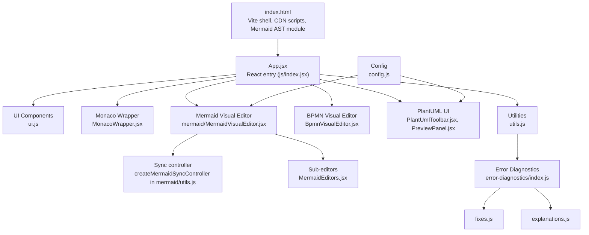
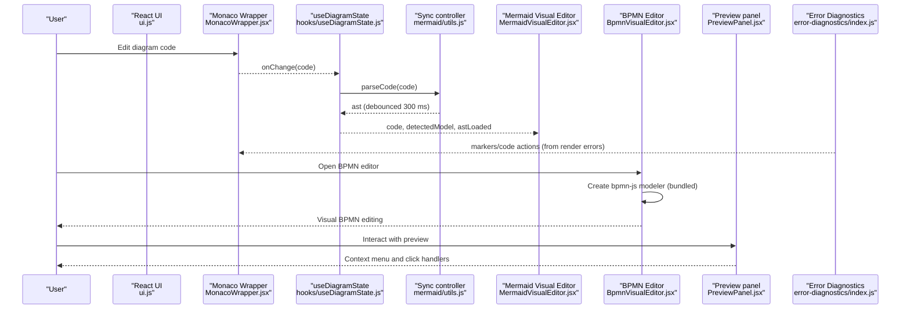
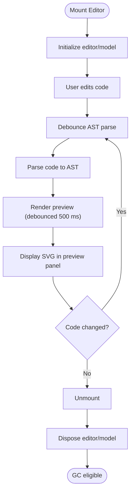
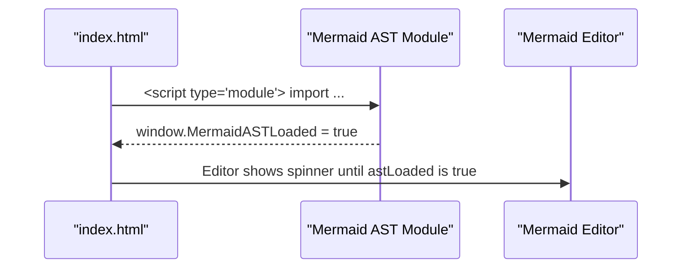
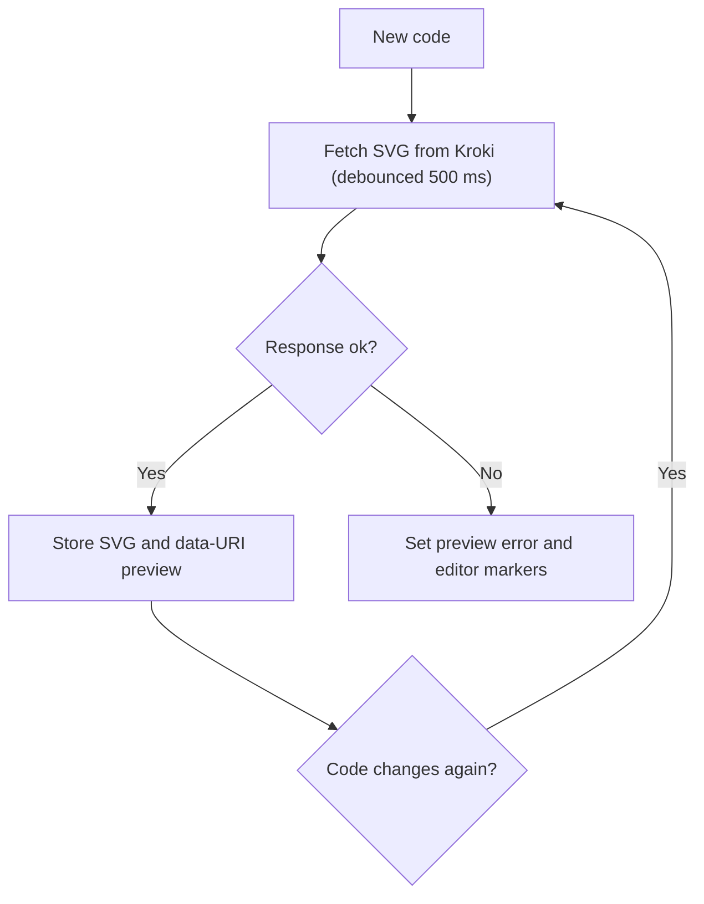
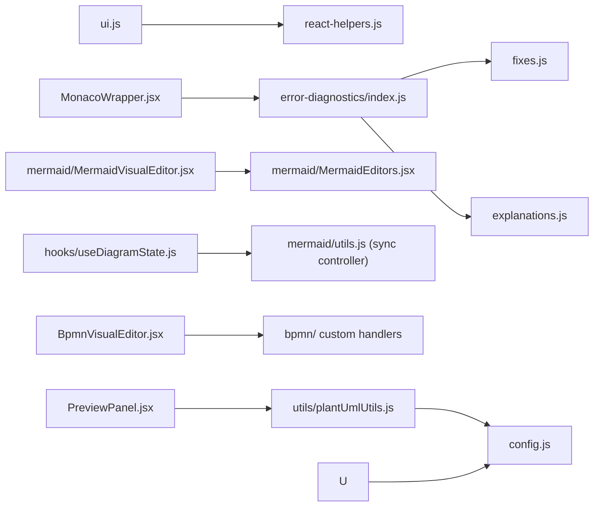

# Performance Optimization

<cite>
**Referenced Files in This Document**
- [index.html](file://index.html)
- [js/config.js](file://js/config.js)
- [js/utils.js](file://js/utils.js)
- [js/react-helpers.js](file://js/react-helpers.js)
- [js/components/ui.js](file://js/components/ui.js)
- [js/components/PlantUmlToolbar.jsx](file://js/components/PlantUmlToolbar.jsx)
- [js/components/editors/PreviewPanel.jsx](file://js/components/editors/PreviewPanel.jsx)
- [js/components/editors/mermaid/utils.js](file://js/components/editors/mermaid/utils.js)
- [js/components/editors/mermaid/MermaidVisualEditor.jsx](file://js/components/editors/mermaid/MermaidVisualEditor.jsx)
- [js/components/editors/BpmnVisualEditor.jsx](file://js/components/editors/BpmnVisualEditor.jsx)
- [js/error-diagnostics/index.js](file://js/error-diagnostics/index.js)
- [js/error-diagnostics/fixes.js](file://js/error-diagnostics/fixes.js)
- [js/error-diagnostics/explanations.js](file://js/error-diagnostics/explanations.js)
</cite>

## Table of Contents
1. [Introduction](#introduction)
2. [Project Structure](#project-structure)
3. [Core Components](#core-components)
4. [Architecture Overview](#architecture-overview)
5. [Detailed Component Analysis](#detailed-component-analysis)
6. [Dependency Analysis](#dependency-analysis)
7. [Performance Considerations](#performance-considerations)
8. [Troubleshooting Guide](#troubleshooting-guide)
9. [Conclusion](#conclusion)
10. [Appendices](#appendices)

## Introduction
This document focuses on performance optimization techniques and strategies for the Universal Diagram application. It covers memory management (AST cleanup, event listener cleanup, garbage collection optimization), lazy loading and CDN resource optimization, conditional loading, caching mechanisms, bundle size optimization, code splitting, dependency management, performance monitoring and profiling, bottleneck identification, browser-specific optimizations, progressive enhancement, and responsive performance tuning. Concrete implementation references are provided from the repository’s source files.

## Project Structure
The application is a single-page app built with Vite. `index.html` is a small shell that loads a few CDN scripts (Monaco loader, Mermaid AST, pako, dagre, SheetJS) and the `js/index.jsx` entry point. React, bpmn-js and most other libraries come from npm and are bundled. Editors are organized by diagram type, with shared utilities and error diagnostics.

**Diagram sources**
- [index.html](file://index.html)
- [js/App.jsx](file://js/App.jsx)
- [js/components/ui.js](file://js/components/ui.js)
- [js/components/editors/MonacoWrapper.jsx](file://js/components/editors/MonacoWrapper.jsx)
- [js/components/editors/mermaid/MermaidVisualEditor.jsx](file://js/components/editors/mermaid/MermaidVisualEditor.jsx)
- [js/components/editors/mermaid/utils.js](file://js/components/editors/mermaid/utils.js)
- [js/components/editors/BpmnVisualEditor.jsx](file://js/components/editors/BpmnVisualEditor.jsx)
- [js/components/PlantUmlToolbar.jsx](file://js/components/PlantUmlToolbar.jsx)
- [js/components/editors/PreviewPanel.jsx](file://js/components/editors/PreviewPanel.jsx)
- [js/utils.js](file://js/utils.js#L1-L177)
- [js/error-diagnostics/index.js](file://js/error-diagnostics/index.js#L1-L303)
- [js/error-diagnostics/fixes.js](file://js/error-diagnostics/fixes.js#L1-L403)
- [js/error-diagnostics/explanations.js](file://js/error-diagnostics/explanations.js)
- [js/config.js](file://js/config.js#L1-L566)

**Section sources**
- [index.html](file://index.html)
- [js/config.js](file://js/config.js#L1-L566)

## Core Components
- Asset loading: Vite bundles React, bpmn-js, Excalidraw and the other npm packages, and compiles Tailwind at build time. The Monaco AMD loader, Mermaid AST, pako, dagre, SheetJS and Font Awesome load from CDNs in `index.html`.
- Utilities: Script/CSS loaders and debouncing in `utils.js`, Kroki compression in the renderer adapter, and error parsing in the diagnostics modules.
- Editors:
  - Mermaid visual editor (Beta) with AST parsing in `useDiagramState`; preview generation is separate, in `useRemoteRenderer`.
  - BPMN visual editor using the bundled bpmn-js modeler, destroyed on unmount.
  - PlantUML toolbar, template gallery, and a preview panel with a context menu.
- Error diagnostics: Structured error parsing, fix suggestions, and explanations for Monaco integration.

**Section sources**
- [index.html](file://index.html#L8-L48)
- [js/utils.js](file://js/utils.js#L1-L177)
- [js/components/editors/mermaid/MermaidVisualEditor.jsx](file://js/components/editors/mermaid/MermaidVisualEditor.jsx)
- [js/components/editors/BpmnVisualEditor.jsx](file://js/components/editors/BpmnVisualEditor.jsx)
- [js/components/PlantUmlToolbar.jsx](file://js/components/PlantUmlToolbar.jsx)
- [js/components/editors/PreviewPanel.jsx](file://js/components/editors/PreviewPanel.jsx)
- [js/error-diagnostics/index.js](file://js/error-diagnostics/index.js#L1-L303)

## Architecture Overview
The runtime architecture centers on:
- A small HTML shell with CDN scripts for the Monaco loader and Mermaid AST, plus a Vite-built entry point.
- JSX components compiled by Vite (`react-helpers.js` still binds htm templates for a few older components).
- Editor components that manage their own lifecycle, such as creating and destroying the Monaco editor and the BPMN modeler.
- Error diagnostics integrated with Monaco for immediate feedback.

**Diagram sources**
- [index.html](file://index.html)
- [js/components/editors/mermaid/MermaidVisualEditor.jsx](file://js/components/editors/mermaid/MermaidVisualEditor.jsx)
- [js/components/editors/mermaid/utils.js](file://js/components/editors/mermaid/utils.js)
- [js/components/editors/BpmnVisualEditor.jsx](file://js/components/editors/BpmnVisualEditor.jsx)
- [js/components/editors/PreviewPanel.jsx](file://js/components/editors/PreviewPanel.jsx)
- [js/error-diagnostics/index.js](file://js/error-diagnostics/index.js#L13-L44)

## Detailed Component Analysis

### Memory Management and Garbage Collection Optimization
Key areas for memory optimization:
- Monaco editor lifecycle: dispose on unmount to release DOM and worker resources.
- Download object URLs: the SVG, PNG and source download helpers create object URLs and revoke them straight after use. The preview itself uses a data URI.
- BPMN modeler lifecycle: destroy on unmount to free DOM and event listeners.
- Debounced AST parsing: cancel timers to avoid stale closures and redundant work.
- Event listeners for SVG elements: attach/remove listeners carefully to prevent leaks.

**Diagram sources**
- [index.html](file://index.html)
- [js/components/editors/mermaid/MermaidVisualEditor.jsx](file://js/components/editors/mermaid/MermaidVisualEditor.jsx)
- [js/components/editors/BpmnVisualEditor.jsx](file://js/components/editors/BpmnVisualEditor.jsx)
- [js/components/editors/mermaid/utils.js](file://js/components/editors/mermaid/utils.js)

**Section sources**
- [index.html](file://index.html)
- [js/components/editors/mermaid/MermaidVisualEditor.jsx](file://js/components/editors/mermaid/MermaidVisualEditor.jsx)
- [js/components/editors/BpmnVisualEditor.jsx](file://js/components/editors/BpmnVisualEditor.jsx)
- [js/components/editors/mermaid/utils.js](file://js/components/editors/mermaid/utils.js)

### Lazy Loading Strategies and Conditional Loading
- Mermaid AST module is loaded via an ES module script tag in `index.html`, which sets `window.MermaidAST` and `window.MermaidASTLoaded`. `useDiagramState` reads that flag when it mounts and also listens for a `mermaid-ast-loaded` event (the current `index.html` does not dispatch that event). The Mermaid visual editor shows a loading spinner until the flag is true.
- `utils.js` still provides loaders for other scripts and stylesheets:
  - loadScript checks for existing script tags before injecting.
  - loadCSS avoids duplicate link injection.
- The BPMN modeler is created only when the BPMN visual editor mounts. Its code is part of the Vite bundle, not a separate CDN download.

**Diagram sources**
- [index.html](file://index.html)
- [js/components/editors/mermaid/MermaidVisualEditor.jsx](file://js/components/editors/mermaid/MermaidVisualEditor.jsx)

**Section sources**
- [index.html](file://index.html)
- [js/utils.js](file://js/utils.js#L116-L146)
- [js/utils.js](file://js/utils.js#L152-L158)
- [js/components/editors/BpmnVisualEditor.jsx](file://js/components/editors/BpmnVisualEditor.jsx)

### Caching Mechanisms
- Preview state: the latest SVG stays in state until the next debounced render replaces it. The sync controller also keeps the latest parsed AST in memory.
- Object URL lifecycle: URL.revokeObjectURL is used to release memory for downloads.
- Template and snippet caches: Config-driven arrays are reused across sessions.

**Diagram sources**
- [js/hooks/useRemoteRenderer.js](file://js/hooks/useRemoteRenderer.js)

**Section sources**
- [js/hooks/useRemoteRenderer.js](file://js/hooks/useRemoteRenderer.js)
- [js/config.js](file://js/config.js#L118-L192)
- [js/config.js](file://js/config.js#L194-L565)

### Bundle Size Optimization and Code Splitting
Current implementation:
- A Vite build (`vite build`) bundles the JSX modules and npm packages, with Rollup's tree-shaking.
- `index.html` adds a few CDN scripts outside the bundle.
- `App.jsx` imports every visual editor statically, so the bundle has no per-editor chunks.

Recommendations:
- Use dynamic imports for diagram-specific editors to reduce initial payload.
- Enable gzip/HTTP/2 push for frequently used assets.

[No sources needed since this section provides general guidance]

### Dependency Management
- npm package versions are managed through `package.json` and the lockfile; the CDN scripts in `index.html` use pinned versions but have no integrity checks.
- Internal dependencies are explicit via ES modules and named exports.

**Section sources**
- [index.html](file://index.html#L8-L48)
- [package.json](file://package.json)
- [js/utils.js](file://js/utils.js#L2-L2)

### Performance Monitoring and Profiling
- Monaco markers and hover providers surface errors immediately; integrate with performance budgets to avoid excessive re-renders.
- Debounce AST parsing to limit CPU usage during rapid typing.
- Monitor preview generation latency.

**Section sources**
- [index.html](file://index.html)
- [js/components/editors/mermaid/utils.js](file://js/components/editors/mermaid/utils.js)
- [js/components/editors/mermaid/MermaidVisualEditor.jsx](file://js/components/editors/mermaid/MermaidVisualEditor.jsx)

### Browser-Specific Optimizations and Progressive Enhancement
- Tailwind is compiled at build time through PostCSS, so the browser loads plain CSS.
- Check the Mermaid AST flag (`astLoaded`) and Monaco's loader (`window.require`) before using them; the Mermaid visual editor shows a spinner and `MonacoWrapper` logs a warning if the loader is missing.
- Progressive enhancement: start with code view, then enable visual editors when dependencies are ready.

**Section sources**
- [index.html](file://index.html#L30-L45)
- [index.html](file://index.html)
- [js/components/editors/mermaid/MermaidVisualEditor.jsx](file://js/components/editors/mermaid/MermaidVisualEditor.jsx)

### Responsive Performance Tuning
- Minimap and line highlighting in Monaco can impact performance on large documents. `MonacoWrapper` enables the minimap (scale 0.75) and whole-line highlighting, so turn them off first if large documents feel slow.
- Debounce preview generation to balance responsiveness and accuracy.

**Section sources**
- [index.html](file://index.html)
- [js/components/editors/mermaid/MermaidVisualEditor.jsx](file://js/components/editors/mermaid/MermaidVisualEditor.jsx)

## Dependency Analysis
The system exhibits low coupling between components, with clear separation of concerns:
- UI components depend on shared helpers.
- Editors depend on utilities for loading and debouncing.
- Error diagnostics are decoupled and reusable.

**Diagram sources**
- [js/components/ui.js](file://js/components/ui.js)
- [js/react-helpers.js](file://js/react-helpers.js#L1-L39)
- [js/components/editors/MonacoWrapper.jsx](file://js/components/editors/MonacoWrapper.jsx)
- [js/components/editors/mermaid/MermaidVisualEditor.jsx](file://js/components/editors/mermaid/MermaidVisualEditor.jsx)
- [js/components/editors/mermaid/MermaidEditors.jsx](file://js/components/editors/mermaid/MermaidEditors.jsx)
- [js/components/editors/mermaid/utils.js](file://js/components/editors/mermaid/utils.js)
- [js/components/editors/BpmnVisualEditor.jsx](file://js/components/editors/BpmnVisualEditor.jsx)
- [js/components/editors/PreviewPanel.jsx](file://js/components/editors/PreviewPanel.jsx)
- [js/utils/plantUmlUtils.js](file://js/utils/plantUmlUtils.js)
- [js/config.js](file://js/config.js#L1-L566)
- [js/utils.js](file://js/utils.js#L1-L177)
- [js/error-diagnostics/index.js](file://js/error-diagnostics/index.js#L1-L303)
- [js/error-diagnostics/fixes.js](file://js/error-diagnostics/fixes.js#L1-L403)
- [js/error-diagnostics/explanations.js](file://js/error-diagnostics/explanations.js)

**Section sources**
- [js/components/editors/mermaid/MermaidVisualEditor.jsx](file://js/components/editors/mermaid/MermaidVisualEditor.jsx)
- [js/components/editors/mermaid/utils.js](file://js/components/editors/mermaid/utils.js)
- [js/components/editors/BpmnVisualEditor.jsx](file://js/components/editors/BpmnVisualEditor.jsx)
- [js/components/editors/PreviewPanel.jsx](file://js/components/editors/PreviewPanel.jsx)
- [js/error-diagnostics/index.js](file://js/error-diagnostics/index.js#L1-L303)

## Performance Considerations
- Caching: Vite emits hashed asset file names, so long-lived cache headers work for the bundle. Pin versions for the CDN scripts.
- Lazy initialization: The bundle loads every editor up front; dynamic imports could defer heavy libraries until the user activates an editor.
- Debouncing: Limit frequent operations like AST parsing and preview generation.
- Lifecycle hooks: Dispose editors and revoke object URLs promptly.
- Error diagnostics: Avoid expensive computations in hot paths; cache parsed results.

[No sources needed since this section provides general guidance]

## Troubleshooting Guide
- Preview not updating: Confirm the 500 ms debounce has elapsed and read the preview error from the renderer.
- Editor not disposing: Verify unmount effects dispose Monaco and BPMN modeler instances.
- Memory leaks: Check for retained references to DOM nodes or event listeners.
- Error markers not appearing: Confirm Monaco provider registration and that the preview render reported an error line.

**Section sources**
- [js/components/editors/mermaid/MermaidVisualEditor.jsx](file://js/components/editors/mermaid/MermaidVisualEditor.jsx)
- [index.html](file://index.html)
- [js/components/editors/BpmnVisualEditor.jsx](file://js/components/editors/BpmnVisualEditor.jsx)
- [index.html](file://index.html)

## Conclusion
The application starts from a small Vite-built bundle plus a few CDN scripts. Performance hinges on disciplined memory management (disposing the Monaco editor and BPMN modeler, revoking download URLs), debounced operations, and careful lifecycle handling. Future enhancements can include dynamic imports, CDN integrity checks, and structured performance monitoring to sustain responsiveness as features expand.

[No sources needed since this section summarizes without analyzing specific files]

## Appendices
- Practical examples of optimization implementations:
  - Use loadScript/loadCSS guards to avoid duplicate injections.
  - Revoke object URLs straight after a download.
  - Debounce AST parsing (300 ms) and preview generation (500 ms).
  - Destroy editors and modelers on unmount.

[No sources needed since this section provides general guidance]