# Technical Implementations

<cite>
**Referenced Files in This Document**
- [index.html](file://index.html)
- [js/utils.js](file://js/utils.js)
- [js/react-helpers.js](file://js/react-helpers.js)
- [js/services/RendererAdapter.js](file://js/services/RendererAdapter.js)
- [js/hooks/useDiagramState.js](file://js/hooks/useDiagramState.js)
- [js/hooks/useRemoteRenderer.js](file://js/hooks/useRemoteRenderer.js)
- [js/components/editors/MonacoWrapper.jsx](file://js/components/editors/MonacoWrapper.jsx)
- [js/config.js](file://js/config.js)
- [js/error-diagnostics/index.js](file://js/error-diagnostics/index.js)
- [js/error-diagnostics/explanations.js](file://js/error-diagnostics/explanations.js)
- [js/error-diagnostics/fixes.js](file://js/error-diagnostics/fixes.js)
- [js/components/PlantUmlToolbar.jsx](file://js/components/PlantUmlToolbar.jsx)
- [js/components/editors/PreviewPanel.jsx](file://js/components/editors/PreviewPanel.jsx)
- [js/components/ui.js](file://js/components/ui.js)
- [js/components/editors/BpmnVisualEditor.jsx](file://js/components/editors/BpmnVisualEditor.jsx)
- [js/components/editors/mermaid/MermaidEditors.jsx](file://js/components/editors/mermaid/MermaidEditors.jsx)
- [js/components/editors/mermaid/MermaidVisualEditor.jsx](file://js/components/editors/mermaid/MermaidVisualEditor.jsx)
- [js/components/editors/mermaid/utils.js](file://js/components/editors/mermaid/utils.js)
- [js/library-registry.js](file://js/library-registry.js)
- [js/cdn-version-checker.js](file://js/cdn-version-checker.js)
- [js/update-manager.js](file://js/update-manager.js)
- [js/update-tester.js](file://js/update-tester.js)
- [js/html-rewriter.js](file://js/html-rewriter.js)
</cite>

## Update Summary
**Changes Made**
- Enhanced library registry with comprehensive version tracking, peer dependency validation, and linked version management
- Improved update manager with better error handling, state management, and comprehensive testing workflows
- Expanded update tester with sophisticated iframe-based sandbox testing, URL validation, and visual rendering verification
- Added comprehensive dependency conflict detection and resolution
- Enhanced HTML rewriter with precise URL pattern matching and change tracking
- Integrated update system into main application with React component subscriptions and reactive state updates

## Table of Contents
1. [Introduction](#introduction)
2. [Project Structure](#project-structure)
3. [Core Components](#core-components)
4. [Architecture Overview](#architecture-overview)
5. [Detailed Component Analysis](#detailed-component-analysis)
6. [Library Update Management System](#library-update-management-system)
7. [Dependency Analysis](#dependency-analysis)
8. [Performance Considerations](#performance-considerations)
9. [Troubleshooting Guide](#troubleshooting-guide)
10. [Conclusion](#conclusion)

## Introduction
This document explains the advanced technical implementations and architectural patterns used in the Universal Diagram Editor. It covers the utility function architecture (encoding/decoding, error handling, cross-platform compatibility), React helper utilities for DOM/event/lifecycle management, the Monaco wrapper implementation (syntax highlighting, error markers, custom languages), integration patterns for external libraries (npm packages bundled by Vite, plus a few CDN scripts), configuration and plugin/extensibility points, advanced JavaScript patterns, asynchronous programming, state management strategies, and the comprehensive library update management system with enhanced error handling and testing scenarios.

## Project Structure
The application is a single-page React application built with Vite:
- `index.html` is a small shell. It loads the Monaco AMD loader, pako, dagre, SheetJS and Font Awesome from CDNs, imports the Mermaid AST module, and loads the `js/index.jsx` entry point.
- React, ReactDOM, bpmn-js and the other npm packages are bundled by Vite.
- Core logic is split into modular JS and JSX files under js/ for utilities, hooks, the Monaco wrapper, configuration, error diagnostics, visual editors, and the enhanced library update management system.
- The main application is bootstrapped by `js/index.jsx`, which renders `App.jsx`.
- The library update system is integrated as an ES module with a dedicated UI panel featuring reactive state management.

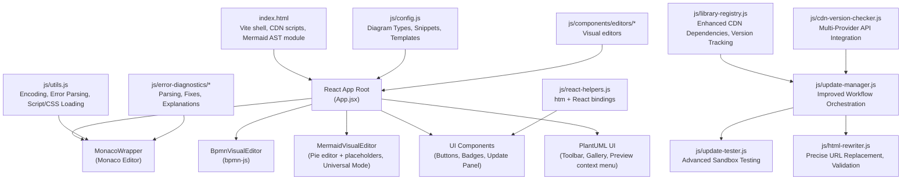

**Diagram sources**
- [index.html](file://index.html)
- [js/utils.js](file://js/utils.js#L1-L177)
- [js/config.js](file://js/config.js#L1-L566)
- [js/react-helpers.js](file://js/react-helpers.js#L1-L39)
- [js/components/editors/MonacoWrapper.jsx](file://js/components/editors/MonacoWrapper.jsx)
- [js/components/editors/BpmnVisualEditor.jsx](file://js/components/editors/BpmnVisualEditor.jsx)
- [js/components/editors/mermaid/MermaidEditors.jsx](file://js/components/editors/mermaid/MermaidEditors.jsx)
- [js/components/editors/mermaid/MermaidVisualEditor.jsx](file://js/components/editors/mermaid/MermaidVisualEditor.jsx)
- [js/library-registry.js](file://js/library-registry.js)
- [js/update-manager.js](file://js/update-manager.js)
- [js/update-tester.js](file://js/update-tester.js)
- [js/html-rewriter.js](file://js/html-rewriter.js)
- [js/cdn-version-checker.js](file://js/cdn-version-checker.js)

**Section sources**
- [index.html](file://index.html)
- [js/config.js](file://js/config.js#L1-L120)

## Core Components
- Utility functions: model detection, regex escaping, dynamic script/CSS loading and debouncing in `utils.js`. The renderer adapter (`js/services/RendererAdapter.js`) holds Kroki encoding (deflate plus URL-safe base64), type detection from a file name, and error-line extraction.
- React helpers: `react-helpers.js` binds htm tagged templates to React for the older components. Newer components are JSX compiled by Vite.
- Monaco wrapper: `MonacoWrapper.jsx` configures the Monaco AMD loader, registers PlantUML, Mermaid and LikeC4 Monarch tokens, attaches error providers, and exposes imperative methods through a ref.
- Error diagnostics: Parser for extracting line/column, categorization, and conversion to Monaco markers; fix suggestions and explanations.
- Configuration: Central registry of diagram types, language mappings, snippets, and templates.
- Visual editors: BPMN visual editor (bpmn-js), the Mermaid visual editor (a working pie editor, placeholder sub-editors and a Universal Mode fallback), and UI components.
- **Syntext Smith**: AI assistant that edits native diagram code through tools. The real parsers check every edit, and the model repairs the draft within the same turn, in up to eight model steps. See [Syntext Smith](file://Advanced Features/Syntext Smith (AI Copilot).md).
- **Enhanced**: Library update management system: Comprehensive dependency tracking, CDN version checking, automated testing, and HTML rewriting with advanced validation.

**Section sources**
- [js/utils.js](file://js/utils.js#L1-L177)
- [js/react-helpers.js](file://js/react-helpers.js#L1-L39)
- [js/components/editors/MonacoWrapper.jsx](file://js/components/editors/MonacoWrapper.jsx)
- [js/error-diagnostics/index.js](file://js/error-diagnostics/index.js#L1-L303)
- [js/error-diagnostics/explanations.js](file://js/error-diagnostics/explanations.js)
- [js/error-diagnostics/fixes.js](file://js/error-diagnostics/fixes.js#L1-L403)
- [js/config.js](file://js/config.js#L1-L120)
- [js/components/editors/BpmnVisualEditor.jsx](file://js/components/editors/BpmnVisualEditor.jsx)
- [js/components/editors/mermaid/MermaidEditors.jsx](file://js/components/editors/mermaid/MermaidEditors.jsx)
- [js/components/editors/mermaid/MermaidVisualEditor.jsx](file://js/components/editors/mermaid/MermaidVisualEditor.jsx)
- [js/library-registry.js](file://js/library-registry.js)
- [js/update-manager.js](file://js/update-manager.js)
- [js/update-tester.js](file://js/update-tester.js)
- [js/html-rewriter.js](file://js/html-rewriter.js)
- [js/cdn-version-checker.js](file://js/cdn-version-checker.js)

## Architecture Overview
High-level architecture:
- Frontend: React + Monaco + visual editors.
- External integrations: npm packages bundled by Vite (React, bpmn-js and others), CDN-hosted scripts (Monaco loader, Mermaid AST, pako, dagre), and the Kroki backend for rendering.
- Data flow: Code changes trigger debounced preview generation; errors are parsed and surfaced via Monaco markers and hover explanations; the Mermaid sync controller parses code into an AST, and the pie editor writes regenerated code back.
- **Enhanced**: Update system: Comprehensive dependency version tracking, testing, and HTML rewriting with sandboxed validation and error handling.

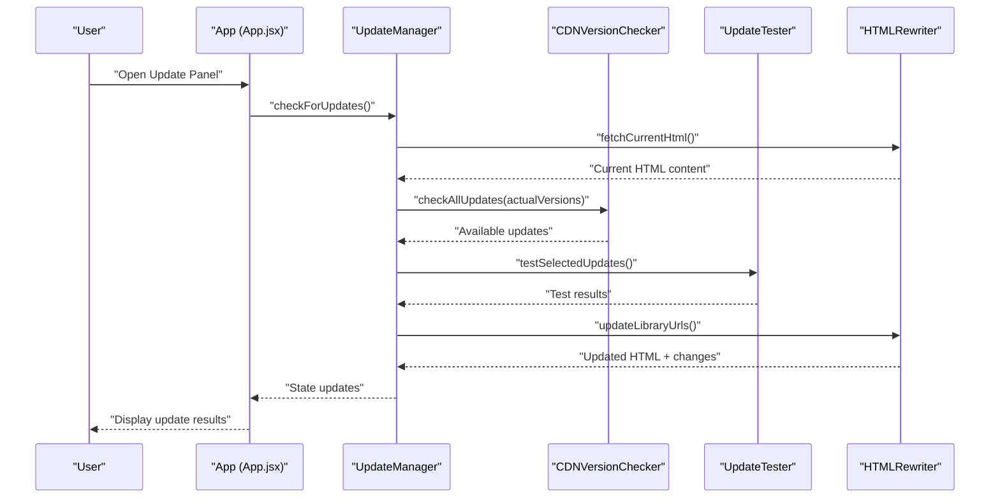

**Diagram sources**
- [index.html](file://index.html)
- [js/update-manager.js](file://js/update-manager.js#L63-L98)
- [js/cdn-version-checker.js](file://js/cdn-version-checker.js#L191-L214)
- [js/update-tester.js](file://js/update-tester.js#L398-L444)
- [js/html-rewriter.js](file://js/html-rewriter.js#L66-L99)

## Detailed Component Analysis

### Utility Function Architecture
- Encoding/Decoding: `RendererAdapter.encodeKroki` converts text to bytes, compresses with pako, base64-encodes, and URL-safes the result for Kroki URLs.
- Type Detection: `RendererAdapter.detectType` infers the diagram type from a file name and content, and `detectSpecificModel` in `utils.js` infers the model from code.
- Error Extraction: Parses line/column from various error formats (`RendererAdapter` and the diagnostics modules).
- Regex Escaping: Safe construction of RegExp from user-provided strings.
- Dynamic Loading: Loads external scripts/CSS avoiding AMD conflicts; deduplicates existing resources.
- Debounce: Throttles expensive operations (e.g., Mermaid AST parsing).

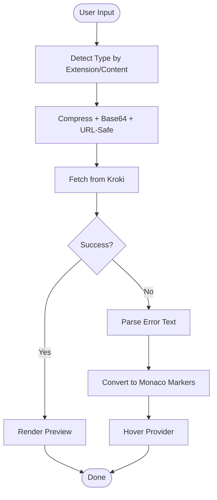

**Diagram sources**
- [js/utils.js](file://js/utils.js#L14-L85)
- [js/services/RendererAdapter.js](file://js/services/RendererAdapter.js)
- [js/error-diagnostics/index.js](file://js/error-diagnostics/index.js#L13-L145)
- [js/error-diagnostics/explanations.js](file://js/error-diagnostics/explanations.js#L237-L271)

**Section sources**
- [js/utils.js](file://js/utils.js#L1-L177)
- [js/error-diagnostics/index.js](file://js/error-diagnostics/index.js#L1-L303)
- [js/error-diagnostics/explanations.js](file://js/error-diagnostics/explanations.js)
- [js/error-diagnostics/fixes.js](file://js/error-diagnostics/fixes.js#L1-L403)

### React Helper Utilities
- `react-helpers.js` imports htm from a CDN module and binds it to the React that Vite bundles.
- Exports React hooks and the `html` tagged template for the components that still use that syntax.
- Newer components are written in JSX and compiled by Vite, so the helper is no longer the main way to write components.

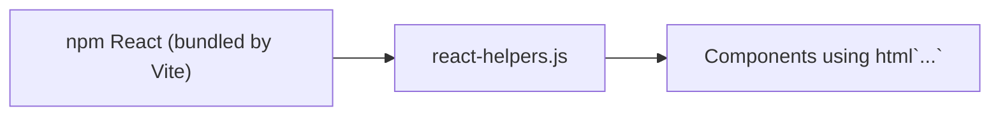

**Diagram sources**
- [js/react-helpers.js](file://js/react-helpers.js#L1-L39)
- [index.html](file://index.html#L8-L13)

**Section sources**
- [js/react-helpers.js](file://js/react-helpers.js#L1-L39)

### Monaco Wrapper Implementation
Key capabilities:
- AMD configuration for the Monaco loader (loaded from a CDN by `index.html`; the wrapper warns and does not start if `window.require` is missing).
- Registers PlantUML, Mermaid and LikeC4 Monarch grammars with keywords, operators, and tokenizer rules.
- Registers error providers for Mermaid, PlantUML, XML and Structurizr: CodeActionProvider for quick fixes and HoverProvider for explanations.
- Exposes imperative methods through `forwardRef` and `useImperativeHandle`: scrollToLine, setValue, insertAtCursor, insertAtLocation, findAndSelect, setMarkers, clearMarkers, getModel, getMonaco.
- Synchronizes language, value and read-only changes; clears decorations on content change.

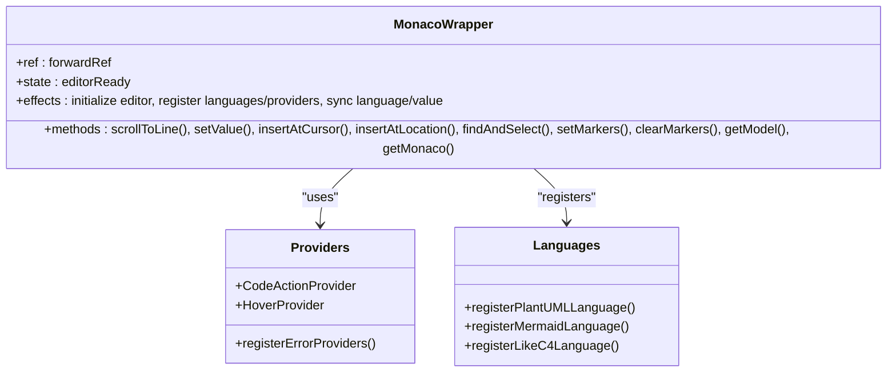

**Diagram sources**
- [js/components/editors/MonacoWrapper.jsx](file://js/components/editors/MonacoWrapper.jsx)

**Section sources**
- [js/components/editors/MonacoWrapper.jsx](file://js/components/editors/MonacoWrapper.jsx)

### Error Diagnostics System
- Parsing: Extracts line/column from error text using diagram-type-aware patterns; categorizes errors and assigns codes.
- Conversion: Translates parsed errors into Monaco markers and code actions.
- Explanations: Human-readable explanations with examples and documentation links.
- Fixes: Automated quick fixes with auto-edit ranges; handles special EOF marker positions.

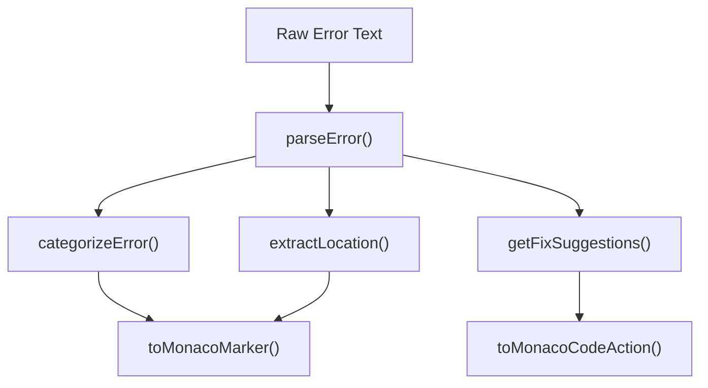

**Diagram sources**
- [js/error-diagnostics/index.js](file://js/error-diagnostics/index.js#L13-L276)
- [js/error-diagnostics/explanations.js](file://js/error-diagnostics/explanations.js#L237-L299)
- [js/error-diagnostics/fixes.js](file://js/error-diagnostics/fixes.js#L332-L366)

**Section sources**
- [js/error-diagnostics/index.js](file://js/error-diagnostics/index.js#L1-L303)
- [js/error-diagnostics/explanations.js](file://js/error-diagnostics/explanations.js)
- [js/error-diagnostics/fixes.js](file://js/error-diagnostics/fixes.js#L1-L403)

### Configuration and Plugin Architecture
- Central configuration defines diagram types, extensions, Monaco language mappings, docs links, and example templates.
- Snippets and templates are organized per diagram type for quick insertion and onboarding.
- Extensibility: Adding a new diagram type requires updating the configuration and registering a Monaco language/provider if needed.

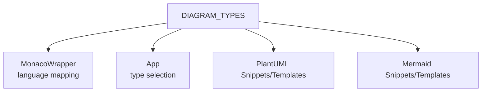

**Diagram sources**
- [js/config.js](file://js/config.js#L6-L116)
- [js/config.js](file://js/config.js#L118-L192)
- [js/config.js](file://js/config.js#L194-L566)

**Section sources**
- [js/config.js](file://js/config.js#L1-L566)

### Advanced JavaScript Patterns and Asynchronous Programming
- Debouncing: Used for Mermaid AST parsing (300 ms) and preview rendering (500 ms) to avoid excessive re-renders.
- Promise-based dynamic loading: Ensures AMD compatibility and avoids conflicts.
- Controlled state updates: The sync controller's change-source flag is designed to prevent feedback loops between code and visual editors.
- Event-driven editors: Monaco emits change/cursor events; bpmn-js emits command stack changes.

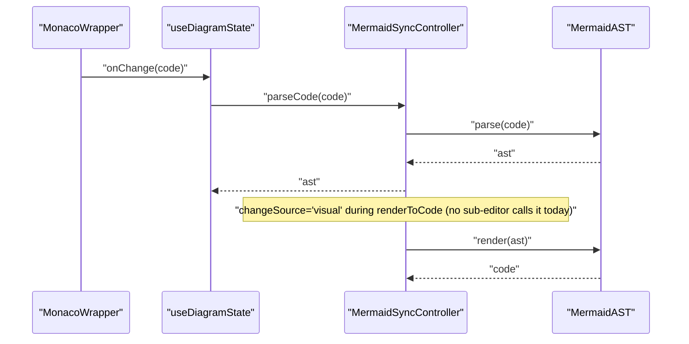

**Diagram sources**
- [js/components/editors/mermaid/utils.js](file://js/components/editors/mermaid/utils.js)
- [index.html](file://index.html)

**Section sources**
- [js/utils.js](file://js/utils.js#L165-L177)
- [js/components/editors/mermaid/utils.js](file://js/components/editors/mermaid/utils.js)
- [index.html](file://index.html)

### State Management Strategies
- Local React state: `App.jsx` and its hooks (`useDiagramState`, `useRemoteRenderer`) manage diagram type, detected model, text input, preview URL, stats, loading, errors, cursor position and view mode. The template modal visibility lives in `App.jsx`.
- Editor refs: Imperative methods on MonacoWrapper coordinate with App state.
- Visual editor state: BPMN visual editor maintains internal modeler state and syncs XML back to code.
- **Enhanced**: Update system state: UpdateManager maintains available updates, test results, and loading states with subscription-based notifications and comprehensive error handling.

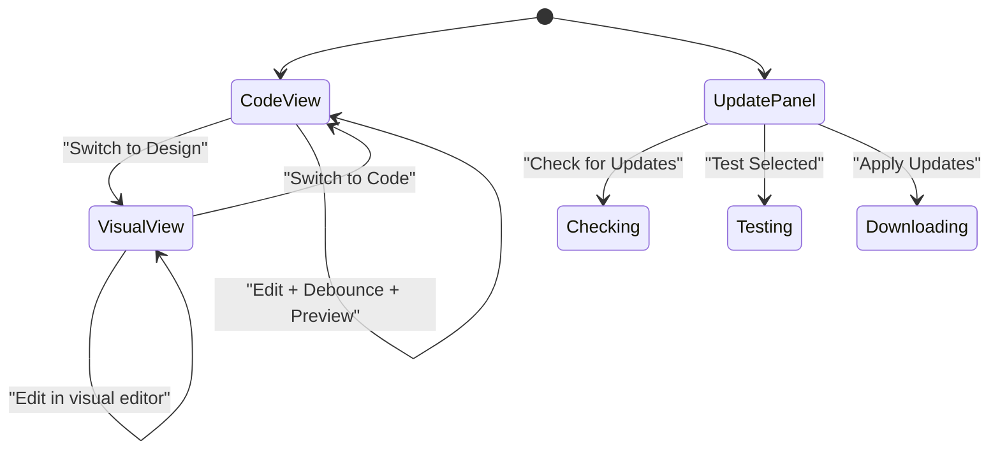

**Diagram sources**
- [index.html](file://index.html)
- [js/components/editors/BpmnVisualEditor.jsx](file://js/components/editors/BpmnVisualEditor.jsx)
- [js/update-manager.js](file://js/update-manager.js#L23-L58)

**Section sources**
- [index.html](file://index.html)
- [js/components/editors/BpmnVisualEditor.jsx](file://js/components/editors/BpmnVisualEditor.jsx)
- [js/update-manager.js](file://js/update-manager.js)

### Integration Patterns for External Libraries and CDNs
- React and ReactDOM come from npm and are bundled by Vite, which compiles the JSX at build time.
- Monaco AMD loader configured to load from CDN; language providers registered post-load.
- bpmn-js is an npm import in `BpmnVisualEditor.jsx`, with its CSS imported alongside, so Vite bundles both.
- Mermaid AST loaded as an ES module from a CDN in `index.html`; readiness is tracked by the `window.MermaidASTLoaded` flag.
- Pako for zlib compression used in encoding (an npm import in the renderer adapter and `utils.js`; `index.html` also loads it from a CDN).
- **Enhanced**: Library update system integrates with CDN APIs for version checking and automated updates with comprehensive validation.

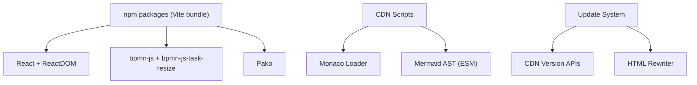

**Diagram sources**
- [index.html](file://index.html)
- [js/utils.js](file://js/utils.js#L116-L158)
- [js/components/editors/BpmnVisualEditor.jsx](file://js/components/editors/BpmnVisualEditor.jsx)
- [js/library-registry.js](file://js/library-registry.js#L16-L228)

**Section sources**
- [index.html](file://index.html)
- [js/utils.js](file://js/utils.js#L116-L158)
- [js/components/editors/BpmnVisualEditor.jsx](file://js/components/editors/BpmnVisualEditor.jsx)
- [js/library-registry.js](file://js/library-registry.js)

### React Helpers, DOM Manipulation, and Lifecycle
- DOM manipulation: Components use refs to attach to containers and inject SVG content for interactive previews.
- Event handling: Click, contextmenu, drag-and-drop handlers; controlled input for inline editing.
- Lifecycle: Effects manage initialization, cleanup, and synchronization; debouncing prevents thrashing.

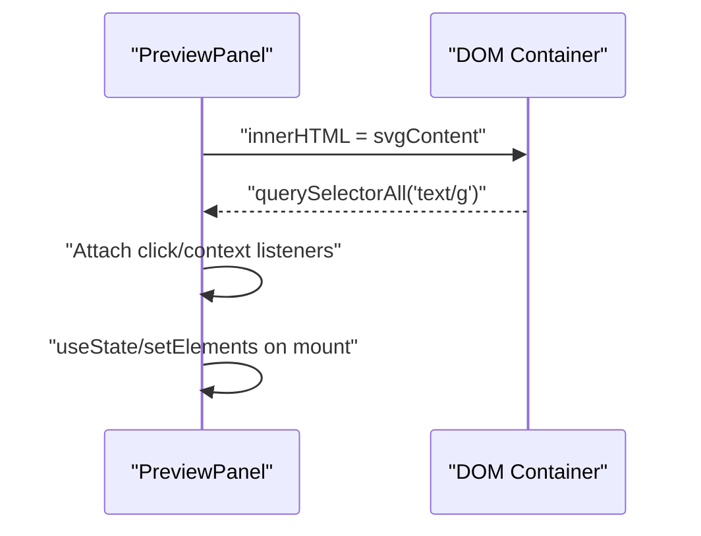

**Diagram sources**
- [js/components/editors/PreviewPanel.jsx](file://js/components/editors/PreviewPanel.jsx)

**Section sources**
- [js/components/PlantUmlToolbar.jsx](file://js/components/PlantUmlToolbar.jsx)
- [js/components/editors/PreviewPanel.jsx](file://js/components/editors/PreviewPanel.jsx)
- [js/components/ui.js](file://js/components/ui.js)

### Specialized Editors
- BPMN Visual Editor: Imports the bpmn-js modeler from npm, creates it with custom context pad, renderer, lane split and transpose modules, listens for changes, and imports XML (falling back to an empty diagram on error).
- Mermaid Visual Editor: Routes by detected model name to the sub-editors in `MermaidEditors.jsx` (pie, flowchart, sequence, gantt, timeline, journey, mindmap). Only the pie editor edits the diagram; the others show "Code-Only Editing" placeholders. Any other model shows the Universal Mode fallback panel, with no AST explorer.
- Mermaid Sync Controller (`createMermaidSyncController`): Debounces parsing, guards against sync loops, and can render an AST back to code.

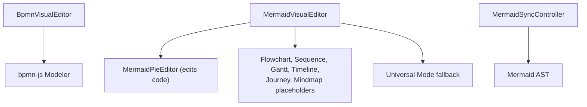

**Diagram sources**
- [js/components/editors/BpmnVisualEditor.jsx](file://js/components/editors/BpmnVisualEditor.jsx)
- [js/components/editors/mermaid/MermaidEditors.jsx](file://js/components/editors/mermaid/MermaidEditors.jsx)
- [js/components/editors/mermaid/MermaidVisualEditor.jsx](file://js/components/editors/mermaid/MermaidVisualEditor.jsx)
- [js/components/editors/mermaid/utils.js](file://js/components/editors/mermaid/utils.js)

**Section sources**
- [js/components/editors/BpmnVisualEditor.jsx](file://js/components/editors/BpmnVisualEditor.jsx)
- [js/components/editors/mermaid/MermaidEditors.jsx](file://js/components/editors/mermaid/MermaidEditors.jsx)
- [js/components/editors/mermaid/MermaidVisualEditor.jsx](file://js/components/editors/mermaid/MermaidVisualEditor.jsx)
- [js/components/editors/mermaid/utils.js](file://js/components/editors/mermaid/utils.js)

### Syntext Smith (AI assistant)
Syntext Smith lets a language model write native diagram code through tools, and checks every edit with the same parsers the editor uses:
1.  **Request**: The chat sends a system instruction, the earlier turns, the diagram type and the current editor code to the chosen model provider (Google Gemini, Anthropic or an OpenAI-compatible endpoint). The reply streams back into the chat.
2.  **Tool loop**: The model changes a draft with `edit_diagram` (exact text replacements) or `write_diagram` (a whole diagram with its type). The editor stays as it is. For BPMN, the model works on the XML without its layout section, and the BPMN pipeline keeps or regenerates the layout (`js/services/diagram-tools/bpmn-pipeline.js`). For other notations, `render_diagram` lets the model look at a picture of the draft.
3.  **Validation**: Each tool call checks the draft with the shared validator (`js/services/diagram-tools/validate.js`) and returns the parser's verdict to the model. The validator uses `mermaid.parse` and a render for Mermaid, `bpmn-moddle` for BPMN, `vegaLite.compile` or `vega.parse` for charts, and the Kroki server for every other type.
4.  **Repair**: When the verdict is "invalid", the model fixes the draft with another call. The loop allows eight model steps.
5.  **Review**: The finished draft becomes a proposal. The user reviews the proposal in the code pane, accepts or rejects each change, and applies the result as one undo step (`js/components/editors/DiffReviewPane.jsx`).

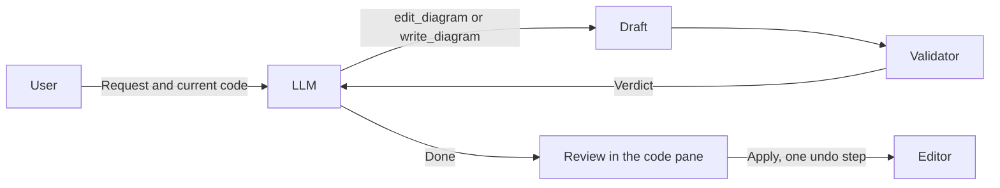

The earlier design, in which the model returned a JSON syntax tree for a separate compiler, had no caller and was removed on 25 November 2026.

**Section sources**
- [js/services/smith/agent-loop.js](file://js/services/smith/agent-loop.js)
- [js/services/smith/tools.js](file://js/services/smith/tools.js)
- [js/services/diagram-tools/validate.js](file://js/services/diagram-tools/validate.js)
- [js/services/diagram-tools/bpmn-pipeline.js](file://js/services/diagram-tools/bpmn-pipeline.js)
- [js/components/editors/DiffReviewPane.jsx](file://js/components/editors/DiffReviewPane.jsx)

## Library Update Management System

### Enhanced Library Registry
The library registry serves as the central configuration hub for all CDN dependencies, providing comprehensive version tracking, URL patterns, and testing configurations with advanced dependency management.

**Key Features:**
- **Multi-CDN support**: Unpkg, CDNJS, ESM.sh, JSR, and Tailwind CSS with specialized handling
- **Version tracking**: Current versions and URL patterns for automatic updates with semantic version comparison
- **Testing configurations**: Complex libraries with CSS requirements, import maps, and visual validation
- **Peer dependency validation**: Automatic conflict detection and resolution for version compatibility
- **Linked versions**: React and ReactDOM versions synchronized automatically
- **Skip version checks**: Libraries using 'latest' tags or special cases
- **Enhanced parsing**: Sophisticated URL pattern matching and version extraction from HTML

**Updated** Enhanced dependency conflict detection with comprehensive validation and error reporting.

**Section sources**
- [js/library-registry.js](file://js/library-registry.js)

### CDN Version Checker
Integrates with multiple CDN APIs to fetch the latest versions of libraries with intelligent caching, error handling, and comprehensive version comparison.

**Supported Providers:**
- **Unpkg**: Package.json endpoint for npm packages with version extraction
- **CDNJS**: Official API with version field and metadata
- **ESM.sh**: Mirrors npm packages through npm registry with latest version detection
- **JSR**: jsr.io package metadata with scope-based package resolution
- **Tailwind**: Special case - CDN always serves latest with skip version check

**Features:**
- **5-minute cache TTL**: Performance optimization with intelligent caching strategy
- **Semantic version comparison**: Accurate version comparison with major/minor/patch detection
- **Major version detection**: Identifies breaking changes and warns users appropriately
- **Changelog URL generation**: Direct links to release notes and change logs
- **Error handling**: Graceful degradation when API calls fail

**Updated** Improved error handling and caching mechanisms for better reliability.

**Section sources**
- [js/cdn-version-checker.js](file://js/cdn-version-checker.js)

### Enhanced Update Manager
Orchestrates the complete library update workflow with comprehensive state management, testing, and HTML rewriting with advanced error handling and user interaction.

**Core Workflow:**
1. **Check for Updates**: Parse current HTML, fetch latest versions, filter available updates with intelligent selection logic
2. **Test Updates**: Validate URLs and test in sandboxed iframe with comprehensive error reporting
3. **Apply Updates**: Rewrite HTML, validate, and generate download with change tracking
4. **State Management**: Reactive updates with subscription pattern, localStorage persistence, and user preferences

**Enhanced State Management:**
- **Available updates**: Selection state with auto-selection for non-major updates
- **Test results**: Detailed pass/fail status with error messages and visual indicators
- **Loading states**: Comprehensive checking and testing progress indicators
- **History tracking**: localStorage persistence with truncation to prevent quota issues
- **Ignored updates**: User preference management with reasons and re-enabling capabilities
- **Subscription pattern**: Real-time UI updates with listener management

**Enhanced Features:**
- **Auto-selection logic**: Non-major, non-skipped updates are automatically selected
- **Ignored update management**: Persistent user preferences with reason tracking
- **Linked version updates**: Automatic updates for synchronized libraries (e.g., react-esm linked to react)
- **Comprehensive error handling**: Detailed error reporting with user-friendly messages
- **Time-based last check**: Human-readable timestamps for update freshness

**Section sources**
- [js/update-manager.js](file://js/update-manager.js)

### Advanced Update Tester
Provides comprehensive sandboxed testing for library updates using iframe isolation, visual validation, and sophisticated dependency management.

**Testing Capabilities:**
- **URL Validation**: HEAD requests to verify accessibility with CORS handling
- **Import Map Testing**: Complex libraries like Excalidraw with external dependencies and React integration
- **Visual Rendering**: Libraries that require DOM rendering for validation with timeout handling
- **Timeout Handling**: 20-second timeout for test completion with graceful failure reporting
- **Result Aggregation**: Detailed pass/fail reports with error messages and visual indicators
- **Dependency Conflict Testing**: Pre-validation of peer dependencies before testing

**Supported Libraries:**
- **Excalidraw**: Complex ESM module with React dependencies, CSS requirements, and visual validation
- **BPMN-JS**: Visual modeler testing with diagram instantiation and import validation
- **Monaco Editor**: AMD loader and editor initialization with configuration testing
- **React/ReactDOM**: Basic rendering validation with ESM fallback support
- **Pako**: Compression functionality verification with deflate testing
- **Dagre**: Graph library validation with graphlib testing
- **Babel**: Transpilation capability testing with preset validation
- **Mermaid AST**: ES module loading and AST parsing validation
- **HTM**: JSX-like syntax testing with template literal support
- **Tailwind CSS**: CDN availability testing with style application verification
- **Font Awesome**: Icon font loading and styling verification
- **React Flow**: CSS stylesheet validation and availability checking

**Enhanced Features:**
- **Pre-validation**: Dependency conflicts are checked before URL validation and testing
- **URL validation**: Comprehensive HEAD request testing with CORS handling
- **Visual testing**: Library-specific rendering validation with timeout management
- **Error aggregation**: Comprehensive error reporting with library-specific details
- **Console filtering**: Noise reduction in test results with favicon and 404 filtering

**Section sources**
- [js/update-tester.js](file://js/update-tester.js)

### Enhanced HTML Rewriter
Handles precise URL replacement in HTML with sophisticated pattern matching, validation, and comprehensive change tracking.

**Enhanced URL Pattern Matching:**
- **Unpkg**: `@version/` pattern in package@version/ paths with regex escaping
- **CDNJS**: `/package/version/` pattern in library paths with package name validation
- **ESM.sh**: `@version` pattern at end of package names with import map support

**Enhanced Features:**
- **Regex-based pattern matching**: Sophisticated URL pattern extraction with escape handling
- **Multiple URL replacement**: Support for additional URLs and CSS files per library
- **Change tracking**: Detailed summaries with library names, version changes, and counts
- **HTML validation**: Pre-download validation to prevent broken updates
- **Blob-based file download**: Secure file generation with proper MIME types
- **Escape regex handling**: Safe pattern construction to prevent regex injection

**Enhanced Capabilities:**
- **Pattern building**: Dynamic regex construction for different CDN types
- **Version replacement**: Accurate version string replacement with boundary detection
- **Change summarization**: Detailed change reports for user review
- **URL categorization**: CDN provider identification for accurate pattern matching

**Section sources**
- [js/html-rewriter.js](file://js/html-rewriter.js)

### Integration with Main Application
The update system is seamlessly integrated into the main application with a dedicated UI panel, React component subscriptions, and comprehensive user interaction.

**Enhanced Integration Points:**
- ES module import in index.html with global exposure and event dispatching
- React component with subscription-based state updates and real-time UI refresh
- Modal interface with progress indicators, detailed results display, and user controls
- Error handling with user-friendly messaging and recovery options
- Download workflow with generated HTML files and change summaries
- Update history tracking with localStorage persistence and human-readable timestamps

**Enhanced Features:**
- **Real-time updates**: Subscription-based state management with automatic UI refresh
- **User preferences**: Ignored updates with reasons and re-enabling capabilities
- **Update history**: Comprehensive logging with truncated HTML previews
- **Human-readable timestamps**: Time since last check with day/hour/minute/second formatting
- **Progress indicators**: Loading states for checking, testing, and downloading operations
- **Error recovery**: Comprehensive error handling with user guidance and retry options

**Section sources**
- [index.html](file://index.html)
- [index.html](file://index.html)

## Dependency Analysis
- Internal dependencies:
  - MonacoWrapper depends on React helpers, error diagnostics, and config for language mapping.
  - App orchestrates MonacoWrapper, visual editors, and diagnostics.
  - Specialized editors depend on shared UI components and utils.
  - **Enhanced**: Update system components depend on each other in a coordinated workflow with comprehensive error handling.
- External dependencies:
  - npm-bundled React, ReactDOM, bpmn-js and Pako, plus CDN-hosted Monaco loader, Mermaid AST and Pako.
  - **Enhanced**: CDN APIs for version checking (unpkg, cdnjs, npm registry, jsr.io) with caching and error handling.
  - **Enhanced**: Third-party services for library testing and validation with sandboxed iframe isolation.

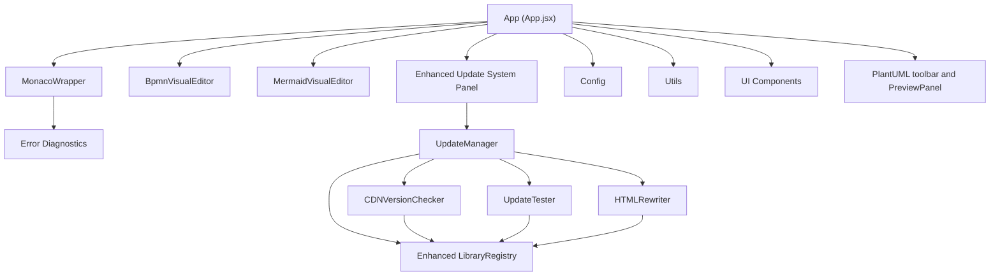

**Diagram sources**
- [index.html](file://index.html)
- [js/components/editors/MonacoWrapper.jsx](file://js/components/editors/MonacoWrapper.jsx)
- [js/components/editors/BpmnVisualEditor.jsx](file://js/components/editors/BpmnVisualEditor.jsx)
- [js/components/editors/mermaid/MermaidEditors.jsx](file://js/components/editors/mermaid/MermaidEditors.jsx)
- [js/error-diagnostics/index.js](file://js/error-diagnostics/index.js#L1-L303)
- [js/config.js](file://js/config.js#L1-L566)
- [js/utils.js](file://js/utils.js#L1-L177)
- [js/components/ui.js](file://js/components/ui.js)
- [js/components/PlantUmlToolbar.jsx](file://js/components/PlantUmlToolbar.jsx)
- [js/components/editors/PreviewPanel.jsx](file://js/components/editors/PreviewPanel.jsx)
- [js/update-manager.js](file://js/update-manager.js)
- [js/cdn-version-checker.js](file://js/cdn-version-checker.js)
- [js/update-tester.js](file://js/update-tester.js)
- [js/html-rewriter.js](file://js/html-rewriter.js)
- [js/library-registry.js](file://js/library-registry.js)

**Section sources**
- [index.html](file://index.html)
- [js/components/editors/MonacoWrapper.jsx](file://js/components/editors/MonacoWrapper.jsx)
- [js/components/editors/BpmnVisualEditor.jsx](file://js/components/editors/BpmnVisualEditor.jsx)
- [js/components/editors/mermaid/MermaidEditors.jsx](file://js/components/editors/mermaid/MermaidEditors.jsx)
- [js/error-diagnostics/index.js](file://js/error-diagnostics/index.js#L1-L303)
- [js/config.js](file://js/config.js#L1-L566)
- [js/utils.js](file://js/utils.js#L1-L177)
- [js/components/ui.js](file://js/components/ui.js)
- [js/components/PlantUmlToolbar.jsx](file://js/components/PlantUmlToolbar.jsx)
- [js/components/editors/PreviewPanel.jsx](file://js/components/editors/PreviewPanel.jsx)
- [js/update-manager.js](file://js/update-manager.js)
- [js/cdn-version-checker.js](file://js/cdn-version-checker.js)
- [js/update-tester.js](file://js/update-tester.js)
- [js/html-rewriter.js](file://js/html-rewriter.js)
- [js/library-registry.js](file://js/library-registry.js)

## Performance Considerations
- Debouncing: Applied to Mermaid AST parsing and preview fetching to reduce network and CPU usage.
- Mounting on demand: `App.jsx` imports every visual editor statically, but each editor mounts only in visual mode. Dynamic imports could shrink the initial bundle.
- Efficient Monaco updates: Imperative setValue and deltaDecorations used to avoid full re-renders.
- CDN caching: The CDN-hosted scripts (Monaco loader, Mermaid AST, pako, dagre) benefit from shared browser caches.
- **Enhanced**: Update system caching: 5-minute TTL for version checks to minimize API calls with intelligent error handling.
- **Enhanced**: Sandbox testing: Isolated iframe testing prevents DOM pollution and improves reliability with timeout management.
- **Enhanced**: Incremental HTML rewriting: Only modified URLs are replaced, reducing processing overhead with comprehensive validation.
- **Enhanced**: Subscription-based state management: Efficient UI updates with minimal re-renders and optimal memory usage.

## Troubleshooting Guide
- Monaco AMD conflicts: Dynamic script loader temporarily removes window.define to avoid conflicts; restores it on load/error.
- Error markers: If markers do not appear, verify diagram type mapping and ensure error providers are registered.
- Visual editor failures: Check console logs for bpmn-js import or custom-module errors. If the Mermaid editor shows a spinner for ever, check that the Mermaid AST CDN module loaded.
- Encoding issues: If preview fails, confirm `RendererAdapter.encodeKroki` returns a non-empty string and URL length does not exceed GET limits.
- **Enhanced**: Update system failures: Check browser console for update system errors; verify CDN accessibility for version checking with detailed error messages.
- **Enhanced**: Test failures: Review test results in update panel; check sandbox iframe for rendering errors with specific library details.
- **Enhanced**: HTML rewrite issues: Verify generated HTML validates; check for blocked downloads or security restrictions with change summaries.
- **Enhanced**: Dependency conflicts: Review peer dependency validation errors; ensure compatible versions are selected for synchronized libraries.
- **Enhanced**: Ignored updates: Check localStorage for ignored updates with reasons; use unignore functionality to re-enable updates.

**Section sources**
- [js/utils.js](file://js/utils.js#L116-L146)
- [js/components/editors/MonacoWrapper.jsx](file://js/components/editors/MonacoWrapper.jsx)
- [js/components/editors/BpmnVisualEditor.jsx](file://js/components/editors/BpmnVisualEditor.jsx)
- [js/update-manager.js](file://js/update-manager.js#L94-L97)
- [js/update-tester.js](file://js/update-tester.js#L427-L438)

## Conclusion
The Universal Diagram Editor combines a Vite-built React application (with a few CDN scripts) and modular components and a powerful Monaco-based editor. Its error diagnostics system, dynamic loading utilities, and specialized editors deliver a robust authoring experience across multiple diagram types. The enhanced comprehensive library update management system represents a significant architectural advancement, providing automated dependency version tracking, sophisticated sandboxed testing, and safe HTML rewriting capabilities with comprehensive error handling and user interaction. This system ensures the application stays current with library updates while maintaining stability and preventing breaking changes through comprehensive validation, testing workflows, and dependency conflict resolution. The design emphasizes extensibility (configuration-driven), maintainability (modular JS), and usability (imperative editor APIs, quick fixes, and hover explanations), now augmented with automated dependency management for long-term sustainability and enhanced user experience through comprehensive state management and real-time updates.