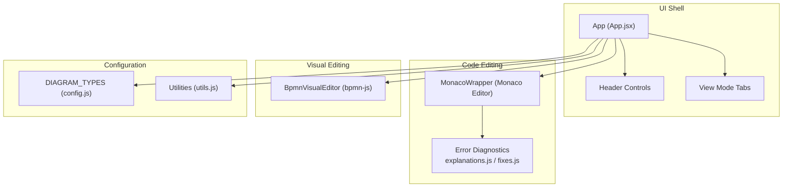
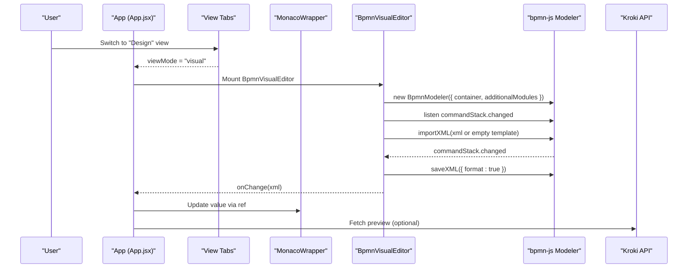
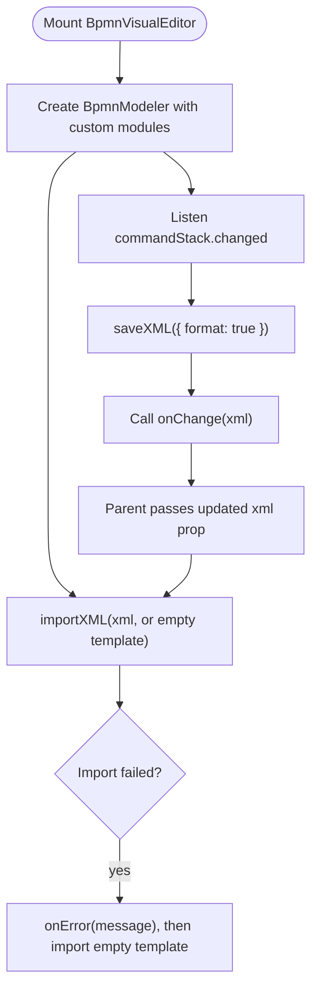
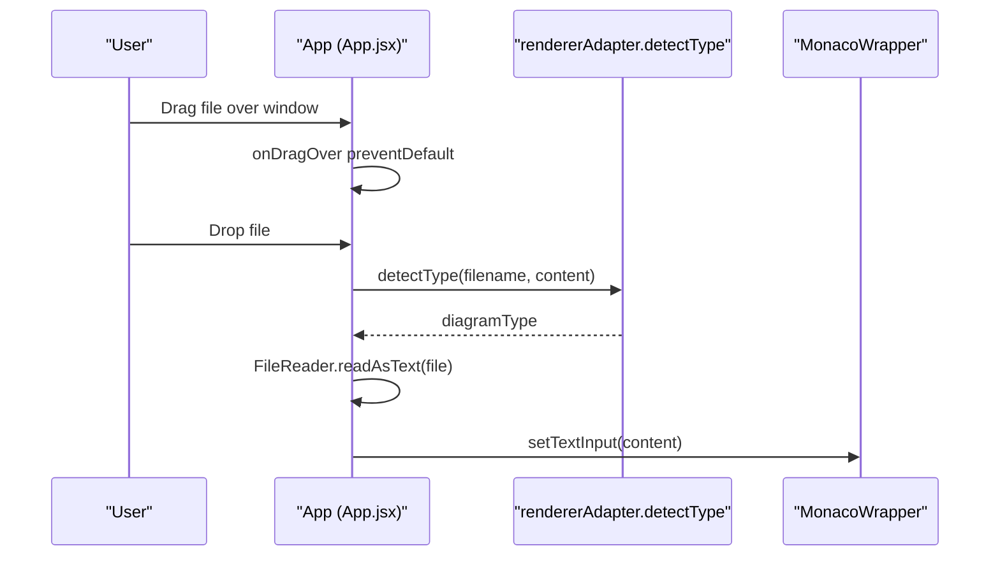
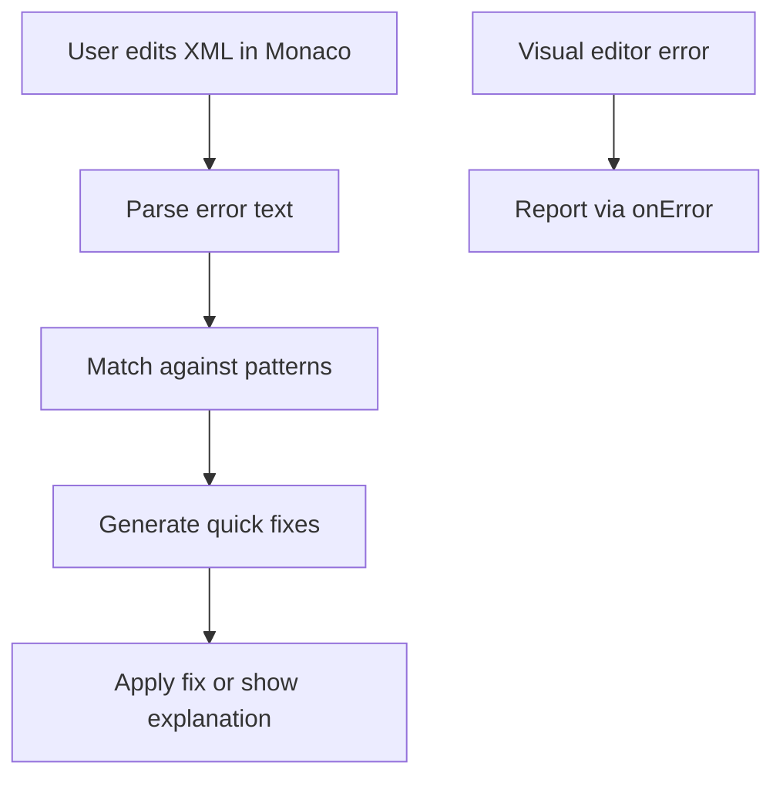
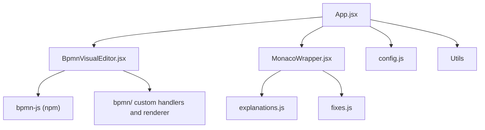

# BPMN (Business Process Model and Notation)

<cite>
**Referenced Files in This Document**
- [index.html](file://index.html)
- [BpmnVisualEditor.jsx](file://js/components/editors/BpmnVisualEditor.jsx)
- [MonacoWrapper.jsx](file://js/components/editors/MonacoWrapper.jsx)
- [config.js](file://js/config.js)
- [explanations.js](file://js/error-diagnostics/explanations.js)
- [fixes.js](file://js/error-diagnostics/fixes.js)
- [utils.js](file://js/utils.js)
</cite>

## Table of Contents
1. [Introduction](#introduction)
2. [Project Structure](#project-structure)
3. [Core Components](#core-components)
4. [Architecture Overview](#architecture-overview)
5. [Detailed Component Analysis](#detailed-component-analysis)
6. [Dependency Analysis](#dependency-analysis)
7. [Performance Considerations](#performance-considerations)
8. [Troubleshooting Guide](#troubleshooting-guide)
9. [Conclusion](#conclusion)
10. [Appendices](#appendices)

## Introduction
This document explains BPMN diagram support in the Universal Diagram Generator. It covers the visual BPMN editor powered by bpmn-js, the declarative configuration system, integration with the Monaco Editor for code editing, drag-and-drop capabilities, validation features, and export options. It also provides best practices for BPMN modeling, common patterns, and guidance for troubleshooting.

## Project Structure
The Universal Diagram Generator is a single-page application that integrates multiple diagramming technologies. BPMN support is implemented through:
- A visual editor component using bpmn-js, imported from the npm package and bundled by Vite
- A declarative configuration registry for diagram types
- A Monaco Editor integration for code editing and diagnostics
- Utilities for model detection in `utils.js`, and a renderer adapter for type detection and Kroki encoding

**Diagram sources**
- [index.html](file://index.html)
- [MonacoWrapper.jsx](file://js/components/editors/MonacoWrapper.jsx)
- [BpmnVisualEditor.jsx](file://js/components/editors/BpmnVisualEditor.jsx)
- [config.js](file://js/config.js#L6-L116)
- [utils.js](file://js/utils.js#L1-L177)

**Section sources**
- [index.html](file://index.html)
- [config.js](file://js/config.js#L6-L116)

## Core Components
- BpmnVisualEditor: A React component that embeds bpmn-js to provide a visual BPMN editor. It imports bpmn-js and its CSS from npm, creates the modeler with custom extensions (task resize, context pad, renderer, lane split and transpose handlers, and a `uni:` moddle extension for lane borders), listens for changes, and synchronizes XML back to the code editor.
- MonacoWrapper: A React wrapper for the Monaco Editor that registers the PlantUML, Mermaid and LikeC4 languages, and attaches error diagnostics and quick fixes to Mermaid, PlantUML, XML (used for BPMN) and Structurizr. The wrapper also reports cursor position and exposes editor methods through a ref.
- DIAGRAM_TYPES: A centralized registry that defines supported diagram types, including BPMN, with metadata such as file extensions, Monaco language, documentation links, and example content.
- Error Diagnostics: Modules that provide human-readable explanations and automated quick fixes for common syntax errors across diagram types, including BPMN/XML.
- Utilities: `utils.js` detects specific diagram models from code and holds script and stylesheet loaders. The renderer adapter (`js/services/RendererAdapter.js`) detects the diagram type from a file name and encodes source for Kroki.

**Section sources**
- [BpmnVisualEditor.jsx](file://js/components/editors/BpmnVisualEditor.jsx)
- [MonacoWrapper.jsx](file://js/components/editors/MonacoWrapper.jsx)
- [config.js](file://js/config.js#L6-L116)
- [explanations.js](file://js/error-diagnostics/explanations.js#L12-L229)
- [fixes.js](file://js/error-diagnostics/fixes.js#L11-L296)
- [utils.js](file://js/utils.js#L35-L85)
- [RendererAdapter.js](file://js/services/RendererAdapter.js)

## Architecture Overview
The application orchestrates between the code editor and the visual editor. When the user switches to the visual mode for BPMN, the BpmnVisualEditor mounts and renders the bpmn-js modeler inside a container. Changes made in the visual editor are saved to XML and propagated back to the Monaco editor. The Monaco editor provides syntax highlighting and diagnostics for XML (BPMN), powered by the error diagnostics modules.

**Diagram sources**
- [index.html](file://index.html)
- [BpmnVisualEditor.jsx](file://js/components/editors/BpmnVisualEditor.jsx)
- [MonacoWrapper.jsx](file://js/components/editors/MonacoWrapper.jsx)

## Detailed Component Analysis

### BpmnVisualEditor Component
The visual BPMN editor integrates bpmn-js to enable drag-and-drop creation and editing of BPMN diagrams. It:
- Imports bpmn-js and its CSS from the npm package
- Creates a modeler instance bound to a DOM container, with the task-resize module and custom context pad, renderer, lane split and transpose handlers
- Listens for command stack changes to export formatted XML
- Imports the XML content, and falls back to an empty BPMN template when the import fails
- Cleans up on unmount

**Diagram sources**
- [BpmnVisualEditor.jsx](file://js/components/editors/BpmnVisualEditor.jsx)

**Section sources**
- [BpmnVisualEditor.jsx](file://js/components/editors/BpmnVisualEditor.jsx)

### Visual Editor Integration with bpmn-js
Key behaviors:
- bpmn-js and its CSS are npm imports, so Vite bundles them with the app.
- The editor skips a re-import when the incoming XML equals the XML it last saved, which prevents an update loop.
- Change synchronization uses the command stack to capture user actions and export XML.
- Import errors are reported through the onError callback. Export errors are written to the console.
- The context pad adds lane actions: split a lane into two or three sub-lanes, transpose the lane grid, and delete or merge lanes.

Practical implications:
- The visual editor is ideal for rapid prototyping and collaborative design.
- XML export enables seamless handoff to code-based workflows and validation.

**Section sources**
- [BpmnVisualEditor.jsx](file://js/components/editors/BpmnVisualEditor.jsx)

### Drag-and-Drop Interface Capabilities
The application supports drag-and-drop file uploads:
- The App component listens for drop and dragover events.
- It detects the diagram type from the file name and content through the renderer adapter, then loads the file content into the editor (BPMN without layout information first prompts an auto-layout).
- The Monaco editor is language-aware based on the detected type.

**Diagram sources**
- [App.jsx](file://js/App.jsx)
- [RendererAdapter.js](file://js/services/RendererAdapter.js)

**Section sources**
- [App.jsx](file://js/App.jsx)
- [RendererAdapter.js](file://js/services/RendererAdapter.js)

### Element Properties Panel
The visual editor does not include a dedicated properties panel. Instead, it relies on:
- bpmn-js’s built-in modeler features (palette, context pad, direct label editing) plus the custom context pad entries for lanes.
- XML export for programmatic inspection and validation.

Best practice:
- Use the visual editor for interactive design and export XML for precise control and validation.

**Section sources**
- [BpmnVisualEditor.jsx](file://js/components/editors/BpmnVisualEditor.jsx)

### Validation Features
Validation is handled through two channels:
- Monaco-based diagnostics for XML (BPMN) code:
  - Error providers register quick fixes and hover explanations.
  - Fix suggestions are generated based on error patterns.
- Runtime error reporting from the visual editor:
  - Import errors are forwarded to the onError callback, and export errors are logged to the console.

**Diagram sources**
- [MonacoWrapper.jsx](file://js/components/editors/MonacoWrapper.jsx)
- [explanations.js](file://js/error-diagnostics/explanations.js#L237-L271)
- [fixes.js](file://js/error-diagnostics/fixes.js#L332-L366)
- [BpmnVisualEditor.jsx](file://js/components/editors/BpmnVisualEditor.jsx)

**Section sources**
- [MonacoWrapper.jsx](file://js/components/editors/MonacoWrapper.jsx)
- [explanations.js](file://js/error-diagnostics/explanations.js#L12-L229)
- [fixes.js](file://js/error-diagnostics/fixes.js#L11-L296)
- [BpmnVisualEditor.jsx](file://js/components/editors/BpmnVisualEditor.jsx)

### BPMN XML Syntax and Standard Shapes
- The configuration declares BPMN as having XML as its Monaco language and includes a comprehensive example.
- The visual editor uses bpmn-js, which implements BPMN 2.0 semantics and rendering.

Recommended XML structure highlights:
- Definitions element with namespaces
- Process element containing start events, tasks, sequence flows, and end events
- BPMNDiagram with BPMNShape and BPMNEdge elements for layout

**Section sources**
- [config.js](file://js/config.js#L7-L57)
- [BpmnVisualEditor.jsx](file://js/components/editors/BpmnVisualEditor.jsx)

### Swimlanes and Pools
- The visual editor uses bpmn-js, which supports collaboration (swimlanes/pools) and process flows. The custom context pad adds lane splitting, transposing and merging, and the `uni:` moddle extension stores which lane borders are hidden.
- The detection utility recognizes collaboration and process flows in BPMN content.

Practical usage:
- Use the visual editor to create collaboration diagrams with lanes and pools.
- Export XML for validation and integration with downstream tools.

**Section sources**
- [utils.js](file://js/utils.js#L78-L82)
- [BpmnVisualEditor.jsx](file://js/components/editors/BpmnVisualEditor.jsx)

### Best Practices for Business Process Modeling
- Keep processes focused and bounded; use collaboration for cross-organizational flows.
- Use standard BPMN symbols consistently: start/end events, tasks, gateways, sequence flows.
- Leverage swimlanes to clarify roles and responsibilities.
- Validate XML regularly and rely on the visual editor for iterative design.

[No sources needed since this section provides general guidance]

### Practical Examples of Common BPMN Patterns
- Basic process with start, task, and end events
- Collaboration with pools and lanes
- Gateways for decision-making and parallel flows

These examples are included in the configuration’s BPMN example and can be used as templates.

**Section sources**
- [config.js](file://js/config.js#L13-L56)

### Export Options
- The application supports downloading rendered diagrams as SVG and PNG.
- For BPMN, the visual editor exports XML; the code editor can be used to download the XML file directly.

Export behavior:
- SVG/PNG downloads use the rendered preview image.
- XML export occurs automatically from the visual editor when the user interacts with the modeler.

**Section sources**
- [index.html](file://index.html)
- [BpmnVisualEditor.jsx](file://js/components/editors/BpmnVisualEditor.jsx)

### Declarative Configuration System for BPMN
The configuration system centralizes:
- Diagram type metadata (label, extensions, Monaco language, docs link)
- Example content for quick start
- Visual editor availability flag (`hasVisualEditor`)

This enables consistent behavior across the UI and editor integrations.

**Section sources**
- [config.js](file://js/config.js#L6-L116)

### Integration with Monaco Editor for Code Editing
Monaco integration includes:
- XML as the Monaco language for BPMN (Monaco's built-in XML support; the wrapper registers only the PlantUML, Mermaid and LikeC4 languages itself)
- Error providers for quick fixes and hover explanations
- Cursor tracking and editor methods exposed via ref

**Section sources**
- [MonacoWrapper.jsx](file://js/components/editors/MonacoWrapper.jsx)

## Dependency Analysis
The BPMN feature depends on:
- bpmn-js and bpmn-js-task-resize (npm packages, bundled by Vite)
- Monaco Editor for code editing and diagnostics
- Error diagnostics modules for explanations and quick fixes
- Utilities and the renderer adapter for type detection and encoding

**Diagram sources**
- [BpmnVisualEditor.jsx](file://js/components/editors/BpmnVisualEditor.jsx)
- [MonacoWrapper.jsx](file://js/components/editors/MonacoWrapper.jsx)
- [index.html](file://index.html)
- [config.js](file://js/config.js#L6-L116)
- [utils.js](file://js/utils.js#L116-L146)

**Section sources**
- [BpmnVisualEditor.jsx](file://js/components/editors/BpmnVisualEditor.jsx)
- [MonacoWrapper.jsx](file://js/components/editors/MonacoWrapper.jsx)
- [index.html](file://index.html)
- [config.js](file://js/config.js#L6-L116)
- [utils.js](file://js/utils.js#L116-L146)

## Performance Considerations
- The visual editor mounts only in visual mode, and the modeler is created when the editor mounts.
- XML export is triggered on command stack changes; debouncing can be considered if performance becomes a concern.
- Large BPMN diagrams may benefit from incremental rendering and careful use of lanes to keep the visual manageable.

[No sources needed since this section provides general guidance]

## Troubleshooting Guide
Common BPMN issues and resolutions:
- XML parsing errors: Use the error diagnostics to identify unclosed tags or invalid attributes; apply quick fixes or correct the XML manually.
- Import failures: Ensure the XML is well-formed and includes required namespaces; check for missing closing tags.
- Visual editor not loading: Check the browser console for errors from the bpmn-js import or from the custom modules.

Diagnostic workflow:
- Monaco highlights errors and offers quick fixes.
- Hover explanations provide actionable guidance.
- Visual editor errors surface via the onError callback.

**Section sources**
- [explanations.js](file://js/error-diagnostics/explanations.js#L168-L192)
- [fixes.js](file://js/error-diagnostics/fixes.js#L240-L278)
- [MonacoWrapper.jsx](file://js/components/editors/MonacoWrapper.jsx)
- [BpmnVisualEditor.jsx](file://js/components/editors/BpmnVisualEditor.jsx)

## Conclusion
The Universal Diagram Generator provides robust BPMN support through a visual editor powered by bpmn-js and a code editor integrated with Monaco. The declarative configuration system, a bundled bpmn-js modeler with custom lane tools, and integrated diagnostics deliver a smooth authoring experience. By combining the visual editor for interactive design with the code editor for validation and export, teams can efficiently model and iterate on business processes.

[No sources needed since this section summarizes without analyzing specific files]

## Appendices

### BPMN Concepts Overview
- Processes: Top-level containers for activities and flows
- Activities: Tasks, sub-processes, and service tasks
- Events: Start, intermediate, and end events
- Gateways: Exclusive, inclusive, parallel, and complex gateways
- Flows: Sequence flows connecting elements

[No sources needed since this section provides general guidance]