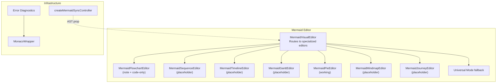
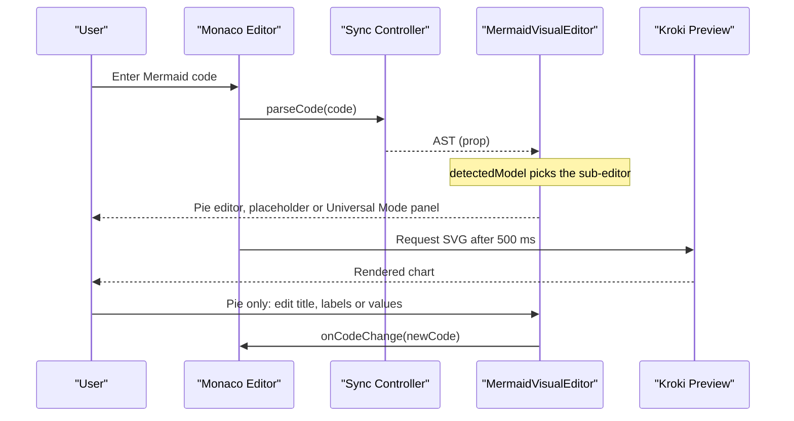
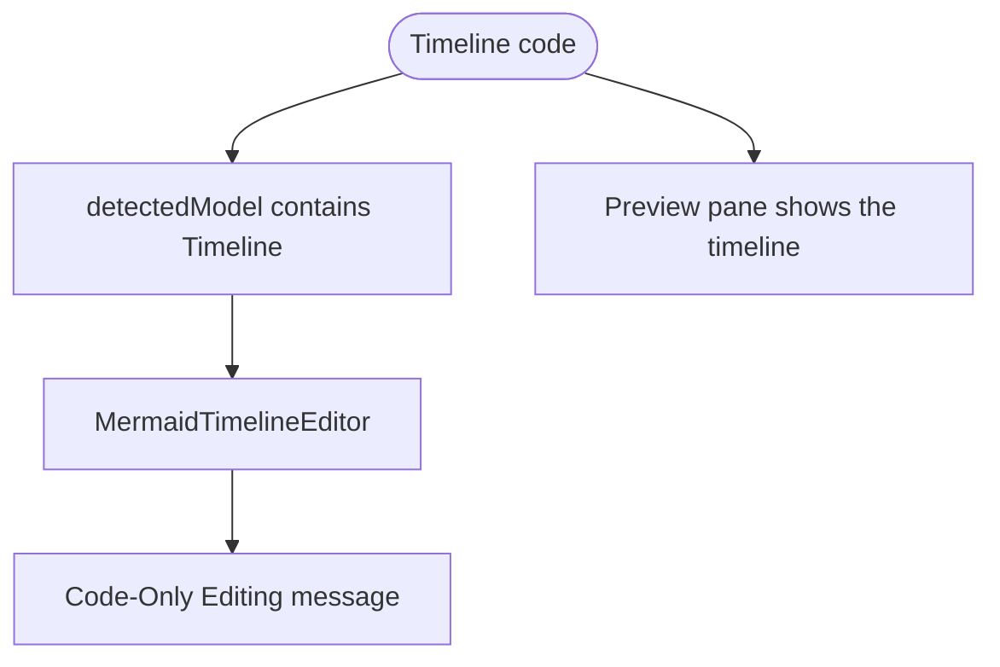
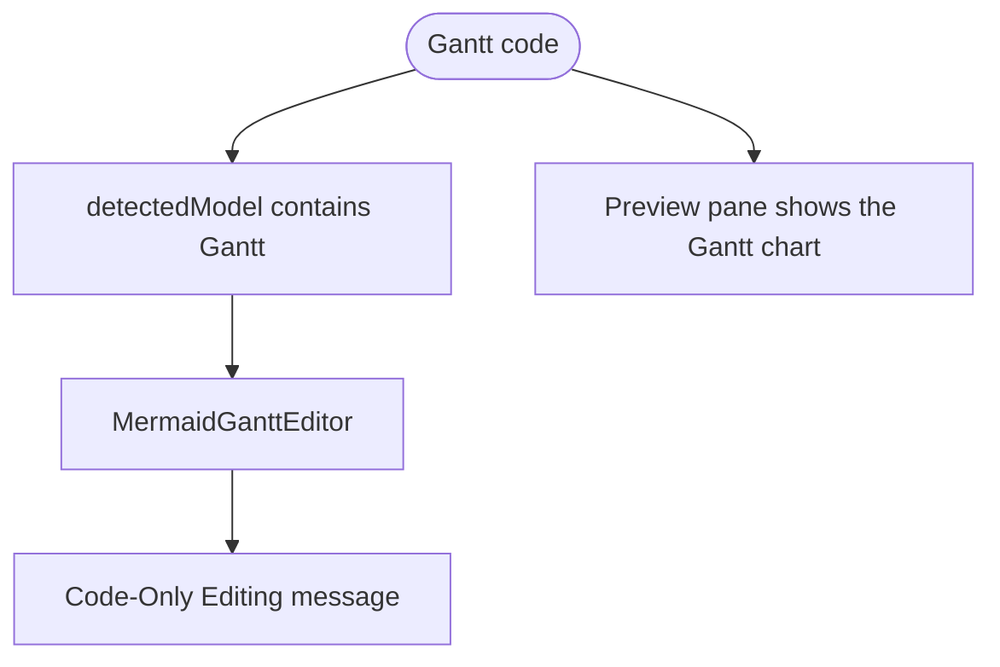
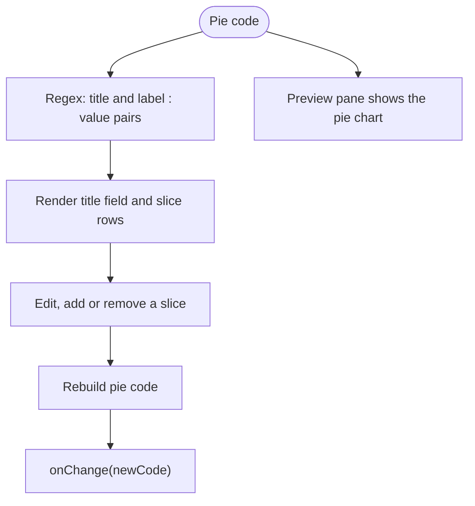
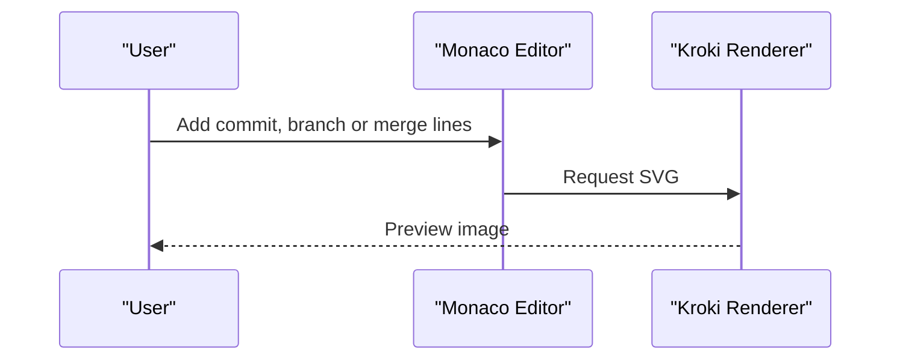
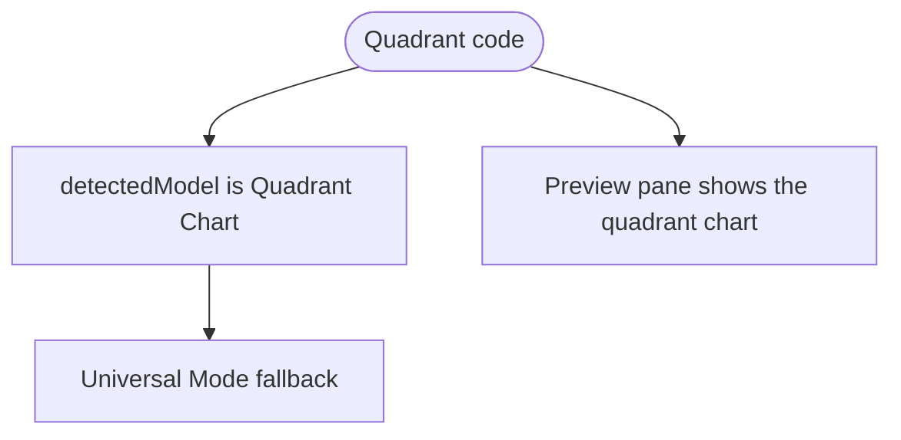
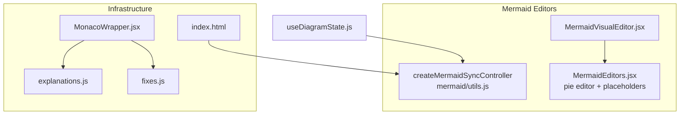

# Advanced Chart Types

<cite>
**Referenced Files in This Document**
- [index.html](file://index.html)
- [MermaidEditors.jsx](file://js/components/editors/mermaid/MermaidEditors.jsx)
- [mermaid/utils.js](file://js/components/editors/mermaid/utils.js)
- [MonacoWrapper.jsx](file://js/components/editors/MonacoWrapper.jsx)
- [explanations.js](file://js/error-diagnostics/explanations.js)
- [fixes.js](file://js/error-diagnostics/fixes.js)
</cite>

## Table of Contents
1. [Introduction](#introduction)
2. [Project Structure](#project-structure)
3. [Core Components](#core-components)
4. [Architecture Overview](#architecture-overview)
5. [Detailed Component Analysis](#detailed-component-analysis)
6. [Dependency Analysis](#dependency-analysis)
7. [Performance Considerations](#performance-considerations)
8. [Troubleshooting Guide](#troubleshooting-guide)
9. [Conclusion](#conclusion)

## Introduction
This document provides comprehensive guidance for advanced Mermaid chart types beyond the basic flowchart and sequence diagrams. It covers specialized diagram formats including timelines, gantt charts, pie charts, mindmaps, user journeys, git graphs, quadrant charts, and other data visualization formats. The documentation explains syntax, use cases, practical examples, and how each type appears in the Mermaid visual editor, and how the sync controller relates code to the AST. Only the pie chart has a working visual editor today. The other types are edited as code.

## Project Structure
The advanced chart type support is implemented through:
- A main Mermaid visual editor (`MermaidVisualEditor`) that selects a sub-editor from the detected model name
- Sub-editors in `MermaidEditors.jsx`: a working pie editor, plus placeholders for flowchart, sequence, gantt, timeline, mindmap and user journey charts
- A Mermaid sync controller that parses code into an AST
- Monaco editor integration with syntax highlighting and error diagnostics
- Template and snippet libraries for quick chart creation

**Diagram sources**
- [index.html](file://index.html)
- [MermaidEditors.jsx](file://js/components/editors/mermaid/MermaidEditors.jsx)
- [mermaid/utils.js](file://js/components/editors/mermaid/utils.js)
- [MonacoWrapper.jsx](file://js/components/editors/MonacoWrapper.jsx)

**Section sources**
- [index.html](file://index.html)
- [MermaidEditors.jsx](file://js/components/editors/mermaid/MermaidEditors.jsx)
- [mermaid/utils.js](file://js/components/editors/mermaid/utils.js)
- [MonacoWrapper.jsx](file://js/components/editors/MonacoWrapper.jsx)

## Core Components
The advanced chart type system consists of several key components:

### Chart Editors in MermaidEditors.jsx
- **Pie Editor**: Reads the title and the slice definitions (`"label" : value`) with regular expressions. The user edits the title, labels and values, adds a slice or removes a slice, and the editor rebuilds the pie code.
- **Gantt, Timeline, Mindmap and Journey editors**: One-line placeholders that return the "Code-Only Editing" message (`VisualEditingNotAvailable`).
- **Flowchart and Sequence editors**: The flowchart editor adds a "coming soon" note above the same message. The sequence editor is a one-line placeholder.
- **Universal Mode fallback**: Inside `MermaidVisualEditor`, the fallback panel serves every other type, with the message "Visual editing for this diagram type is generic. Structure editing is best done via code."

### Synchronization Controller
`createMermaidSyncController` in `mermaid/utils.js` relates code to the AST with:
- Debounced parsing (300 ms), so rapid typing does not trigger a parse for every keystroke
- Change source tracking, which skips parsing while a visual change is being written back
- `renderToCode`, which turns an AST back into code through `window.MermaidAST.render`

`useDiagramState` calls `parseCode` and passes the AST to `MermaidVisualEditor`. The sub-editors receive only `code` and `onChange`, so none of them returns an AST.

### Monaco Integration
Enhanced editor with:
- Mermaid language registration and syntax highlighting
- Error provider integration for quick fixes and explanations
- Snippet insertion for rapid chart creation

**Section sources**
- [MermaidEditors.jsx](file://js/components/editors/mermaid/MermaidEditors.jsx)
- [mermaid/utils.js](file://js/components/editors/mermaid/utils.js)
- [MonacoWrapper.jsx](file://js/components/editors/MonacoWrapper.jsx)

## Architecture Overview
The advanced chart type architecture follows a modular routing pattern where the main editor chooses a sub-editor from the detected model name (the text from `detectSpecificModel`, such as "Pie Chart" or "Gantt Chart").

**Diagram sources**
- [index.html](file://index.html)
- [mermaid/utils.js](file://js/components/editors/mermaid/utils.js)

**Section sources**
- [index.html](file://index.html)
- [mermaid/utils.js](file://js/components/editors/mermaid/utils.js)

## Detailed Component Analysis

### Timeline Charts
Timeline charts show chronological events across periods and sections. `MermaidTimelineEditor` is a placeholder, so sections and periods are written in code.

**Diagram sources**
- [MermaidEditors.jsx](file://js/components/editors/mermaid/MermaidEditors.jsx)

**Section sources**
- [MermaidEditors.jsx](file://js/components/editors/mermaid/MermaidEditors.jsx)

### Gantt Charts
Gantt charts focus on project scheduling with task definitions and temporal relationships. `MermaidGanttEditor` is a placeholder, so tasks and sections are written in code.

**Diagram sources**
- [MermaidEditors.jsx](file://js/components/editors/mermaid/MermaidEditors.jsx)

**Section sources**
- [MermaidEditors.jsx](file://js/components/editors/mermaid/MermaidEditors.jsx)

### Pie Charts
Pie charts handle categorical data with labeled slices. `MermaidPieEditor` is the one working data-chart editor.

**Diagram sources**
- [MermaidEditors.jsx](file://js/components/editors/mermaid/MermaidEditors.jsx)

**Section sources**
- [MermaidEditors.jsx](file://js/components/editors/mermaid/MermaidEditors.jsx)

### Mindmap Charts
Mindmaps use indentation-based organization. `MermaidMindmapEditor` is a placeholder, so the structure is written in code.

**Diagram sources**
- [MermaidEditors.jsx](file://js/components/editors/mermaid/MermaidEditors.jsx)

**Section sources**
- [MermaidEditors.jsx](file://js/components/editors/mermaid/MermaidEditors.jsx)

### User Journey Charts
Journey charts map user experience with task scores and actors. `MermaidJourneyEditor` is a placeholder, so tasks, scores and actors are written in code.

**Diagram sources**
- [MermaidEditors.jsx](file://js/components/editors/mermaid/MermaidEditors.jsx)

**Section sources**
- [MermaidEditors.jsx](file://js/components/editors/mermaid/MermaidEditors.jsx)

### Git Graphs
Git graphs visualize version control history with commits, branches, and merges. No git graph editor exists, so `MermaidVisualEditor` shows the Universal Mode fallback and the user writes the commands in code.

**Diagram sources**
- [index.html](file://index.html)

**Section sources**
- [index.html](file://index.html)

### Quadrant Charts
Quadrant charts provide priority matrix visualization with configurable axes and quadrants. No quadrant editor exists, so `MermaidVisualEditor` shows the Universal Mode fallback and the user writes axes, quadrants and data points in code.

**Diagram sources**
- [index.html](file://index.html)

**Section sources**
- [index.html](file://index.html)

## Dependency Analysis
The advanced chart type system has well-defined dependencies and integration points:

**Diagram sources**
- [index.html](file://index.html)
- [MermaidEditors.jsx](file://js/components/editors/mermaid/MermaidEditors.jsx)
- [mermaid/utils.js](file://js/components/editors/mermaid/utils.js)
- [MonacoWrapper.jsx](file://js/components/editors/MonacoWrapper.jsx)
- [explanations.js](file://js/error-diagnostics/explanations.js#L1-L11)
- [fixes.js](file://js/error-diagnostics/fixes.js#L1-L31)

**Section sources**
- [index.html](file://index.html)
- [MermaidEditors.jsx](file://js/components/editors/mermaid/MermaidEditors.jsx)
- [mermaid/utils.js](file://js/components/editors/mermaid/utils.js)
- [MonacoWrapper.jsx](file://js/components/editors/MonacoWrapper.jsx)
- [explanations.js](file://js/error-diagnostics/explanations.js#L1-L11)
- [fixes.js](file://js/error-diagnostics/fixes.js#L1-L31)

## Performance Considerations
The advanced chart type system implements several performance optimizations:

- **Debounced Parsing**: The sync controller debounces AST parsing by 300 ms to prevent excessive re-renders during rapid code changes
- **Change Source Tracking**: Prevents infinite loops by tracking whether changes originate from code or visual modifications
- **Debounced Previews**: The preview pane fetches the SVG asynchronously, 500 ms after the last change, to minimize network requests
- **Selective Rendering**: `MermaidVisualEditor` renders only the sub-editor that matches the detected chart type

**Section sources**
- [mermaid/utils.js](file://js/components/editors/mermaid/utils.js)
- [index.html](file://index.html)

## Troubleshooting Guide
The system provides comprehensive error handling and diagnostics:

### Error Detection Patterns
The error diagnostics system recognizes common patterns across chart types:
- Missing closing brackets, parentheses, and braces
- Invalid arrow syntax in flowcharts
- Unknown diagram types or keywords
- Unmatched quotes and string terminators
- XML parsing errors for BPMN files

### Quick Fix Suggestions
Automated fix suggestions include:
- Adding missing closing characters based on expected tokens
- Inserting diagram type declarations for unknown diagrams
- Providing syntax examples for common errors
- Suggesting proper bracket pairing corrections

### Error Explanations
Human-readable explanations with examples help users understand and resolve issues quickly.

**Section sources**
- [explanations.js](file://js/error-diagnostics/explanations.js#L12-L229)
- [fixes.js](file://js/error-diagnostics/fixes.js#L33-L92)
- [MonacoWrapper.jsx](file://js/components/editors/MonacoWrapper.jsx)

## Conclusion
The advanced chart type system provides comprehensive support for specialized Mermaid diagram formats through a modular architecture. The system offers:

- **Pie Editor and Placeholders**: A working pie editor, and placeholder editors for timeline, gantt, mindmap and journey charts
- **Loop-Safe Synchronization**: A sync controller that parses code into an AST and guards against feedback loops
- **Enhanced Tooling**: Monaco integration with syntax highlighting, error diagnostics, and quick fixes
- **Performance Optimization**: Debounced parsing and debounced previews
- **Extensible Architecture**: Easy integration of new chart types through the existing framework

The system successfully bridges the gap between code-based diagram authoring and visual editing, enabling users to create complex charts with intuitive interfaces while maintaining full control over the underlying Mermaid syntax.