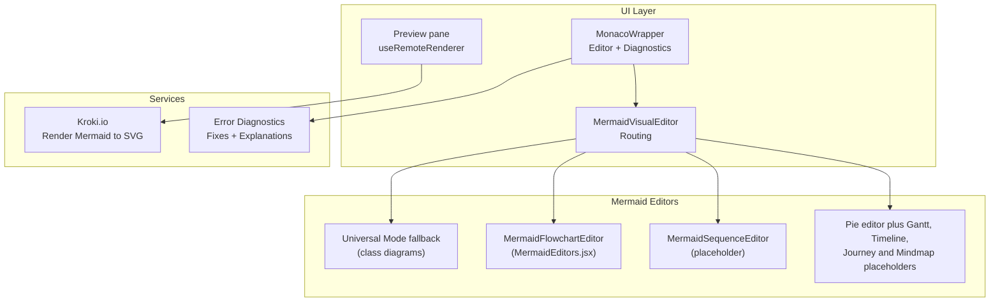
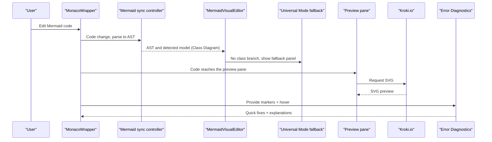
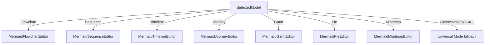
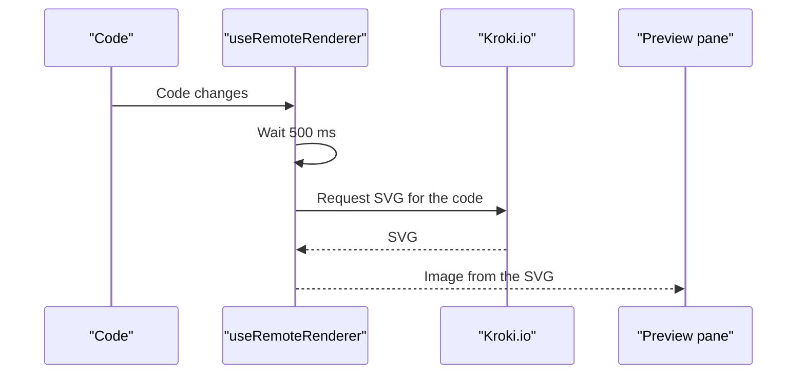
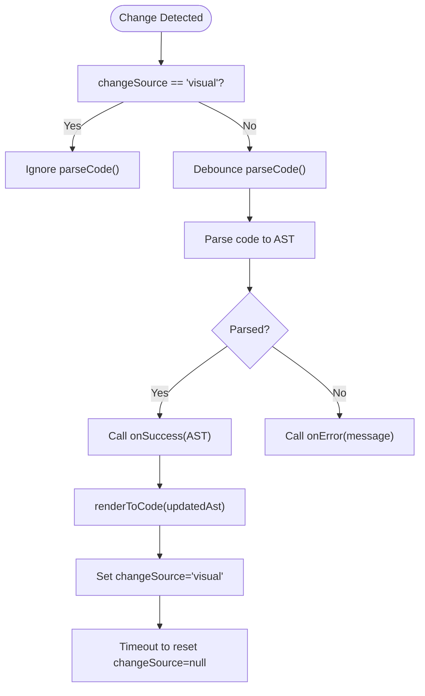
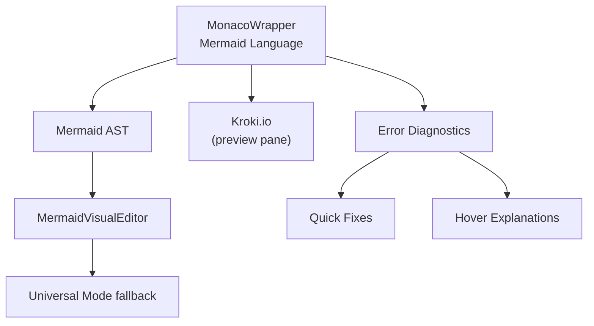

# Class Diagrams

<cite>
**Referenced Files in This Document**
- [index.html](file://index.html)
- [js/config.js](file://js/config.js)
- [js/components/editors/MonacoWrapper.jsx](file://js/components/editors/MonacoWrapper.jsx)
- [js/components/editors/mermaid/MermaidVisualEditor.jsx](file://js/components/editors/mermaid/MermaidVisualEditor.jsx)
- [js/components/editors/mermaid/MermaidEditors.jsx](file://js/components/editors/mermaid/MermaidEditors.jsx)
- [js/components/editors/mermaid/utils.js](file://js/components/editors/mermaid/utils.js)
- [js/error-diagnostics/fixes.js](file://js/error-diagnostics/fixes.js)
- [js/error-diagnostics/explanations.js](file://js/error-diagnostics/explanations.js)
</cite>

## Table of Contents
1. [Introduction](#introduction)
2. [Project Structure](#project-structure)
3. [Core Components](#core-components)
4. [Architecture Overview](#architecture-overview)
5. [Detailed Component Analysis](#detailed-component-analysis)
6. [Dependency Analysis](#dependency-analysis)
7. [Performance Considerations](#performance-considerations)
8. [Troubleshooting Guide](#troubleshooting-guide)
9. [Conclusion](#conclusion)
10. [Appendices](#appendices)

## Introduction
This document explains how class diagrams are modeled and rendered within the application, focusing on Mermaid class diagrams. It covers class definitions, inheritance, associations, interfaces, abstract classes, enumerations, packages, and common modeling patterns. It also documents how the application integrates syntax highlighting, error diagnostics, and live preview for Mermaid class diagrams.

## Project Structure
The application is a browser-based diagram generator with integrated editors and diagnostics. For Mermaid class diagrams:
- The Monaco editor registers a Mermaid language provider with syntax highlighting and bracket/arrow recognition.
- The Mermaid visual editor shows the Universal Mode fallback for class diagrams, and the preview pane renders a live SVG through the Kroki service.
- Error diagnostics provide quick fixes and hover explanations tailored to Mermaid syntax.

**Diagram sources**
- [js/components/editors/MonacoWrapper.jsx](file://js/components/editors/MonacoWrapper.jsx)
- [js/components/editors/mermaid/MermaidVisualEditor.jsx](file://js/components/editors/mermaid/MermaidVisualEditor.jsx)
- [js/components/editors/mermaid/MermaidEditors.jsx](file://js/components/editors/mermaid/MermaidEditors.jsx)

**Section sources**
- [js/components/editors/MonacoWrapper.jsx](file://js/components/editors/MonacoWrapper.jsx)
- [js/components/editors/mermaid/MermaidVisualEditor.jsx](file://js/components/editors/mermaid/MermaidVisualEditor.jsx)

## Core Components
- MonacoWrapper: Registers Mermaid language, syntax highlighting, brackets/arrows, and error providers (hover explanations and quick fixes).
- MermaidVisualEditor: Routes to a sub-editor by checking the detected model name; shows the Universal Mode fallback for class diagrams.
- Universal Mode fallback: The panel "Visual editing for this diagram type is generic. Structure editing is best done via code." Class diagrams are edited as code.
- Mermaid sync controller: `createMermaidSyncController` in `mermaid/utils.js` manages AST parsing and rendering to code, and prevents sync loops between code and visual editors.
- Error diagnostics: Provides Mermaid-specific fixes and explanations for common syntax errors.

**Section sources**
- [js/components/editors/MonacoWrapper.jsx](file://js/components/editors/MonacoWrapper.jsx)
- [js/components/editors/mermaid/MermaidVisualEditor.jsx](file://js/components/editors/mermaid/MermaidVisualEditor.jsx)
- [js/components/editors/mermaid/utils.js](file://js/components/editors/mermaid/utils.js)
- [js/error-diagnostics/fixes.js](file://js/error-diagnostics/fixes.js#L32-L92)
- [js/error-diagnostics/explanations.js](file://js/error-diagnostics/explanations.js#L12-L87)

## Architecture Overview
The Mermaid class diagram pipeline:
- User writes class diagram code in the Monaco editor.
- Monaco highlights Mermaid keywords, shapes, arrows, and labels.
- The sync controller parses the code to an AST, and the detected model name tells `MermaidVisualEditor` which panel to show.
- For class diagrams, the visual editor shows the Universal Mode fallback, and the preview pane displays a live SVG from Kroki.
- Errors are diagnosed with quick fixes and hover explanations.

**Diagram sources**
- [js/components/editors/MonacoWrapper.jsx](file://js/components/editors/MonacoWrapper.jsx)
- [js/components/editors/mermaid/MermaidVisualEditor.jsx](file://js/components/editors/mermaid/MermaidVisualEditor.jsx)
- [js/error-diagnostics/fixes.js](file://js/error-diagnostics/fixes.js#L32-L92)
- [js/error-diagnostics/explanations.js](file://js/error-diagnostics/explanations.js#L237-L271)

## Detailed Component Analysis

### Mermaid Language and Syntax Highlighting
Mermaid syntax highlighting recognizes diagram types, keywords, arrows, labels, and dates. It treats class-related keywords and classDiagram as diagram type keywords.

Key aspects:
- Keywords include diagram types and constructs like class, interface, state, subgraph, section, etc.
- Arrows are recognized for links between nodes/classes.
- Labels are highlighted as strings for node/class labels.
- Direction keywords (TB, TD, BT, RL, LR) are recognized.

**Section sources**
- [js/components/editors/MonacoWrapper.jsx](file://js/components/editors/MonacoWrapper.jsx)

### Mermaid Visual Editor Routing
The visual editor routes to sub-editors by checking the detected model name. For class diagrams, no branch matches, so the Universal Mode fallback appears.

**Diagram sources**
- [js/components/editors/mermaid/MermaidVisualEditor.jsx](file://js/components/editors/mermaid/MermaidVisualEditor.jsx)

**Section sources**
- [js/components/editors/mermaid/MermaidVisualEditor.jsx](file://js/components/editors/mermaid/MermaidVisualEditor.jsx)

### Universal Mode Fallback (Class Diagram Preview)
For class diagrams, `MermaidVisualEditor` shows a "Universal Mode" panel under the shared `EditorToolbar`, titled "Class Diagram Editor" with the sub-title "Visual Mode (Beta)". The panel gives no structure editing, so the user edits class diagrams in Monaco.

The SVG preview comes from the preview pane in `App.jsx`, which the `useRemoteRenderer` hook feeds. The hook waits 500 ms after the last change, then asks Kroki for the SVG.

**Diagram sources**
- [js/components/editors/mermaid/MermaidVisualEditor.jsx](file://js/components/editors/mermaid/MermaidVisualEditor.jsx)
- [js/hooks/useRemoteRenderer.js](file://js/hooks/useRemoteRenderer.js)

**Section sources**
- [js/components/editors/mermaid/MermaidVisualEditor.jsx](file://js/components/editors/mermaid/MermaidVisualEditor.jsx)
- [js/hooks/useRemoteRenderer.js](file://js/hooks/useRemoteRenderer.js)

### Mermaid Sync Controller
Prevents infinite loops during bidirectional synchronization between code and visual editors. The controller debounces parsing by 300 ms and resets a change source flag 50 ms after rendering.

**Diagram sources**
- [js/components/editors/mermaid/utils.js](file://js/components/editors/mermaid/utils.js)

**Section sources**
- [js/components/editors/mermaid/utils.js](file://js/components/editors/mermaid/utils.js)

### Error Diagnostics for Mermaid
Provides targeted fixes and explanations for common Mermaid errors, including missing diagram declarations, invalid arrows, and unmatched brackets.

Examples of supported patterns:
- Missing diagram type declaration (adds classDiagram or sequenceDiagram).
- Subgraph not closed (suggests adding end).
- Invalid arrow syntax (lists supported arrow forms).

**Section sources**
- [js/error-diagnostics/fixes.js](file://js/error-diagnostics/fixes.js#L32-L92)
- [js/error-diagnostics/explanations.js](file://js/error-diagnostics/explanations.js#L12-L87)

## Dependency Analysis
The Mermaid class diagram feature depends on:
- Monaco language registration for Mermaid.
- AST parsing and model detection for the visual editor.
- The Universal Mode fallback for class diagrams.
- Kroki for SVG rendering.
- Error diagnostics for quick fixes and hover explanations.

**Diagram sources**
- [js/components/editors/MonacoWrapper.jsx](file://js/components/editors/MonacoWrapper.jsx)
- [js/components/editors/mermaid/MermaidVisualEditor.jsx](file://js/components/editors/mermaid/MermaidVisualEditor.jsx)
- [js/error-diagnostics/fixes.js](file://js/error-diagnostics/fixes.js#L32-L92)
- [js/error-diagnostics/explanations.js](file://js/error-diagnostics/explanations.js#L237-L271)

**Section sources**
- [js/components/editors/MonacoWrapper.jsx](file://js/components/editors/MonacoWrapper.jsx)
- [js/components/editors/mermaid/MermaidVisualEditor.jsx](file://js/components/editors/mermaid/MermaidVisualEditor.jsx)
- [js/error-diagnostics/fixes.js](file://js/error-diagnostics/fixes.js#L32-L92)
- [js/error-diagnostics/explanations.js](file://js/error-diagnostics/explanations.js#L237-L271)

## Performance Considerations
- Debouncing: The sync controller debounces AST parsing by 300 ms to reduce unnecessary re-renders.
- Preview debounce: `useRemoteRenderer` waits 500 ms after the last change before it requests the SVG.
- Minimal re-rendering: The preview refreshes only when the code, diagram type or related flags change.

**Section sources**
- [js/components/editors/mermaid/utils.js](file://js/components/editors/mermaid/utils.js)
- [js/hooks/useRemoteRenderer.js](file://js/hooks/useRemoteRenderer.js)

## Troubleshooting Guide
Common class diagram issues and resolutions:
- Missing diagram declaration: Add classDiagram at the top.
- Invalid arrow syntax: Use supported arrow forms (e.g., -->, -.->, ==>).
- Unmatched brackets/braces/parentheses: Ensure all labels and shapes are properly closed.
- Unknown diagram type: Confirm the diagram type keyword is correct.

Quick fixes and hover explanations are provided automatically by the diagnostics system.

**Section sources**
- [js/error-diagnostics/fixes.js](file://js/error-diagnostics/fixes.js#L32-L92)
- [js/error-diagnostics/explanations.js](file://js/error-diagnostics/explanations.js#L12-L87)

## Conclusion
The application provides a robust environment for authoring Mermaid class diagrams with:
- Syntax highlighting tailored to Mermaid constructs.
- A visual editor that shows the Universal Mode fallback for class diagrams.
- Live preview via Kroki and comprehensive error diagnostics with quick fixes and explanations.

## Appendices

### Class Modeling Patterns in Mermaid
- Class definitions: Use class with a body containing fields and methods.
- Interfaces: Use class with stereotype <<interface>>.
- Abstract classes: Use abstract class with {abstract} in the body.
- Enums: Use enum with values listed inside.
- Inheritance: Use --|> for extends.
- Implementation: Use ..|> for implements.
- Composition: Use *-- for composition.
- Aggregation: Use o-- for aggregation.
- Association: Use --> for association.
- Dependency: Use ..> for dependency.
- Packages: Use package {...} to group classes.
- Notes: Use note "..." as N to annotate classes.

These patterns are reflected in the configuration snippets and templates.

**Section sources**
- [js/config.js](file://js/config.js#L133-L146)
- [js/config.js](file://js/config.js#L228-L263)
- [index.html](file://index.html)

### Relationship Types and Notation
- Inheritance (generalization): ChildClass --|> ParentClass
- Implementation: Class ..|> Interface
- Composition: ClassA *-- ClassB
- Aggregation: ClassA o-- ClassB
- Association: ClassA --> ClassB
- Dependency: ClassA ..> ClassB

**Section sources**
- [index.html](file://index.html)
- [js/config.js](file://js/config.js#L133-L146)

### Styling Options and Layout Considerations
- Node shapes: Square brackets [label], parentheses (label), braces {label}, double-parentheses ((label)), brackets with parentheses [label], pipes |label|, and others.
- Arrow styles: -->, -.->, ==>, and labeled arrows with |text|.
- Direction keywords: TB, TD, BT, RL, LR for graph orientation.
- Comments: Use %% for single-line comments.

**Section sources**
- [js/components/editors/MonacoWrapper.jsx](file://js/components/editors/MonacoWrapper.jsx)