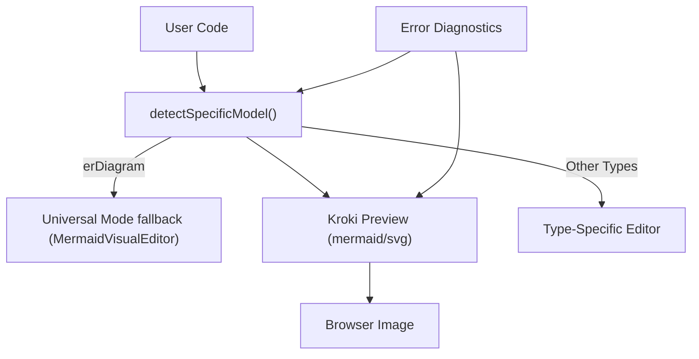
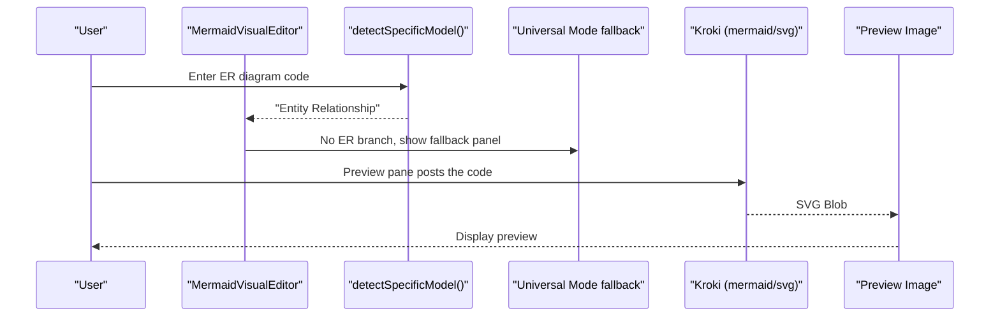
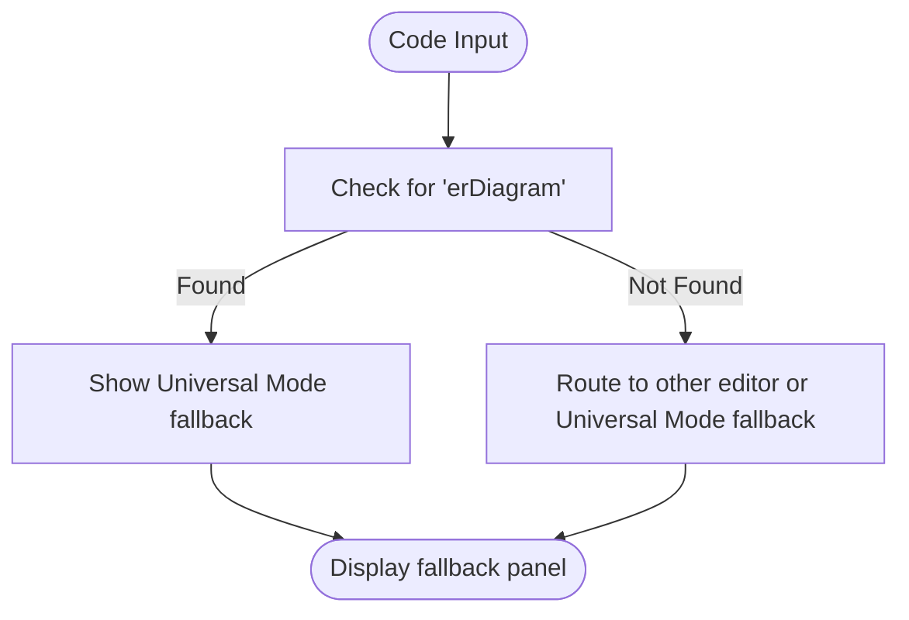
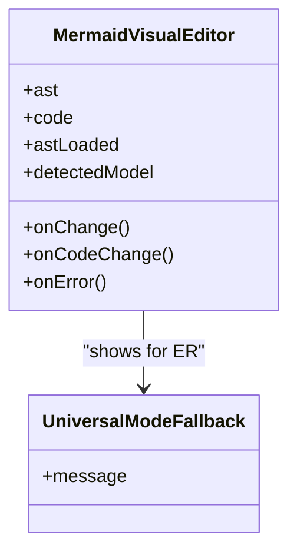
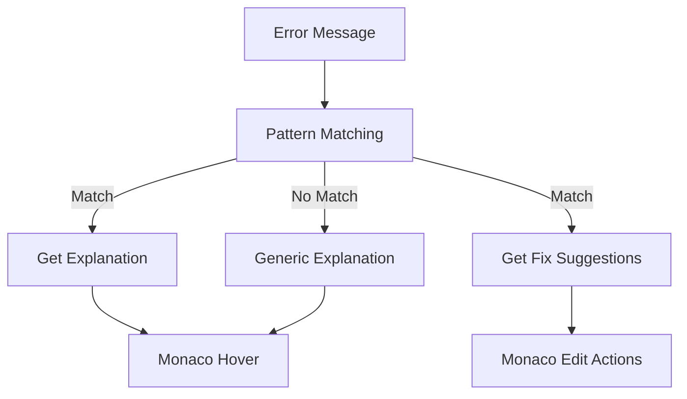
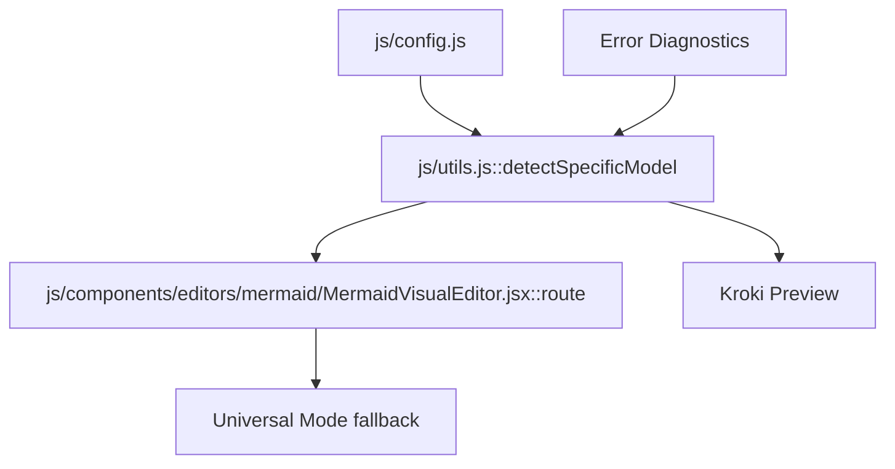

# Entity Relationship Diagrams

<cite>
**Referenced Files in This Document**
- [index.html](file://index.html)
- [config.js](file://js/config.js)
- [utils.js](file://js/utils.js)
- [MermaidVisualEditor.jsx](file://js/components/editors/mermaid/MermaidVisualEditor.jsx)
- [MermaidEditors.jsx](file://js/components/editors/mermaid/MermaidEditors.jsx)
- [mermaid/utils.js](file://js/components/editors/mermaid/utils.js)
- [explanations.js](file://js/error-diagnostics/explanations.js)
- [fixes.js](file://js/error-diagnostics/fixes.js)
</cite>

## Table of Contents
1. [Introduction](#introduction)
2. [Project Structure](#project-structure)
3. [Core Components](#core-components)
4. [Architecture Overview](#architecture-overview)
5. [Detailed Component Analysis](#detailed-component-analysis)
6. [Dependency Analysis](#dependency-analysis)
7. [Performance Considerations](#performance-considerations)
8. [Troubleshooting Guide](#troubleshooting-guide)
9. [Conclusion](#conclusion)
10. [Appendices](#appendices)

## Introduction
This document explains how Entity Relationship (ER) diagrams are supported and rendered within the Universal Diagram Generator. It focuses on the Mermaid ER diagram syntax, how the application detects ER diagrams, and how the Mermaid visual editor treats ER diagrams (the Universal Mode fallback). It also documents the syntax for entity definitions, attribute types, primary and foreign keys, relationship cardinalities, and how the system handles ER-related errors and suggestions.

## Project Structure
The Universal Diagram Generator supports multiple diagram types. For Mermaid ER diagrams, the application:
- Detects ER diagram type from code
- Shows the Universal Mode fallback in the Mermaid visual editor, because no ER editor exists
- Renders the preview pane through Kroki
- Provides error diagnostics and fix suggestions

**Diagram sources**
- [MermaidVisualEditor.jsx](file://js/components/editors/mermaid/MermaidVisualEditor.jsx)
- [utils.js](file://js/utils.js#L49-L85)
- [index.html](file://index.html)

**Section sources**
- [index.html](file://index.html)
- [js/config.js](file://js/config.js#L58-L69)
- [js/utils.js](file://js/utils.js#L49-L85)
- [js/components/editors/mermaid/MermaidVisualEditor.jsx](file://js/components/editors/mermaid/MermaidVisualEditor.jsx)

## Core Components
- Diagram detection: The application identifies ER diagrams by scanning for the erDiagram declaration.
- Editor routing: `MermaidVisualEditor` has no branch for ER diagrams, so the detected model "Entity Relationship" reaches the Universal Mode fallback.
- Preview rendering: The main preview pane requests the SVG from the Kroki service, with a 500 ms debounce, whatever the editor shows.
- Error diagnostics: The system provides explanations and fix suggestions for ER-related errors.

Key behaviors:
- ER diagram detection uses a regex against the code content.
- The Universal Mode fallback shows the message "Visual editing for this diagram type is generic. Structure editing is best done via code." The Mermaid visual editor shows no property panel and no preview of its own.
- Error diagnostics map error patterns to human-readable explanations and suggested fixes.

**Section sources**
- [js/utils.js](file://js/utils.js#L53-L64)
- [js/components/editors/mermaid/MermaidVisualEditor.jsx](file://js/components/editors/mermaid/MermaidVisualEditor.jsx)
- [js/error-diagnostics/explanations.js](file://js/error-diagnostics/explanations.js#L237-L271)
- [js/error-diagnostics/fixes.js](file://js/error-diagnostics/fixes.js#L611-L656)

## Architecture Overview
The ER diagram workflow integrates with the broader diagram generator architecture. The Mermaid ER diagram is edited as code in Monaco, and the Mermaid visual editor shows the Universal Mode fallback for ER diagrams.

**Diagram sources**
- [js/components/editors/mermaid/MermaidVisualEditor.jsx](file://js/components/editors/mermaid/MermaidVisualEditor.jsx)
- [js/utils.js](file://js/utils.js#L49-L85)

## Detailed Component Analysis

### ER Diagram Detection and Routing
- Detection: The application checks for the erDiagram keyword to identify ER diagrams.
- Routing: `MermaidVisualEditor` checks the detected model for Flowchart, Sequence, Pie, Gantt, Timeline, Journey and Mindmap. "Entity Relationship" matches none of these, so the Universal Mode fallback appears.

**Diagram sources**
- [js/utils.js](file://js/utils.js#L53-L64)
- [js/components/editors/mermaid/MermaidVisualEditor.jsx](file://js/components/editors/mermaid/MermaidVisualEditor.jsx)

**Section sources**
- [js/utils.js](file://js/utils.js#L53-L64)
- [js/components/editors/mermaid/MermaidVisualEditor.jsx](file://js/components/editors/mermaid/MermaidVisualEditor.jsx)

### Mermaid ER Diagram Syntax and Semantics
The application supports ER diagrams in two forms:
- Mermaid ER syntax (erDiagram)
- PlantUML ER-like entity blocks

Mermaid ER syntax highlights:
- Entity definitions with attributes
- Relationship declarations with cardinality indicators
- Attribute types and key markers

PlantUML ER-like syntax highlights:
- entity blocks with attribute lists
- primary and foreign key markers
- relationship lines with roles and cardinalities

These examples demonstrate the supported syntax patterns for ER diagrams.

**Section sources**
- [index.html](file://index.html)
- [js/config.js](file://js/config.js#L441-L490)

### Universal Mode fallback for ER diagrams
The fallback panel inside `MermaidVisualEditor` shows a "Universal Mode" heading and the message "Visual editing for this diagram type is generic. Structure editing is best done via code." The panel sits under the shared `EditorToolbar`, titled "Entity Relationship Editor" with the sub-title "Visual Mode (Beta)".

The fallback appears for ER diagrams because no ER editor exists. The user edits the erDiagram text in Monaco, and the preview pane renders the result.

**Diagram sources**
- [js/components/editors/mermaid/MermaidVisualEditor.jsx](file://js/components/editors/mermaid/MermaidVisualEditor.jsx)

**Section sources**
- [js/components/editors/mermaid/MermaidVisualEditor.jsx](file://js/components/editors/mermaid/MermaidVisualEditor.jsx)

### Error Diagnostics and Fix Suggestions for ER Diagrams
The system provides:
- Error explanations mapped to error codes
- Fix suggestions based on error patterns and extracted token information
- Token-to-character mapping for Mermaid parsers

Common ER-related error patterns:
- Missing diagram type declaration
- Unbalanced brackets or braces
- Invalid arrow/link syntax
- ERD-specific bracket issues

**Diagram sources**
- [js/error-diagnostics/explanations.js](file://js/error-diagnostics/explanations.js#L237-L271)
- [js/error-diagnostics/fixes.js](file://js/error-diagnostics/fixes.js#L611-L656)

**Section sources**
- [js/error-diagnostics/explanations.js](file://js/error-diagnostics/explanations.js#L12-L229)
- [js/error-diagnostics/fixes.js](file://js/error-diagnostics/fixes.js#L32-L510)

## Dependency Analysis
The ER diagram support depends on:
- Diagram type detection
- Editor routing
- Preview rendering
- Error diagnostics

**Diagram sources**
- [js/config.js](file://js/config.js#L58-L69)
- [js/utils.js](file://js/utils.js#L49-L85)
- [js/components/editors/mermaid/MermaidVisualEditor.jsx](file://js/components/editors/mermaid/MermaidVisualEditor.jsx)

**Section sources**
- [js/config.js](file://js/config.js#L58-L69)
- [js/utils.js](file://js/utils.js#L49-L85)
- [js/components/editors/mermaid/MermaidVisualEditor.jsx](file://js/components/editors/mermaid/MermaidVisualEditor.jsx)

## Performance Considerations
- Preview rendering is debounced to reduce network requests.
- The Universal Mode fallback is a static panel, so ER diagrams add no editor-side work.
- Error diagnostics are computed only when errors occur.

[No sources needed since this section provides general guidance]

## Troubleshooting Guide
Common ER diagram issues and resolutions:
- Missing diagram type declaration: Add the erDiagram header.
- Unbalanced brackets/braces: Ensure all constructs are properly closed.
- Invalid arrow/link syntax: Use supported Mermaid arrow syntax.
- ERD-specific bracket issues: Ensure entity names and attribute lists are correctly bracketed.

Use the error explanations and fix suggestions for targeted guidance.

**Section sources**
- [js/error-diagnostics/explanations.js](file://js/error-diagnostics/explanations.js#L237-L271)
- [js/error-diagnostics/fixes.js](file://js/error-diagnostics/fixes.js#L611-L656)

## Conclusion
The Universal Diagram Generator supports ER diagrams by detecting the erDiagram type and rendering them in the preview pane through Kroki, with the Universal Mode fallback in the visual editor. While there is no specialized ER editor, the system provides robust error diagnostics and fix suggestions to help users author correct ER diagrams. The documented syntax patterns and troubleshooting steps enable reliable ER modeling within the platform.

[No sources needed since this section summarizes without analyzing specific files]

## Appendices

### Appendix A: ER Diagram Syntax Patterns
- Mermaid ER syntax: entity definitions, attribute lists, and relationship declarations with cardinalities.
- PlantUML ER-like syntax: entity blocks with attribute lists, primary and foreign key markers, and relationships.

**Section sources**
- [index.html](file://index.html)
- [js/config.js](file://js/config.js#L441-L490)

### Appendix B: Relationship Lines and Multiplicity Indicators
- Relationship lines connect entities with roles and cardinalities.
- Multiplicity indicators reflect one-to-one, one-to-many, and many-to-many relationships.

**Section sources**
- [index.html](file://index.html)
- [js/config.js](file://js/config.js#L485-L487)