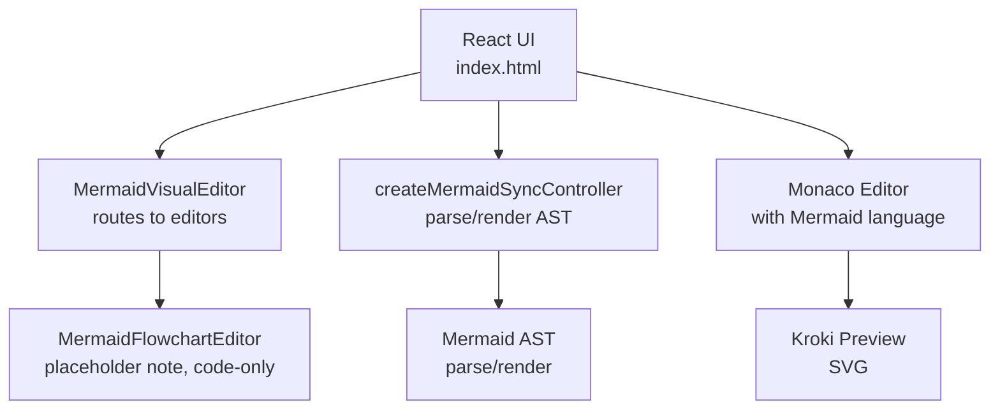
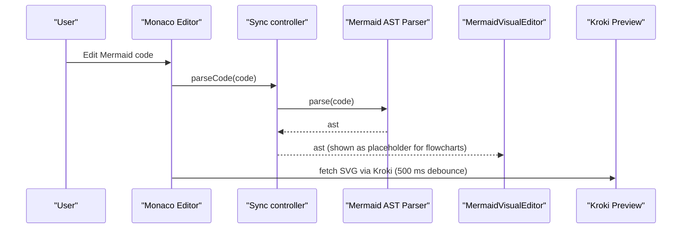
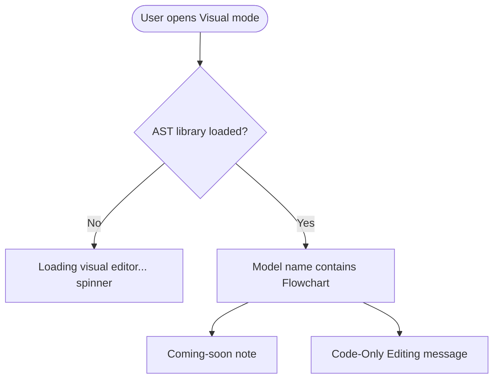
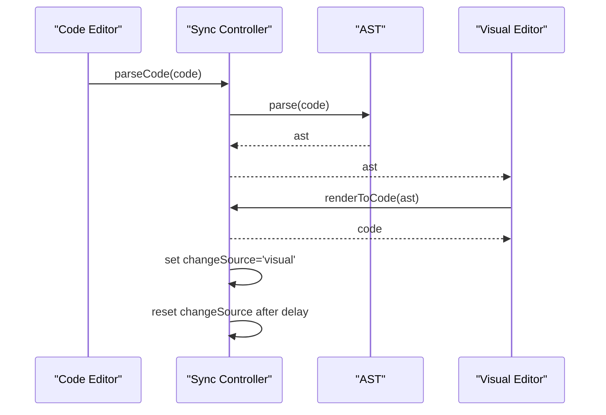
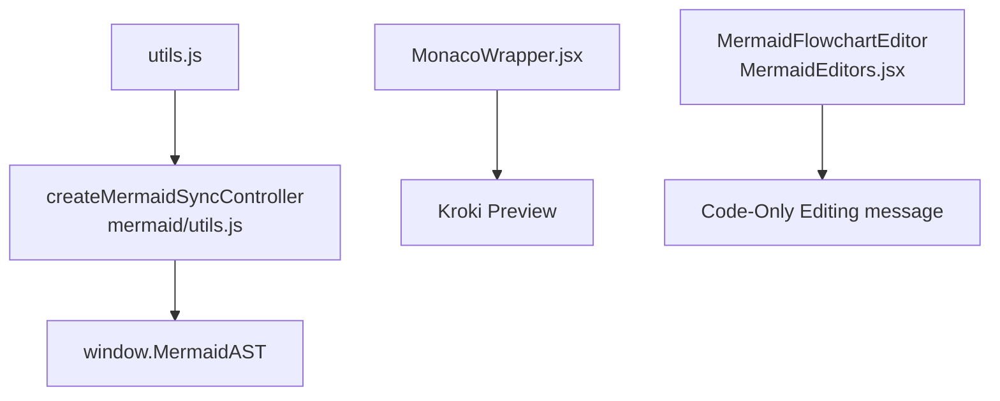

# Flowcharts and Flowchart Types

<cite>
**Referenced Files in This Document**
- [MermaidEditors.jsx](file://js/components/editors/mermaid/MermaidEditors.jsx)
- [mermaid/utils.js](file://js/components/editors/mermaid/utils.js)
- [index.html](file://index.html)
- [explanations.js](file://js/error-diagnostics/explanations.js)
- [fixes.js](file://js/error-diagnostics/fixes.js)
- [MonacoWrapper.jsx](file://js/components/editors/MonacoWrapper.jsx)
- [utils.js](file://js/utils.js)
</cite>

## Table of Contents
1. [Introduction](#introduction)
2. [Project Structure](#project-structure)
3. [Core Components](#core-components)
4. [Architecture Overview](#architecture-overview)
5. [Detailed Component Analysis](#detailed-component-analysis)
6. [Dependency Analysis](#dependency-analysis)
7. [Performance Considerations](#performance-considerations)
8. [Troubleshooting Guide](#troubleshooting-guide)
9. [Conclusion](#conclusion)
10. [Appendices](#appendices)

## Introduction
This document explains the Mermaid flowchart support in the universal diagram generator, focusing on flowchart syntax, node shapes, connection types, directional options, and styling. It also covers the Mermaid sync controller that parses code into an AST, the current state of the flowchart visual editor, practical examples, best practices, and troubleshooting of common syntax errors.

## Project Structure
The Mermaid flowchart feature combines a React-based visual editor shell, a Mermaid AST parser and a live preview via the Kroki service. The key parts are:
- A flowchart editor component that currently shows a "coming soon" note and a code-only message, with no node or edge editing
- A sync controller that parses code into an AST
- Error diagnostics with explanations and fix suggestions
- Monaco editor integration with Mermaid language support

**Diagram sources**
- [index.html](file://index.html)
- [MermaidEditors.jsx](file://js/components/editors/mermaid/MermaidEditors.jsx)
- [mermaid/utils.js](file://js/components/editors/mermaid/utils.js)

**Section sources**
- [index.html](file://index.html)
- [MermaidEditors.jsx](file://js/components/editors/mermaid/MermaidEditors.jsx)
- [mermaid/utils.js](file://js/components/editors/mermaid/utils.js)

## Core Components
- MermaidFlowchartEditor: Shows the note "Interactive node editing coming soon. Use the code editor for full control." followed by the "Code-Only Editing" message (`VisualEditingNotAvailable`). It receives only `code` and `onChange`, and offers no node or edge editing.
- Mermaid sync controller (`createMermaidSyncController` in `mermaid/utils.js`): Parses code into an AST after a 300 ms debounce, skips parsing while a visual change is being written back, and can render an AST back to code.
- Error diagnostics: Provides human-readable explanations and suggested fixes for common Mermaid syntax errors.
- Monaco editor integration: Adds Mermaid language support, syntax highlighting, bracket matching, and direction keywords.

Key responsibilities:
- Flowchart editor: displays the placeholder note. Flowcharts are authored in Monaco, and the preview pane shows the result.
- Sync controller: parse code to AST, render AST back to code, and guard against infinite loops.
- Diagnostics: explain errors and propose fixes for missing brackets, arrows, and other syntax issues.

**Section sources**
- [MermaidEditors.jsx](file://js/components/editors/mermaid/MermaidEditors.jsx)
- [mermaid/utils.js](file://js/components/editors/mermaid/utils.js)
- [explanations.js](file://js/error-diagnostics/explanations.js)
- [fixes.js](file://js/error-diagnostics/fixes.js#L32-L92)
- [MonacoWrapper.jsx](file://js/components/editors/MonacoWrapper.jsx)

## Architecture Overview
The system parses Mermaid code into an AST and detects the diagram model from the code text. `MermaidVisualEditor` routes to the flowchart editor when the model name contains "Flowchart", and the preview pane displays a live SVG via Kroki. `App.jsx` can turn an AST passed to `onChange` back into code, but the current sub-editors never pass one.

**Diagram sources**
- [mermaid/utils.js](file://js/components/editors/mermaid/utils.js)
- [MermaidEditors.jsx](file://js/components/editors/mermaid/MermaidEditors.jsx)
- [index.html](file://index.html)

## Detailed Component Analysis

### Flowchart Editor
`MermaidFlowchartEditor` lives in `MermaidEditors.jsx`. `MermaidVisualEditor` renders the component inside the shared `EditorToolbar`, titled "Flowchart Editor" with the sub-title "Visual Mode (Beta)".

Key behaviours:
- Shows a blue note: "Interactive node editing coming soon. Use the code editor for full control."
- Shows the "Code-Only Editing" message from `VisualEditingNotAvailable`.
- Receives only `code` and `onChange`, so the component has no access to the AST.
- Leaves node and edge editing, label editing and adding elements to the Monaco code editor.

**Diagram sources**
- [MermaidEditors.jsx](file://js/components/editors/mermaid/MermaidEditors.jsx)

**Section sources**
- [MermaidEditors.jsx](file://js/components/editors/mermaid/MermaidEditors.jsx)

### Bi-directional Synchronization Controller
The controller manages AST state and prevents infinite loops during synchronization. It debounces parsing by 300 ms, sets a change source flag when rendering, and resets the flag 50 ms later.

Highlights:
- Debounced parseCode to avoid frequent re-parsing.
- changeSource flag to block parsing when triggered by visual changes.
- renderToCode returns code from the AST and resets changeSource asynchronously.
- getAst returns the last parsed AST, and isLoaded reports whether `window.MermaidAST` has loaded.
- If the library has not loaded, parseCode returns a stand-in root node holding the code.

**Diagram sources**
- [mermaid/utils.js](file://js/components/editors/mermaid/utils.js)

**Section sources**
- [mermaid/utils.js](file://js/components/editors/mermaid/utils.js)

### Error Diagnostics and Fixes
The system provides explanations for common Mermaid errors and suggests fixes. It maps error messages to explanations and patterns, and offers quick-fix actions for missing brackets, arrows, and other syntax issues.

Examples of covered errors:
- Missing closing bracket, parenthesis, or brace
- Invalid arrow syntax
- Unexpected token or unrecognized text
- Unknown diagram type

Fix suggestions include inserting the expected token or adding diagram declarations.

**Section sources**
- [explanations.js](file://js/error-diagnostics/explanations.js)
- [fixes.js](file://js/error-diagnostics/fixes.js#L32-L92)

### Monaco Editor Integration
Monaco is configured for Mermaid with:
- Syntax highlighting for diagram keywords and directions
- Bracket pairs and auto-closing
- Direction keywords (TB, TD, BT, RL, LR) highlighted as keywords
- Arrow operators recognized for flowchart links

These features improve readability and reduce syntax errors.

**Section sources**
- [MonacoWrapper.jsx](file://js/components/editors/MonacoWrapper.jsx)

## Dependency Analysis
The flowchart feature depends on:
- React and JSX
- Mermaid AST parser for parsing and rendering
- Monaco editor for code editing and diagnostics
- Kroki service for SVG previews
- Utility functions for encoding and detection

**Diagram sources**
- [utils.js](file://js/utils.js#L1-L177)
- [MermaidEditors.jsx](file://js/components/editors/mermaid/MermaidEditors.jsx)
- [mermaid/utils.js](file://js/components/editors/mermaid/utils.js)
- [index.html](file://index.html)

**Section sources**
- [utils.js](file://js/utils.js#L1-L177)
- [MermaidEditors.jsx](file://js/components/editors/mermaid/MermaidEditors.jsx)
- [mermaid/utils.js](file://js/components/editors/mermaid/utils.js)
- [index.html](file://index.html)

## Performance Considerations
- Debouncing: The sync controller debounces parseCode to avoid excessive parsing during rapid edits.
- Change-source gating: changeSource prevents infinite loops when visual changes trigger code updates.
- Preview throttling: The preview fetch waits 500 ms after the last change to avoid frequent network requests.
- AST caching: The controller stores the last AST, available through getAst.

Best practices:
- Keep edits focused to reduce AST churn.
- Use subgraphs to organize complex flowcharts.
- Prefer concise node labels to improve readability.

[No sources needed since this section provides general guidance]

## Troubleshooting Guide
Common issues and resolutions:
- Missing closing bracket/parenthesis/brace: The diagnostics explain the problem and show correct syntax examples.
- Invalid arrow syntax: Suggestions include using standard, dotted, or thick arrows.
- Unexpected token or unrecognized text: Check for typos in keywords and ensure proper diagram type declaration.
- Unknown diagram type: Ensure the first line declares a valid diagram type.

Quick fixes:
- Insert the missing token at the error position.
- Add a diagram declaration at the top of the file.
- Close subgraphs and blocks properly.

**Section sources**
- [explanations.js](file://js/error-diagnostics/explanations.js)
- [fixes.js](file://js/error-diagnostics/fixes.js#L611-L656)

## Conclusion
The Mermaid flowchart support combines Monaco code editing, an AST sync controller, live previews and robust error diagnostics. The flowchart visual editor is a placeholder today, so users create and maintain flowcharts in code, with clear feedback and helpful fixes for common syntax errors.

[No sources needed since this section summarizes without analyzing specific files]

## Appendices

### Flowchart Syntax and Node Shapes
- Node shapes: square brackets for rectangles, parentheses for rounded nodes, braces for diamonds, and specialized shapes like double circles and stadiums.
- Decision nodes: use braces to represent branching conditions.
- Subgraphs: group related nodes for clarity.

**Section sources**
- [index.html](file://index.html)
- [explanations.js](file://js/error-diagnostics/explanations.js#L14-L41)

### Connection Types and Directional Options
- Arrows: solid, dotted, and thick variants for different semantics.
- Direction keywords: TD (top-down), LR (left-right), TB (bottom-top), RL (right-left).
- Edge labels: text annotations on arrows.

**Section sources**
- [explanations.js](file://js/error-diagnostics/explanations.js#L42-L52)
- [MonacoWrapper.jsx](file://js/components/editors/MonacoWrapper.jsx)
- [index.html](file://index.html)

### Practical Examples and Best Practices
- Use templates and snippets to bootstrap diagrams quickly.
- Keep node labels short and descriptive.
- Group related steps into subgraphs.
- Use direction keywords to control layout orientation.

**Section sources**
- [index.html](file://index.html)