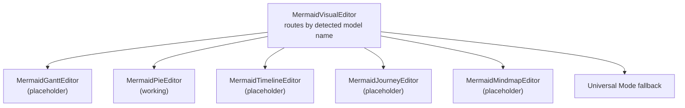
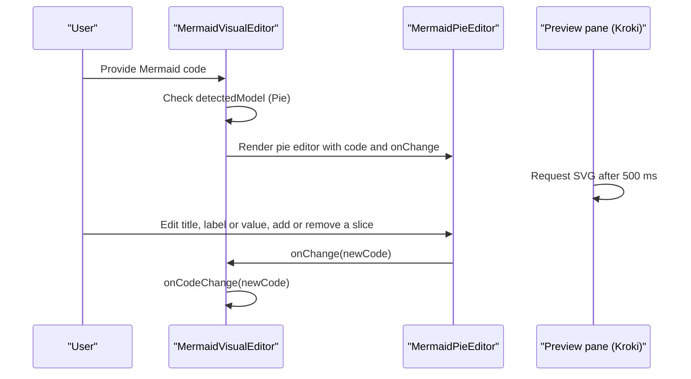
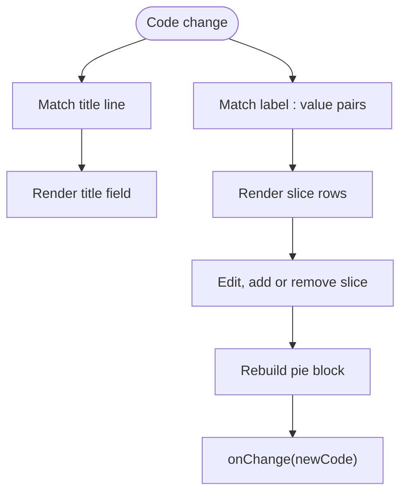
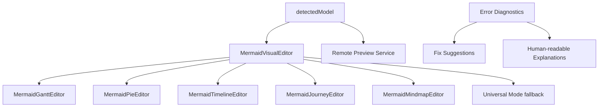

# Gantt Charts and Pie Charts

<cite>
**Referenced Files in This Document**
- [index.html](file://index.html)
- [MermaidEditors.jsx](file://js/components/editors/mermaid/MermaidEditors.jsx)
- [MermaidVisualEditor.jsx](file://js/components/editors/mermaid/MermaidVisualEditor.jsx)
- [explanations.js](file://js/error-diagnostics/explanations.js)
- [fixes.js](file://js/error-diagnostics/fixes.js)
</cite>

## Table of Contents
1. [Introduction](#introduction)
2. [Project Structure](#project-structure)
3. [Core Components](#core-components)
4. [Architecture Overview](#architecture-overview)
5. [Detailed Component Analysis](#detailed-component-analysis)
6. [Dependency Analysis](#dependency-analysis)
7. [Performance Considerations](#performance-considerations)
8. [Troubleshooting Guide](#troubleshooting-guide)
9. [Conclusion](#conclusion)
10. [Appendices](#appendices)

## Introduction
This document explains how Gantt charts and pie charts are supported in the Mermaid editor within this project. It covers:
- How Gantt charts represent tasks, milestones, and dependencies
- How pie charts represent data slices and totals
- How `MermaidVisualEditor` routes Gantt and pie charts (the pie editor works, and the Gantt editor is a placeholder)
- Practical examples and best practices for project planning and data visualization
- Differences from flowchart-based diagrams

## Project Structure
The Mermaid editor is composed of:
- A router (`MermaidVisualEditor`) that selects the sub-editor from the detected model name
- Editors for data-oriented charts (Pie, Gantt, Timeline, Journey, Mindmap) in `MermaidEditors.jsx`, of which only the pie editor does real work
- A Universal Mode fallback for diagram types without a sub-editor
- Error diagnostics and fix suggestions tailored to Mermaid syntax

**Diagram sources**
- [MermaidVisualEditor.jsx](file://js/components/editors/mermaid/MermaidVisualEditor.jsx)
- [MermaidEditors.jsx](file://js/components/editors/mermaid/MermaidEditors.jsx)

**Section sources**
- [MermaidVisualEditor.jsx](file://js/components/editors/mermaid/MermaidVisualEditor.jsx)
- [MermaidEditors.jsx](file://js/components/editors/mermaid/MermaidEditors.jsx)

## Core Components
- MermaidVisualEditor: Routes to the correct editor by checking the detected model name for Pie, Gantt, Timeline, Journey and Mindmap (and Flowchart and Sequence). It shows a "Loading visual editor..." spinner until the AST library has loaded, and wraps the chosen editor in `EditorToolbar`. The editors receive only `code` and `onChange`.
- MermaidPieEditor: Reads the title and slices from the code with regular expressions, and lets the user edit the title, labels and values, add a slice and remove a slice.
- MermaidGanttEditor, MermaidTimelineEditor, MermaidJourneyEditor, MermaidMindmapEditor: One-line placeholders that return `VisualEditingNotAvailable`, the "Code-Only Editing" message.
- Universal Mode fallback: The panel inside `MermaidVisualEditor` for any other diagram type, with the message "Visual editing for this diagram type is generic. Structure editing is best done via code."

Key behaviours:
- Live preview: The preview pane (not the visual editor) requests the SVG from Kroki after a 500 ms debounce and displays it as an image.
- Code synchronization: The pie editor writes its changes back through `onChange`, which `MermaidVisualEditor` wires to `onCodeChange`.
- Model-name routing: The router checks `detectedModel` with `includes`, and does not inspect the AST.

**Section sources**
- [MermaidVisualEditor.jsx](file://js/components/editors/mermaid/MermaidVisualEditor.jsx)
- [MermaidEditors.jsx](file://js/components/editors/mermaid/MermaidEditors.jsx)

## Architecture Overview
The Mermaid editor pipeline:
- Detect the diagram model from the Mermaid source (`detectSpecificModel`)
- Route to a sub-editor by model name once the AST library has loaded
- Render the live preview through the Kroki service in the preview pane
- Allow users to edit code, or use the pie editor controls

**Diagram sources**
- [MermaidVisualEditor.jsx](file://js/components/editors/mermaid/MermaidVisualEditor.jsx)
- [MermaidEditors.jsx](file://js/components/editors/mermaid/MermaidEditors.jsx)

## Detailed Component Analysis

### Gantt Chart Editor
Purpose of the chart type:
- Visualize project schedules with tasks, milestones, and dependencies

Current editor behaviour:
- `MermaidGanttEditor` is a placeholder that returns the "Code-Only Editing" message for "Gantt Chart".
- Tasks, sections and dependencies are written in the Monaco code editor.
- The preview pane renders the chart through Kroki, as it does for every other Mermaid type.

**Section sources**
- [MermaidEditors.jsx](file://js/components/editors/mermaid/MermaidEditors.jsx)

### Pie Chart Editor
Purpose:
- Visualize categorical data distributions as slices
- Provide controls to edit slices without touching the code

How it works:
- Reads the title (`title ...`) and the slices (`"label" : value`) from the code with regular expressions
- Shows a title field, and a label field plus a number field for each slice
- Lets the user add a slice (default label "New Slice", value 10) or remove a slice
- Writes the code back through `onChange`

**Diagram sources**
- [MermaidEditors.jsx](file://js/components/editors/mermaid/MermaidEditors.jsx)

Key capabilities:
- Extract the title, slices and values from pie code
- Edit labels and values, add a slice and remove a slice
- Rebuild the code as `pie title ...` followed by one line per slice, so lines other than the title and slices (for example `showData`) are not carried over

**Section sources**
- [MermaidEditors.jsx](file://js/components/editors/mermaid/MermaidEditors.jsx)

### Timeline Editor
`MermaidTimelineEditor` is a placeholder that returns the "Code-Only Editing" message for "Timeline". Sections and periods are written in the code editor.

**Section sources**
- [MermaidEditors.jsx](file://js/components/editors/mermaid/MermaidEditors.jsx)

### Journey Editor
`MermaidJourneyEditor` is a placeholder that returns the "Code-Only Editing" message for "User Journey". Tasks, scores and actors are written in the code editor.

**Section sources**
- [MermaidEditors.jsx](file://js/components/editors/mermaid/MermaidEditors.jsx)

### Mindmap Editor
`MermaidMindmapEditor` is a placeholder that returns the "Code-Only Editing" message for "Mindmap". The indentation-based structure is written in the code editor.

**Section sources**
- [MermaidEditors.jsx](file://js/components/editors/mermaid/MermaidEditors.jsx)

### Universal Mode Fallback
Purpose:
- Fallback inside `MermaidVisualEditor` for diagram types that have no sub-editor

How it works:
- Shows a "Universal Mode" heading and the message "Visual editing for this diagram type is generic. Structure editing is best done via code."
- Leaves editing to the Monaco code editor, and the preview pane still renders the diagram

**Section sources**
- [MermaidVisualEditor.jsx](file://js/components/editors/mermaid/MermaidVisualEditor.jsx)

## Dependency Analysis
The Mermaid editor stack depends on:
- Model detection (`detectSpecificModel`) to route to the correct editor
- Remote preview service for SVG rendering in the preview pane
- The pie editor's regular expressions to extract structured data from code
- Error diagnostics for helpful explanations and fixes

**Diagram sources**
- [MermaidVisualEditor.jsx](file://js/components/editors/mermaid/MermaidVisualEditor.jsx)
- [MermaidEditors.jsx](file://js/components/editors/mermaid/MermaidEditors.jsx)
- [explanations.js](file://js/error-diagnostics/explanations.js#L12-L229)
- [fixes.js](file://js/error-diagnostics/fixes.js#L32-L92)

**Section sources**
- [MermaidVisualEditor.jsx](file://js/components/editors/mermaid/MermaidVisualEditor.jsx)
- [explanations.js](file://js/error-diagnostics/explanations.js#L12-L229)
- [fixes.js](file://js/error-diagnostics/fixes.js#L32-L92)

## Performance Considerations
- Preview throttling: The preview pane waits 500 ms before requesting a new preview to avoid excessive network calls.
- Minimal re-rendering: The pie editor relies on code change callbacks and simple state updates to keep the UI responsive.
- Efficient parsing: The pie editor parses the code only when the code changes.

[No sources needed since this section provides general guidance]

## Troubleshooting Guide
Common Mermaid errors and how to address them:
- Unknown diagram type: Ensure the diagram type declaration is present and correct.
- Missing closing brackets/parentheses/braces: Ensure all node shapes and blocks are properly closed.
- Invalid arrow syntax: Use supported arrow types for the diagram type.
- Unexpected tokens: Check for typos or misplaced characters.

Fix suggestions:
- Add missing diagram type declaration
- Close subgraphs with end
- Use supported arrow syntax

**Section sources**
- [explanations.js](file://js/error-diagnostics/explanations.js#L74-L87)
- [fixes.js](file://js/error-diagnostics/fixes.js#L34-L91)

## Conclusion
The Mermaid editor in this project supports pie charts with a working visual editor that edits the title, labels and values, adds slices and removes slices. Gantt charts have a placeholder editor, so users write tasks and sections in code. The router picks the editor from the detected model name, the preview pane shows live previews, and error diagnostics help resolve syntax issues quickly.

[No sources needed since this section summarizes without analyzing specific files]

## Appendices

### Syntax Differences from Flowchart-Based Diagrams
- Gantt charts focus on time-based scheduling with tasks, milestones, and dependencies, using section blocks and task definitions with identifiers and durations.
- Pie charts focus on categorical data with labeled slices and numeric values, using title and slice declarations.
- Flowchart-based diagrams emphasize node shapes and links, using arrows and branching logic.

**Section sources**
- [index.html](file://index.html)
- [index.html](file://index.html)
- [index.html](file://index.html)
- [index.html](file://index.html)

### Example Scenarios
- Project planning with Gantt: Define sections for Planning, Development, and Testing; add tasks with start dates and durations in the code editor; use after to express dependencies.
- Data visualization with Pie: Define a title; add slices with labels and values; optionally enable data display.

**Section sources**
- [index.html](file://index.html)
- [index.html](file://index.html)

### Best Practices
- Keep task identifiers unique and meaningful
- Use consistent date formats and durations
- Group related tasks under sections
- Use clear labels and values for pie slices
- Use the pie editor's add-slice control to iterate quickly

[No sources needed since this section provides general guidance]