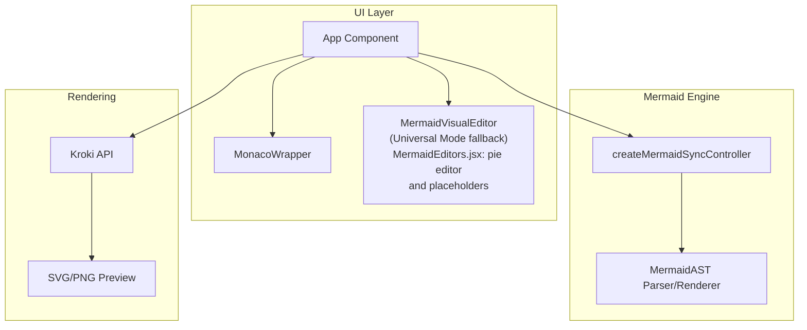
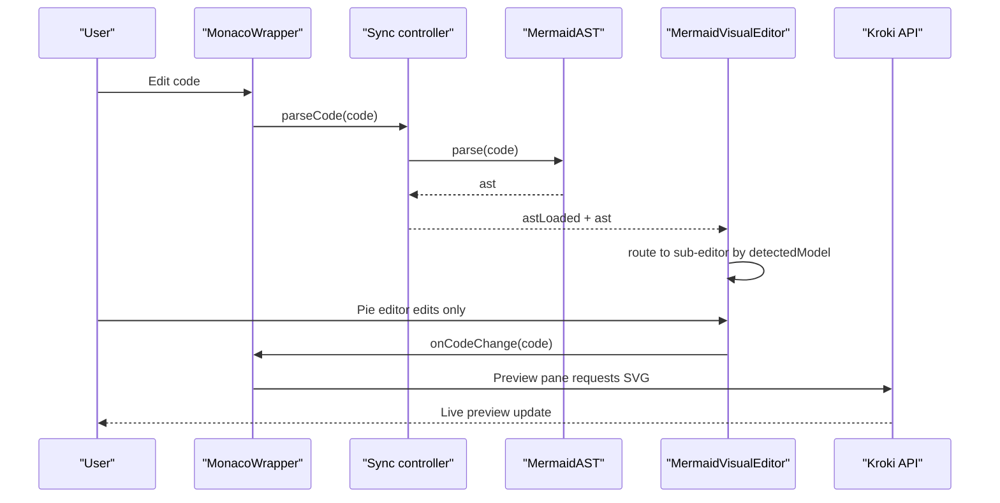
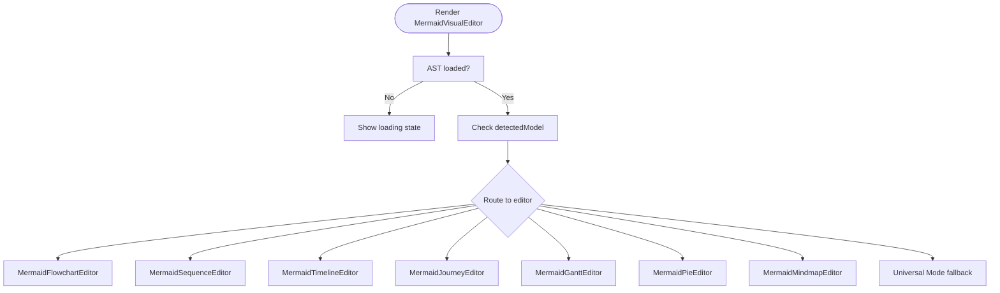
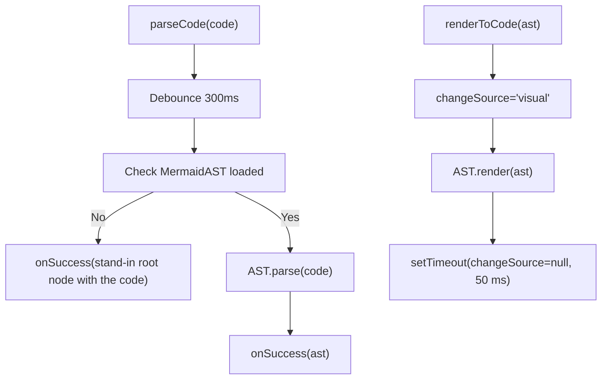
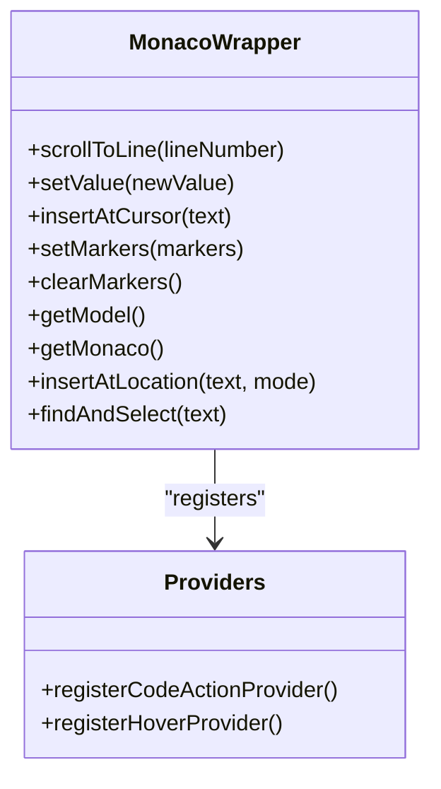
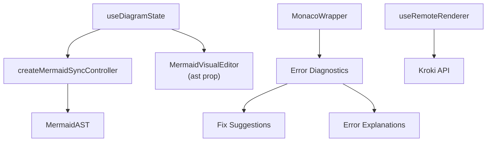

# Mermaid Diagrams

<cite>
**Referenced Files in This Document**
- [index.html](file://index.html)
- [MermaidVisualEditor.jsx](file://js/components/editors/mermaid/MermaidVisualEditor.jsx)
- [mermaid/utils.js](file://js/components/editors/mermaid/utils.js)
- [MermaidEditors.jsx](file://js/components/editors/mermaid/MermaidEditors.jsx)
- [MonacoWrapper.jsx](file://js/components/editors/MonacoWrapper.jsx)
- [explanations.js](file://js/error-diagnostics/explanations.js)
- [fixes.js](file://js/error-diagnostics/fixes.js)
- [config.js](file://js/config.js)
- [useDiagramState.js](file://js/hooks/useDiagramState.js)
- [useRemoteRenderer.js](file://js/hooks/useRemoteRenderer.js)
</cite>

## Table of Contents
1. [Introduction](#introduction)
2. [Project Structure](#project-structure)
3. [Core Components](#core-components)
4. [Architecture Overview](#architecture-overview)
5. [Detailed Component Analysis](#detailed-component-analysis)
6. [Dependency Analysis](#dependency-analysis)
7. [Performance Considerations](#performance-considerations)
8. [Troubleshooting Guide](#troubleshooting-guide)
9. [Conclusion](#conclusion)
10. [Appendices](#appendices)

## Introduction
This document explains the Mermaid diagram support in the universal diagram generator. It covers all diagram types supported by the Mermaid editor: flowcharts, sequence diagrams, class diagrams, state diagrams, entity relationship diagrams, Gantt charts, pie charts, timelines, user journeys, mind maps, git graphs, and quadrant charts. It also documents Mermaid syntax, node types, connection styles, styling options, formatting capabilities, and the sync controller that parses code into an AST, its change detection mechanism, and real-time preview updates. The visual editor's current state (a working pie editor, placeholders for other types, and the Universal Mode fallback), the template system, and integration with the Monaco Editor are included, along with practical examples, best practices, and troubleshooting common syntax errors.

## Project Structure
The Mermaid editor is implemented as a modular React-based system integrated with Monaco Editor and Kroki for rendering previews. The key parts are:
- A router component (`MermaidVisualEditor`) that selects a sub-editor from the detected model name
- Sub-editors for flowcharts, sequence diagrams and data/chart types in `MermaidEditors.jsx`, of which only the pie editor does real work
- A Universal Mode fallback panel for every other diagram type
- A synchronization controller that parses code to AST and renders AST back to code
- Monaco integration with language registration, error providers, and quick fixes
- Error diagnostics with explanations and automated fix suggestions
- Configuration for diagram types, templates, and snippets

**Diagram sources**
- [index.html](file://index.html)
- [MermaidVisualEditor.jsx](file://js/components/editors/mermaid/MermaidVisualEditor.jsx)
- [mermaid/utils.js](file://js/components/editors/mermaid/utils.js)
- [MonacoWrapper.jsx](file://js/components/editors/MonacoWrapper.jsx)

**Section sources**
- [index.html](file://index.html)
- [MermaidVisualEditor.jsx](file://js/components/editors/mermaid/MermaidVisualEditor.jsx)
- [mermaid/utils.js](file://js/components/editors/mermaid/utils.js)
- [MonacoWrapper.jsx](file://js/components/editors/MonacoWrapper.jsx)

## Core Components
- MermaidVisualEditor: Routes to a sub-editor by checking the detected model name. Shows a "Loading visual editor..." spinner until the AST library loads, and wraps the sub-editor in `EditorToolbar` ("Visual Mode (Beta)"). The preview is not part of this component. The preview pane in `App.jsx` fetches it from Kroki.
- Mermaid sync controller (`createMermaidSyncController`): Provides AST parsing, AST-to-code rendering and load status, and prevents sync loops through a change source flag.
- Universal Mode fallback: The panel inside `MermaidVisualEditor` for diagram types without a sub-editor. It says "Visual editing for this diagram type is generic. Structure editing is best done via code."
- MermaidFlowchartEditor: Shows a "coming soon" note and the "Code-Only Editing" message. No node or edge editing.
- MermaidSequenceEditor: A one-line placeholder that returns the "Code-Only Editing" message.
- Pie, Gantt, Timeline, Journey and Mindmap editors: `MermaidPieEditor` edits the title, labels and values, adds a slice and removes a slice. The Gantt, Timeline, Journey and Mindmap editors are one-line placeholders.
- MonacoWrapper: Integrates Monaco Editor with Mermaid language support, error providers, quick fixes, and hover explanations.
- Error Diagnostics: Parses errors, extracts locations, categorizes issues, and provides explanations and fix suggestions.
- Configuration: Defines diagram types, templates, and snippets for Mermaid and PlantUML.

**Section sources**
- [MermaidVisualEditor.jsx](file://js/components/editors/mermaid/MermaidVisualEditor.jsx)
- [mermaid/utils.js](file://js/components/editors/mermaid/utils.js)
- [MermaidEditors.jsx](file://js/components/editors/mermaid/MermaidEditors.jsx)
- [MonacoWrapper.jsx](file://js/components/editors/MonacoWrapper.jsx)
- [explanations.js](file://js/error-diagnostics/explanations.js)
- [fixes.js](file://js/error-diagnostics/fixes.js#L11-L403)
- [config.js](file://js/config.js#L58-L116)

## Architecture Overview
The Mermaid editor pipeline:
- Code input is processed by Monaco with Mermaid language support.
- For Mermaid diagrams, AST parsing occurs asynchronously via MermaidAST, and the result goes to `MermaidVisualEditor` as the `ast` prop.
- The router selects a sub-editor from the detected model name (`detectedModel`), not from the AST.
- Real-time preview is generated by the preview pane, which sends the code to the Kroki service 500 ms after the last change.
- The change source flag stops visual changes from triggering code parsing loops.

**Diagram sources**
- [mermaid/utils.js](file://js/components/editors/mermaid/utils.js)
- [MermaidVisualEditor.jsx](file://js/components/editors/mermaid/MermaidVisualEditor.jsx)
- [MonacoWrapper.jsx](file://js/components/editors/MonacoWrapper.jsx)
- [index.html](file://index.html)

**Section sources**
- [mermaid/utils.js](file://js/components/editors/mermaid/utils.js)
- [MermaidVisualEditor.jsx](file://js/components/editors/mermaid/MermaidVisualEditor.jsx)
- [MonacoWrapper.jsx](file://js/components/editors/MonacoWrapper.jsx)
- [index.html](file://index.html)

## Detailed Component Analysis

### MermaidVisualEditor
- Routes to sub-editors by checking `detectedModel` for Flowchart, Sequence, Pie, Gantt, Timeline, Journey and Mindmap, or falls back to the Universal Mode panel.
- Passes only `code` and `onChange` (wired to `onCodeChange`) to the sub-editors, not the AST.
- Shows a loading state while the AST library loads.
- Leaves the preview to the preview pane, whose `useRemoteRenderer` hook debounces Kroki requests by 500 ms.

**Diagram sources**
- [MermaidVisualEditor.jsx](file://js/components/editors/mermaid/MermaidVisualEditor.jsx)

**Section sources**
- [MermaidVisualEditor.jsx](file://js/components/editors/mermaid/MermaidVisualEditor.jsx)
- [useRemoteRenderer.js](file://js/hooks/useRemoteRenderer.js)

### Mermaid Sync Controller
- `createMermaidSyncController` in `mermaid/utils.js` prevents infinite loops by tracking change source and debouncing parse operations.
- Parses code to AST, and can render an AST back to code. `App.jsx` wires `renderToCode` to the `onChange` prop, but no current sub-editor calls it.
- Exposes the last AST through `getAst` and the load status through `isLoaded`.

**Diagram sources**
- [mermaid/utils.js](file://js/components/editors/mermaid/utils.js)

**Section sources**
- [mermaid/utils.js](file://js/components/editors/mermaid/utils.js)

### Universal Mode Fallback
- Appears inside `MermaidVisualEditor` for diagram types without a sub-editor (class, state, ER, git graph and others).
- Shows a "Universal Mode" heading and the message "Visual editing for this diagram type is generic. Structure editing is best done via code."
- Has no property panel and no structure view. The preview pane still renders the diagram.

**Section sources**
- [MermaidVisualEditor.jsx](file://js/components/editors/mermaid/MermaidVisualEditor.jsx)

### Flowchart and Sequence Editors
- `MermaidFlowchartEditor` shows the note "Interactive node editing coming soon. Use the code editor for full control." and the "Code-Only Editing" message.
- `MermaidSequenceEditor` is a one-line placeholder that returns the "Code-Only Editing" message.
- Neither component has node, edge, participant or message editing.

**Section sources**
- [MermaidEditors.jsx](file://js/components/editors/mermaid/MermaidEditors.jsx)

### Data-Chart Editors in MermaidEditors.jsx
- Pie Editor (`MermaidPieEditor`): Reads the title and slices with regular expressions. Edits the title, labels and values, adds a slice and removes a slice, then rebuilds the pie code.
- Gantt, Timeline and Journey editors: One-line placeholders that return the "Code-Only Editing" message.
- Mindmap Editor: A one-line placeholder, so the indented structure is written in code.

**Section sources**
- [MermaidEditors.jsx](file://js/components/editors/mermaid/MermaidEditors.jsx)

### Monaco Integration
- Registers Mermaid language with syntax highlighting and bracket pairs.
- Provides code actions (quick fixes) and hover explanations for errors.
- Exposes imperative methods for scrolling to line, setting markers, inserting text, and getting the editor model.

**Diagram sources**
- [MonacoWrapper.jsx](file://js/components/editors/MonacoWrapper.jsx)

**Section sources**
- [MonacoWrapper.jsx](file://js/components/editors/MonacoWrapper.jsx)

### Error Diagnostics
- Parses error text to extract line/column, categorizes error codes, and generates fix suggestions.
- Converts parsed errors to Monaco markers and provides hover explanations with examples and links.

**Section sources**
- [explanations.js](file://js/error-diagnostics/explanations.js)
- [fixes.js](file://js/error-diagnostics/fixes.js#L11-L403)

### Configuration and Templates
- Defines Mermaid diagram types, extensions, and example code.
- Provides Mermaid snippets and templates for quick start.

**Section sources**
- [config.js](file://js/config.js#L58-L116)
- [index.html](file://index.html)

## Dependency Analysis
- MermaidVisualEditor receives the AST that `useDiagramState` produces with the sync controller, and receives code from `App.jsx`, where MonacoWrapper edits the code.
- MonacoWrapper depends on the Monaco Editor library and registers Mermaid language and error providers.
- Error diagnostics modules depend on error patterns and explanations to provide actionable feedback.
- The system integrates with Kroki for rendering previews.

**Diagram sources**
- [MermaidVisualEditor.jsx](file://js/components/editors/mermaid/MermaidVisualEditor.jsx)
- [mermaid/utils.js](file://js/components/editors/mermaid/utils.js)
- [MonacoWrapper.jsx](file://js/components/editors/MonacoWrapper.jsx)
- [explanations.js](file://js/error-diagnostics/explanations.js)
- [fixes.js](file://js/error-diagnostics/fixes.js#L11-L403)

**Section sources**
- [MermaidVisualEditor.jsx](file://js/components/editors/mermaid/MermaidVisualEditor.jsx)
- [mermaid/utils.js](file://js/components/editors/mermaid/utils.js)
- [MonacoWrapper.jsx](file://js/components/editors/MonacoWrapper.jsx)
- [explanations.js](file://js/error-diagnostics/explanations.js)
- [fixes.js](file://js/error-diagnostics/fixes.js#L11-L403)

## Performance Considerations
- Debouncing: AST parsing waits 300 ms after the last change.
- Preview throttling: Live preview requests wait 500 ms after the last change to avoid excessive network calls.
- AST caching: The controller stores the last AST, available through `getAst`.
- Efficient DOM updates: React components update only when relevant state changes.

[No sources needed since this section provides general guidance]

## Troubleshooting Guide
Common Mermaid syntax errors and their resolutions:
- Missing diagram type declaration: Add a valid diagram header (e.g., flowchart TD, sequenceDiagram).
- Missing closing brackets/parentheses/braces: Ensure all node labels and shapes are properly closed.
- Invalid arrow syntax: Use supported arrow types (e.g., -->, -.->, ==>, etc.).
- Unexpected tokens: Verify keywords and syntax are correct.
- Unrecognized text: Confirm diagram type and keywords are spelled correctly.
- Unknown diagram type: Ensure the diagram type declaration is valid.

Automated assistance:
- Quick fixes appear as code actions in Monaco.
- Hover explanations provide human-readable descriptions and examples.
- Error markers highlight problematic lines and columns.

**Section sources**
- [explanations.js](file://js/error-diagnostics/explanations.js#L14-L87)
- [fixes.js](file://js/error-diagnostics/fixes.js#L12-L109)
- [MonacoWrapper.jsx](file://js/components/editors/MonacoWrapper.jsx)

## Conclusion
The Mermaid diagram support provides a real-time editing experience with Monaco, a live Kroki preview, an AST sync controller and intelligent error diagnostics. The visual editor offers a working pie editor, and placeholders or the Universal Mode fallback for the other diagram types. The integration with Monaco and Kroki ensures accurate rendering and helpful developer feedback. The modular architecture allows additional sub-editors to join the router in `MermaidVisualEditor`.

[No sources needed since this section summarizes without analyzing specific files]

## Appendices

### Mermaid Syntax and Formatting Reference
- Flowcharts: Nodes with various shapes, edges with optional text, subgraphs, and directions.
- Sequence Diagrams: Participants, messages, activation boxes, loop/alt fragments.
- Class Diagrams: Classes, interfaces, inheritance, composition, aggregation, associations.
- State Diagrams: States, transitions, composite states, forks/joins.
- ER Diagrams: Entities, relationships, cardinalities.
- Gantt Charts: Sections, tasks with dates and durations.
- Pie Charts: Slices with labels and values.
- Timelines: Sections and periods with events.
- User Journeys: Tasks with scores and actors.
- Mindmaps: Root node and indented child nodes.
- Git Graphs: Commits, branches, checkouts, merges.
- Quadrant Charts: Axes and quadrants with labeled points.

Practical examples and templates are available in the configuration and templates sections.

**Section sources**
- [config.js](file://js/config.js#L58-L116)
- [index.html](file://index.html)