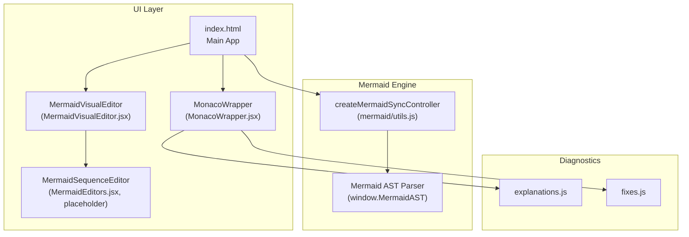
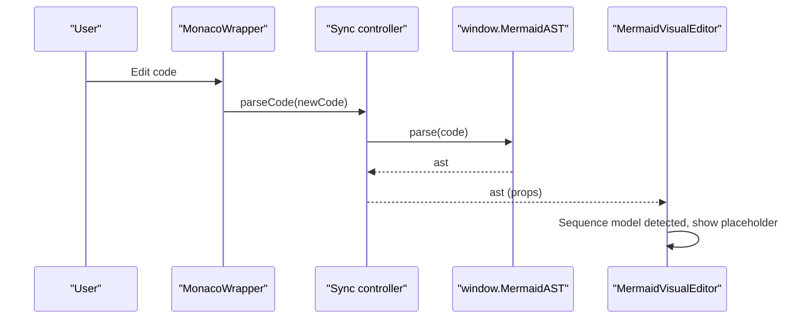
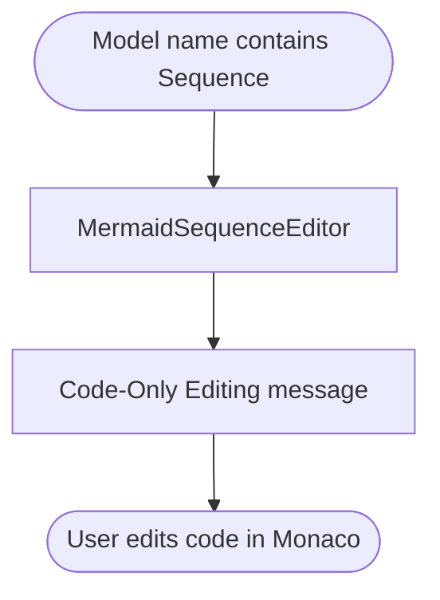
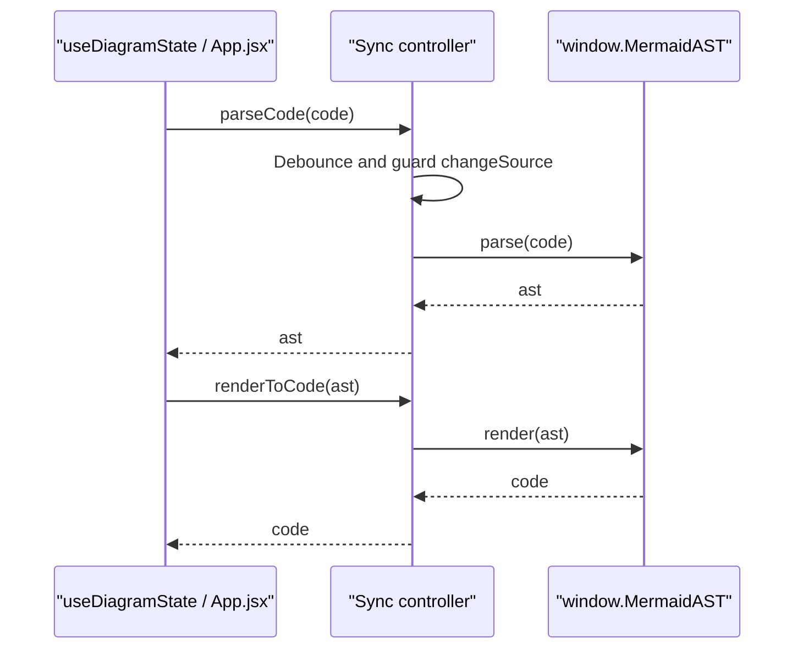
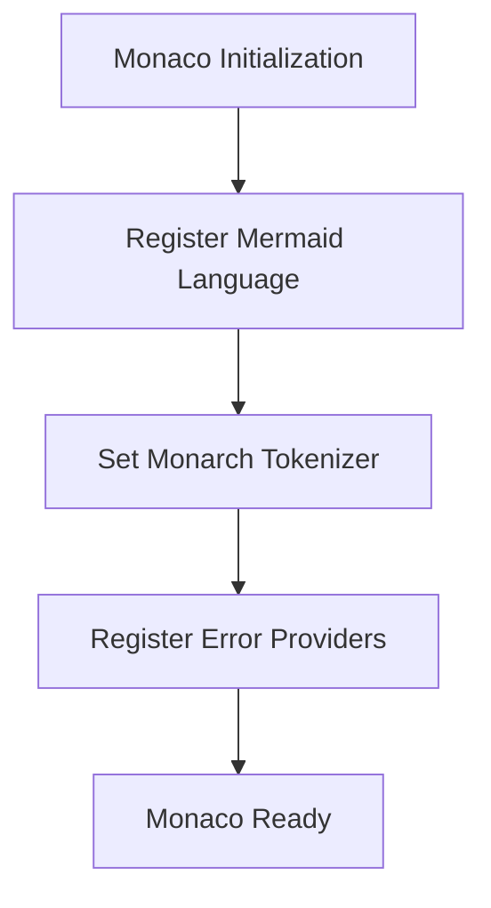
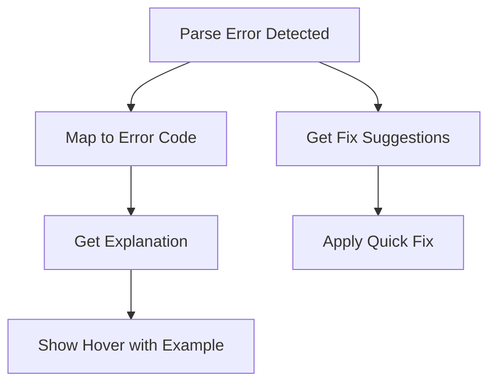
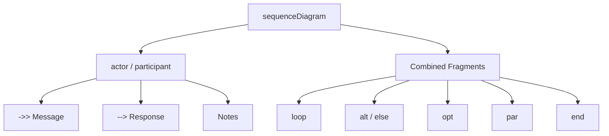
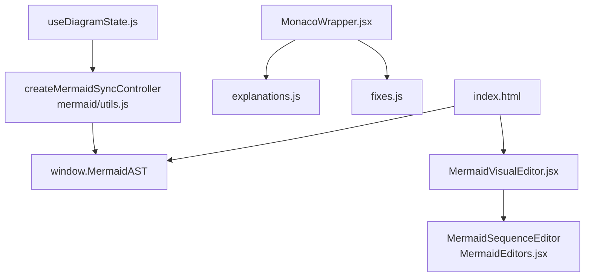

# Sequence Diagrams

<cite>
**Referenced Files in This Document**
- [MermaidEditors.jsx](file://js/components/editors/mermaid/MermaidEditors.jsx)
- [mermaid/utils.js](file://js/components/editors/mermaid/utils.js)
- [MermaidVisualEditor.jsx](file://js/components/editors/mermaid/MermaidVisualEditor.jsx)
- [MonacoWrapper.jsx](file://js/components/editors/MonacoWrapper.jsx)
- [explanations.js](file://js/error-diagnostics/explanations.js)
- [fixes.js](file://js/error-diagnostics/fixes.js)
- [index.html](file://index.html)
</cite>

## Table of Contents
1. [Introduction](#introduction)
2. [Project Structure](#project-structure)
3. [Core Components](#core-components)
4. [Architecture Overview](#architecture-overview)
5. [Detailed Component Analysis](#detailed-component-analysis)
6. [Dependency Analysis](#dependency-analysis)
7. [Performance Considerations](#performance-considerations)
8. [Troubleshooting Guide](#troubleshooting-guide)
9. [Conclusion](#conclusion)

## Introduction
This document explains how sequence diagrams are modeled and edited within the application. It focuses on how the Mermaid visual editor treats sequence diagrams today (a placeholder), the AST sync controller, how participants and messages are written in code, and practical guidance for building robust sequence diagrams. It also covers advanced topics such as participant reuse, custom styling, and combined fragments (loop, alt, opt, par, etc.) as supported by the underlying Mermaid language.

## Project Structure
The sequence diagram feature spans several modules:
- Editor routing and preview generation
- A sequence editor component that is a placeholder (code-only)
- AST synchronization controller
- Monaco editor integration with Mermaid language support
- Error diagnostics and quick fixes
- The Universal Mode fallback for diagram types without a visual editor

**Diagram sources**
- [index.html](file://index.html)
- [MermaidVisualEditor.jsx](file://js/components/editors/mermaid/MermaidVisualEditor.jsx)
- [MermaidEditors.jsx](file://js/components/editors/mermaid/MermaidEditors.jsx)
- [mermaid/utils.js](file://js/components/editors/mermaid/utils.js)
- [MonacoWrapper.jsx](file://js/components/editors/MonacoWrapper.jsx)
- [explanations.js](file://js/error-diagnostics/explanations.js#L12-L301)
- [fixes.js](file://js/error-diagnostics/fixes.js#L32-L693)

**Section sources**
- [index.html](file://index.html)
- [MermaidVisualEditor.jsx](file://js/components/editors/mermaid/MermaidVisualEditor.jsx)

## Core Components
- Sequence Editor: `MermaidSequenceEditor` is a one-line placeholder that returns the "Code-Only Editing" message. It lists no participants or messages and has no add buttons.
- AST Sync Controller: `createMermaidSyncController` prevents infinite loops during synchronization, debounces parsing by 300 ms, and can render code from an AST.
- Monaco Editor: Provides Mermaid language support, syntax highlighting, error markers, and quick fixes.
- Error Diagnostics: Offers explanations and automated fixes for common syntax errors.

Key responsibilities:
- Participants: Written in the Monaco code editor, with `participant` and `actor` keywords.
- Messages: Written in code as arrow lines between participants.
- Real-time updates: Code changes trigger AST parsing in `useDiagramState`, and the preview pane refreshes 500 ms after the last change. No sub-editor passes an AST back, so the code-rendering path stays idle.

**Section sources**
- [MermaidEditors.jsx](file://js/components/editors/mermaid/MermaidEditors.jsx)
- [mermaid/utils.js](file://js/components/editors/mermaid/utils.js)
- [MonacoWrapper.jsx](file://js/components/editors/MonacoWrapper.jsx)
- [explanations.js](file://js/error-diagnostics/explanations.js#L12-L301)
- [fixes.js](file://js/error-diagnostics/fixes.js#L32-L693)

## Architecture Overview
The sequence diagram workflow connects the UI, AST synchronization, and Mermaid engine:

**Diagram sources**
- [MermaidEditors.jsx](file://js/components/editors/mermaid/MermaidEditors.jsx)
- [mermaid/utils.js](file://js/components/editors/mermaid/utils.js)
- [MonacoWrapper.jsx](file://js/components/editors/MonacoWrapper.jsx)
- [index.html](file://index.html)

## Detailed Component Analysis

### Sequence Editor
`MermaidSequenceEditor` sits in `MermaidEditors.jsx`. `MermaidVisualEditor` renders the component when the detected model name contains "Sequence", inside the shared `EditorToolbar` titled "Sequence Diagram Editor" with the sub-title "Visual Mode (Beta)".

The component receives `code` and `onChange`, and returns `VisualEditingNotAvailable` with the type "Sequence Diagram". Participants and messages are therefore written directly in Monaco, for example by adding a `participant` line below the `sequenceDiagram` header.

**Diagram sources**
- [MermaidEditors.jsx](file://js/components/editors/mermaid/MermaidEditors.jsx)
- [MermaidVisualEditor.jsx](file://js/components/editors/mermaid/MermaidVisualEditor.jsx)

**Section sources**
- [MermaidEditors.jsx](file://js/components/editors/mermaid/MermaidEditors.jsx)

### AST Synchronization Controller
The controller (`createMermaidSyncController`) supports synchronization between code and AST:
- parseCode: Debounces parsing by 300 ms, prevents loops when triggered by visual changes, and parses code into AST. If the library has not loaded, parseCode returns a stand-in root node holding the code.
- renderToCode: Renders AST back to code, sets a change source flag to prevent loops, and resets the flag after 50 ms.
- getAst: Returns the last AST.
- isLoaded: Checks availability of the AST library.

**Diagram sources**
- [mermaid/utils.js](file://js/components/editors/mermaid/utils.js)

**Section sources**
- [mermaid/utils.js](file://js/components/editors/mermaid/utils.js)

### Monaco Editor Integration
Monaco registers Mermaid language support with:
- Keywords: diagram types, node shapes, and control structures (e.g., participant, actor, loop, alt, opt, par, end).
- Tokenizer: Recognizes arrows, labels, strings, and comments.
- Error providers: Code actions and hover explanations for quick fixes and guidance.

**Diagram sources**
- [MonacoWrapper.jsx](file://js/components/editors/MonacoWrapper.jsx)

**Section sources**
- [MonacoWrapper.jsx](file://js/components/editors/MonacoWrapper.jsx)

### Error Diagnostics
The system provides:
- Error explanations mapped by error codes with examples and links to documentation.
- Quick-fix suggestions generated from error patterns and token maps.
- Hover provider to display explanations inline.

**Diagram sources**
- [explanations.js](file://js/error-diagnostics/explanations.js#L237-L299)
- [fixes.js](file://js/error-diagnostics/fixes.js#L611-L656)

**Section sources**
- [explanations.js](file://js/error-diagnostics/explanations.js#L12-L301)
- [fixes.js](file://js/error-diagnostics/fixes.js#L32-L693)

### Conceptual Overview
Typical sequence diagram constructs supported by Mermaid include:
- Participants: actor, participant
- Messages: sync (->>), async (-->>), response (-->)
- Notes: Note over/from/to
- Combined fragments: loop, alt, else, opt, par, and end

These are reflected in the Mermaid language registration and the editor’s snippet collections.

[No sources needed since this diagram shows conceptual workflow, not actual code structure]

## Dependency Analysis
The sequence diagram feature depends on:
- Monaco editor for syntax highlighting and diagnostics
- Mermaid AST library for parsing and rendering
- React and JSX for the editor components
- `index.html`, which loads the Mermaid AST library from esm.sh

**Diagram sources**
- [MermaidVisualEditor.jsx](file://js/components/editors/mermaid/MermaidVisualEditor.jsx)
- [useDiagramState.js](file://js/hooks/useDiagramState.js)
- [MermaidEditors.jsx](file://js/components/editors/mermaid/MermaidEditors.jsx)
- [mermaid/utils.js](file://js/components/editors/mermaid/utils.js)
- [MonacoWrapper.jsx](file://js/components/editors/MonacoWrapper.jsx)
- [explanations.js](file://js/error-diagnostics/explanations.js#L1-L11)
- [fixes.js](file://js/error-diagnostics/fixes.js#L1-L6)
- [index.html](file://index.html)

**Section sources**
- [useDiagramState.js](file://js/hooks/useDiagramState.js)
- [index.html](file://index.html)

## Performance Considerations
- Debouncing: The AST parse operation is debounced by 300 ms to avoid excessive re-renders during rapid typing.
- Change-source gating: The controller prevents infinite loops by tracking whether the change originated from code or visual edits.
- Library loading: The Mermaid AST library loads from esm.sh, and the visual editor shows a "Loading visual editor..." spinner until the library is ready.
- Preview throttling: Preview generation waits 500 ms after the last change to minimize network requests.

[No sources needed since this section provides general guidance]

## Troubleshooting Guide
Common issues and resolutions:
- Missing diagram type: Ensure the first line declares a valid diagram type (e.g., sequenceDiagram).
- Unbalanced brackets/labels: Mermaid uses brackets/parentheses/braces for node shapes; ensure they are properly matched.
- Invalid arrow syntax: Use supported arrow types (e.g., ->>, -->, ---).
- Unexpected tokens: Check for typos or incomplete statements.
- Unknown diagram type: Confirm spelling and capitalization of diagram keywords.

Automated assistance:
- Quick fixes: Monaco provides code actions to insert missing declarations or correct syntax.
- Hover explanations: Hover over error markers to see human-readable explanations and examples.
- Error markers: Squiggly underlines highlight problematic areas with associated error codes.

**Section sources**
- [explanations.js](file://js/error-diagnostics/explanations.js#L12-L301)
- [fixes.js](file://js/error-diagnostics/fixes.js#L32-L693)
- [MonacoWrapper.jsx](file://js/components/editors/MonacoWrapper.jsx)

## Conclusion
The sequence diagram feature combines Monaco-powered Mermaid editing and diagnostics, an AST sync controller, and a live Kroki preview. The sequence visual editor is a placeholder today, so users model object interactions in code, using combined fragments and the error diagnostics for feedback.