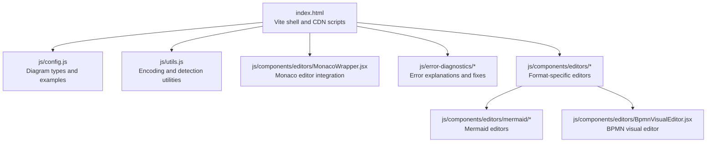
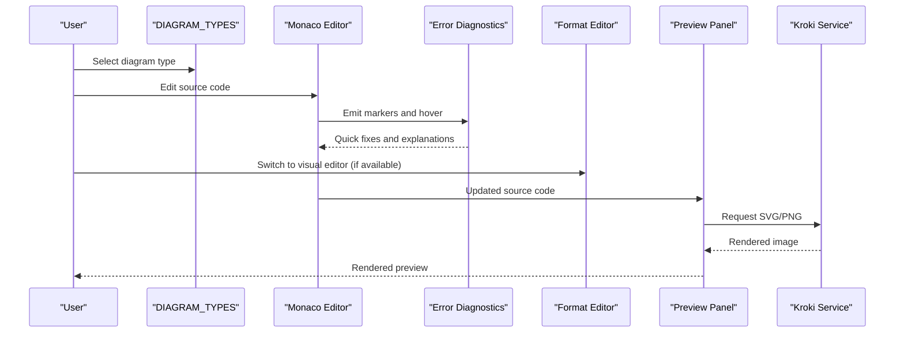
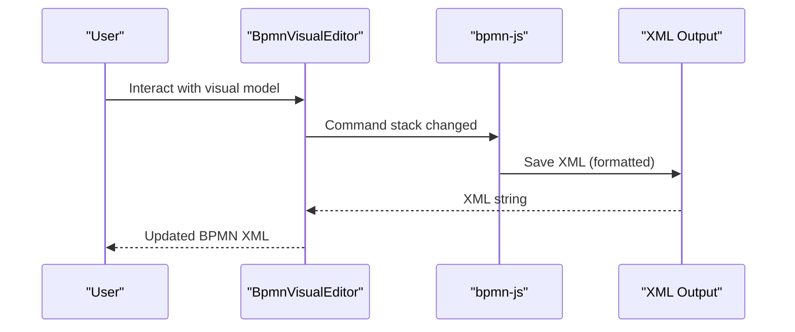
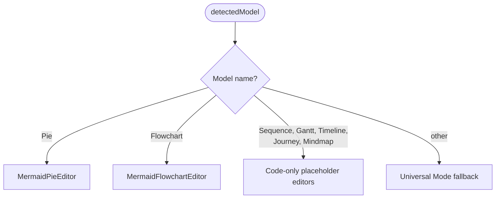
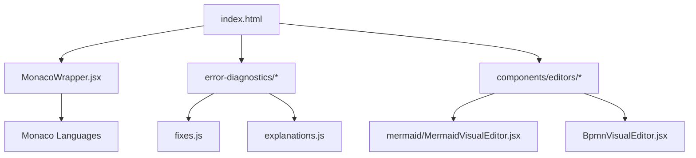
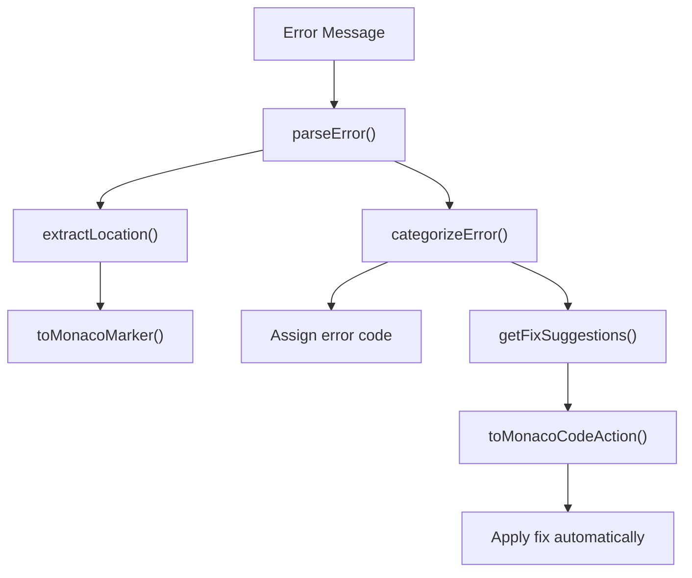

# Specialized Diagram Formats

<cite>
**Referenced Files in This Document**
- [index.html](file://index.html)
- [config.js](file://js/config.js)
- [utils.js](file://js/utils.js)
- [MonacoWrapper.jsx](file://js/components/editors/MonacoWrapper.jsx)
- [PlantUmlToolbar.jsx](file://js/components/PlantUmlToolbar.jsx)
- [TemplateGalleryModal.jsx](file://js/components/dialogs/TemplateGalleryModal.jsx)
- [ui.js](file://js/components/ui.js)
- [explanations.js](file://js/error-diagnostics/explanations.js)
- [fixes.js](file://js/error-diagnostics/fixes.js)
- [error-diagnostics/index.js](file://js/error-diagnostics/index.js)
- [MermaidVisualEditor.jsx](file://js/components/editors/mermaid/MermaidVisualEditor.jsx)
- [MermaidEditors.jsx](file://js/components/editors/mermaid/MermaidEditors.jsx)
- [BpmnVisualEditor.jsx](file://js/components/editors/BpmnVisualEditor.jsx)
</cite>

## Table of Contents
1. [Introduction](#introduction)
2. [Project Structure](#project-structure)
3. [Core Components](#core-components)
4. [Architecture Overview](#architecture-overview)
5. [Detailed Component Analysis](#detailed-component-analysis)
6. [Dependency Analysis](#dependency-analysis)
7. [Performance Considerations](#performance-considerations)
8. [Troubleshooting Guide](#troubleshooting-guide)
9. [Conclusion](#conclusion)

## Introduction
This document explains the specialized diagram formats supported by the Universal Diagram Generator, focusing on GraphViz DOT language, Excalidraw freehand drawings, Structurizr DSL, Vega/Vega-Lite visualizations, ERD tools, and other niche formats. It covers syntax characteristics, use cases, integration approaches, and practical guidance for extending support to new formats. The system integrates with the Kroki universal rendering service and provides editor features such as syntax highlighting, error diagnostics, quick fixes, and visual editors for select formats.

## Project Structure
The application is a single-page React application with modular JavaScript components. Key areas:
- Configuration defines diagram types, extensions, and defaults
- Monaco editor integration provides syntax highlighting and diagnostics
- Error diagnostics engine offers explanations and quick fixes
- Format-specific editors enable interactive editing for supported formats
- A Vite build bundles most dependencies, and a few libraries (Monaco loader, Mermaid AST, pako, dagre) load from CDNs

**Diagram sources**
- [index.html](file://index.html)
- [config.js](file://js/config.js#L6-L116)
- [MonacoWrapper.jsx](file://js/components/editors/MonacoWrapper.jsx)
- [error-diagnostics/index.js](file://js/error-diagnostics/index.js#L13-L44)
- [MermaidVisualEditor.jsx](file://js/components/editors/mermaid/MermaidVisualEditor.jsx)
- [BpmnVisualEditor.jsx](file://js/components/editors/BpmnVisualEditor.jsx)

**Section sources**
- [index.html](file://index.html)
- [config.js](file://js/config.js#L6-L116)

## Core Components
- Diagram type registry: Central configuration enumerating supported formats, extensions, Monaco language bindings, documentation links, and example content.
- Monaco editor integration: Registers custom languages for Mermaid, PlantUML and LikeC4, and error providers for Mermaid, PlantUML, XML (BPMN) and Structurizr, enabling syntax highlighting, diagnostics, and quick fixes.
- Error diagnostics: Parses error messages, extracts locations, categorizes errors, and provides actionable explanations and suggested fixes.
- Format-specific editors: Provide visual editing experiences for BPMN, Excalidraw, Vega, C4 and Mermaid. The Mermaid editor is in Beta: its pie editor edits slices, and other Mermaid types fall back to code editing.

**Section sources**
- [config.js](file://js/config.js#L6-L116)
- [MonacoWrapper.jsx](file://js/components/editors/MonacoWrapper.jsx)
- [error-diagnostics/index.js](file://js/error-diagnostics/index.js#L13-L44)
- [BpmnVisualEditor.jsx](file://js/components/editors/BpmnVisualEditor.jsx)

## Architecture Overview
The system orchestrates diagram rendering via the Kroki universal service. The preview panel renders the source code through the renderer adapter. Formats with visual editors also offer a visual mode beside the code view.

**Diagram sources**
- [index.html](file://index.html)
- [MonacoWrapper.jsx](file://js/components/editors/MonacoWrapper.jsx)
- [error-diagnostics/index.js](file://js/error-diagnostics/index.js#L13-L44)
- [MermaidVisualEditor.jsx](file://js/components/editors/mermaid/MermaidVisualEditor.jsx)

## Detailed Component Analysis

### GraphViz DOT Language
- Purpose: Graph visualization using nodes, edges, and attributes with DOT syntax.
- Syntax highlights: Brackets for attributes, directed/undirected graphs, and statements ending with semicolons.
- Use cases: Network diagrams, dependency graphs, flow structures, and hierarchical layouts.
- Integration approach:
  - Monaco language registration supports DOT-like constructs.
  - Error diagnostics provide explanations for missing semicolons, unmatched brackets, and invalid graph types.
  - Rendering via Kroki service produces SVG/PNG previews.
- Best practices:
  - Ensure balanced brackets and braces.
  - Use digraph for directed graphs and graph for undirected graphs.
  - Quote attribute values and close XML-like tags in BPMN contexts.

**Section sources**
- [config.js](file://js/config.js#L106-L107)
- [MonacoWrapper.jsx](file://js/components/editors/MonacoWrapper.jsx)
- [explanations.js](file://js/error-diagnostics/explanations.js#L133-L166)
- [fixes.js](file://js/error-diagnostics/fixes.js#L178-L238)

### Excalidraw Freehand Drawing
- Purpose: Freehand sketching and vector illustrations stored as JSON.
- Syntax highlights: JSON structure with elements array containing shapes, text, and metadata.
- Use cases: Rapid ideation, whiteboard-style diagrams, informal architecture sketches.
- Integration approach:
  - Monaco language binding treats it as JSON.
  - Example content demonstrates minimal element structure.
  - A visual editor (`ExcalidrawVisualEditor.jsx`) embeds the Excalidraw canvas.
- Best practices:
  - Keep element arrays organized.
  - Use consistent coordinate systems.
  - Export to PNG/SVG via Excalidraw tools for sharing.

**Section sources**
- [config.js](file://js/config.js#L82-L87)
- [MonacoWrapper.jsx](file://js/components/editors/MonacoWrapper.jsx)

### Structurizr DSL
- Purpose: Software architecture modeling with Context, Containers, Components, and Dynamic views.
- Syntax highlights: DSL keywords, relationships, and structured blocks.
- Use cases: Enterprise architecture diagrams, system landscapes, and deployment views.
- Integration approach:
  - Monaco language binding treats it as JSON.
  - Example content demonstrates minimal structure.
  - Renders via Kroki; no dedicated visual editor.
- Best practices:
  - Define people, software systems, and containers clearly.
  - Use relationships to express interactions.
  - Keep views focused and avoid information overload.

**Section sources**
- [config.js](file://js/config.js#L110-L111)
- [MonacoWrapper.jsx](file://js/components/editors/MonacoWrapper.jsx)

### Vega/Vega-Lite Visualizations
- Purpose: Declarative grammar for statistical graphics (Vega) and simplified schema (Vega-Lite).
- Syntax highlights: JSON-based specifications with data, marks, encodings, scales, and layouts.
- Use cases: Charts, histograms, scatter plots, interactive dashboards.
- Integration approach:
  - Monaco language binding treats as JSON.
  - Example content demonstrates minimal chart structure.
  - A visual editor (`VegaVisualEditor.jsx`) uses Graphic Walker for charting.
- Best practices:
  - Separate data from visualization logic.
  - Use scales and axes appropriately.
  - Validate encodings and ensure consistent data types.

**Section sources**
- [config.js](file://js/config.js#L112-L113)
- [MonacoWrapper.jsx](file://js/components/editors/MonacoWrapper.jsx)

### ERD Tools
- Purpose: Entity-relationship diagrams for database design.
- Syntax highlights: Entities with attributes, primary keys, foreign keys, and relationships.
- Use cases: Database schema design, reverse engineering, documentation.
- Integration approach:
  - Supported via PlantUML ER diagrams in the PlantUML ecosystem.
  - Monaco language binding for PlantUML enables syntax highlighting.
  - Example content demonstrates entity and relationship syntax.
- Best practices:
  - Clearly mark primary and foreign keys.
  - Use consistent naming conventions.
  - Normalize to reduce redundancy.

**Section sources**
- [config.js](file://js/config.js#L106-L107)
- [MonacoWrapper.jsx](file://js/components/editors/MonacoWrapper.jsx)

### Archify
- Purpose: architecture, workflow, sequence, data flow, lifecycle, ERD, class, tree, timeline and waterfall diagrams, written as JSON for the [Archify](https://github.com/tt-a1i/archify) renderer.
- Syntax highlights: one JSON document per diagram. `diagram_type` names the diagram kind, and `schema_version` names the version of that kind's schema.
- Integration approach:
  - The Archify renderer needs Node, so the browser cannot run the renderer. The editor's own server runs it: `server/vite-plugin-archify.js` adds `POST /api/archify/render` to `npm run dev` and `npm run preview`.
  - `server/archify-render.js` finds Archify in `ARCHIFY_HOME`, or else in `~/.claude/skills/archify` or `~/.agents/skills/archify`, writes the code to a temporary folder and runs `archify render`.
  - Archify returns a standalone HTML page, not an SVG. `RendererAdapter.render` returns the page as `html`, and `PreviewPanel` shows the page in a sandboxed frame (`allow-scripts allow-downloads`), so the page's script has no access to the editor's stored data.
  - The header's SVG and PNG buttons need an SVG, so they stay disabled for Archify. The export menu inside the preview downloads the diagram.
  - `RendererAdapter.detectType` opens a `.json` file as Archify when `diagram_type` is one of Archify's kinds.
- Limits:
  - A static build served without the editor's server has no renderer. The preview then explains how to start the editor with `npm run dev`.
  - The address accepts `application/json` only, so another website cannot start a render from the user's browser.

**Section sources**
- [archify.js](file://js/services/archify.js)
- [archify-render.js](file://server/archify-render.js)
- [vite-plugin-archify.js](file://server/vite-plugin-archify.js)
- [RendererAdapter.js](file://js/services/RendererAdapter.js)
- [PreviewPanel.jsx](file://js/components/editors/PreviewPanel.jsx)

### BPMN (BPMN 2.0)
- Purpose: Business Process Model and Notation for workflow modeling.
- Syntax highlights: XML-based with namespaces, processes, tasks, and flows.
- Use cases: Business process documentation, compliance, automation.
- Integration approach:
  - Visual editor built with the bpmn-js modeler (npm package) for drag-and-drop editing, with custom lane split, transpose, context pad and renderer extensions.
  - Real-time synchronization between visual model and XML (the editor saves formatted XML on every command-stack change).
  - Error handling for XML import issues: the editor reports the message through `onError` and falls back to an empty diagram.
- Best practices:
  - Use swimlanes for roles and responsibilities.
  - Keep processes executable and deterministic.
  - Validate against BPMN 2.0 standards.

**Diagram sources**
- [BpmnVisualEditor.jsx](file://js/components/editors/BpmnVisualEditor.jsx)

**Section sources**
- [config.js](file://js/config.js#L7-L57)
- [BpmnVisualEditor.jsx](file://js/components/editors/BpmnVisualEditor.jsx)

### Mermaid (Mermaid AST-based Editors)
- Purpose: Diagram types including flowcharts, sequence diagrams, class/state/ER charts, timelines, journeys, and more.
- Integration approach:
  - Monaco language registration for Mermaid keywords and syntax.
  - AST parsing in `useDiagramState`, and routing to sub-editors by the detected model name.
  - Preview generation through the preview panel, separate from the visual editor.
- Sub-editors (in `MermaidEditors.jsx`):
  - Pie editor: Edits slice labels and values and adds slices; the only working visual editor.
  - Flowchart editor: Shows an "interactive node editing coming soon" note.
  - Sequence, Gantt, timeline, journey and mindmap editors: Show a "Code-Only Editing" message.
  - Universal Mode fallback: Any other diagram type shows a panel saying structure editing is best done in code.
- Best practices:
  - Start with diagram type declarations.
  - Keep node/edge labels concise.
  - Use subgraphs and sections for complex diagrams.

**Diagram sources**
- [MermaidVisualEditor.jsx](file://js/components/editors/mermaid/MermaidVisualEditor.jsx)
- [MermaidEditors.jsx](file://js/components/editors/mermaid/MermaidEditors.jsx)

**Section sources**
- [config.js](file://js/config.js#L58-L69)
- [MonacoWrapper.jsx](file://js/components/editors/MonacoWrapper.jsx)
- [MermaidVisualEditor.jsx](file://js/components/editors/mermaid/MermaidVisualEditor.jsx)
- [MermaidEditors.jsx](file://js/components/editors/mermaid/MermaidEditors.jsx)

### PlantUML (Templates and Snippets)
- Purpose: UML and related diagrams with templates and snippet libraries.
- Integration approach:
  - Monaco language registration for PlantUML keywords and syntax.
  - Template gallery and toolbar for quick insertion.
  - Interactive SVG preview with element navigation and context actions.
- Best practices:
  - Use templates as starting points.
  - Leverage snippets for common patterns.
  - Keep diagrams readable with consistent formatting.

**Section sources**
- [config.js](file://js/config.js#L118-L192)
- [MonacoWrapper.jsx](file://js/components/editors/MonacoWrapper.jsx)
- [PlantUmlToolbar.jsx](file://js/components/PlantUmlToolbar.jsx)
- [TemplateGalleryModal.jsx](file://js/components/dialogs/TemplateGalleryModal.jsx)

## Dependency Analysis
The system relies on npm packages bundled by Vite, plus a few CDN-hosted libraries. Key dependencies:
- Monaco Editor (AMD loader from a CDN) for syntax highlighting and diagnostics
- bpmn-js (npm package) for BPMN visual editing
- Mermaid AST (ESM module from a CDN) for Mermaid parsing and rendering
- Kroki service for universal diagram rendering

**Diagram sources**
- [index.html](file://index.html)
- [MonacoWrapper.jsx](file://js/components/editors/MonacoWrapper.jsx)
- [error-diagnostics/index.js](file://js/error-diagnostics/index.js#L13-L44)
- [MermaidVisualEditor.jsx](file://js/components/editors/mermaid/MermaidVisualEditor.jsx)
- [BpmnVisualEditor.jsx](file://js/components/editors/BpmnVisualEditor.jsx)

**Section sources**
- [index.html](file://index.html)
- [MonacoWrapper.jsx](file://js/components/editors/MonacoWrapper.jsx)
- [error-diagnostics/index.js](file://js/error-diagnostics/index.js#L13-L44)

## Performance Considerations
- Debouncing: Mermaid AST parsing is debounced to avoid excessive re-renders during editing.
- Library loading: Vite bundles the npm packages, and the CDN scripts in `index.html` load separately from the app code.
- Preview caching: Generated preview URLs are revoked on unmount to prevent memory leaks.
- Compression: Source code is compressed before sending to the Kroki service to reduce payload size.

**Section sources**
- [utils.js](file://js/utils.js#L166-L177)
- [MermaidVisualEditor.jsx](file://js/components/editors/mermaid/MermaidVisualEditor.jsx)

## Troubleshooting Guide
- Error parsing: Extracts line/column information and assigns error codes for targeted fixes.
- Quick fixes: Provides automated suggestions for common issues (missing brackets, arrows, start/end tags).
- Hover explanations: Displays human-readable explanations with examples and documentation links.
- Common scenarios:
  - Missing @startuml/@enduml in PlantUML
  - Unmatched brackets/parentheses in Mermaid/GraphViz
  - XML parsing errors in BPMN
  - Missing diagram type declaration in Mermaid

**Diagram sources**
- [error-diagnostics/index.js](file://js/error-diagnostics/index.js#L13-L44)
- [error-diagnostics/index.js](file://js/error-diagnostics/index.js#L52-L145)
- [error-diagnostics/index.js](file://js/error-diagnostics/index.js#L153-L254)
- [error-diagnostics/index.js](file://js/error-diagnostics/index.js#L261-L298)
- [fixes.js](file://js/error-diagnostics/fixes.js#L332-L366)
- [explanations.js](file://js/error-diagnostics/explanations.js#L237-L271)

**Section sources**
- [error-diagnostics/index.js](file://js/error-diagnostics/index.js#L13-L44)
- [fixes.js](file://js/error-diagnostics/fixes.js#L332-L366)
- [explanations.js](file://js/error-diagnostics/explanations.js#L237-L271)

## Conclusion
The Universal Diagram Generator provides a robust foundation for multiple diagram formats through a declarative configuration system, Monaco editor integration, and error diagnostics. Specialized editors enhance productivity for BPMN and Mermaid, while other formats benefit from Kroki rendering and syntax-aware editing. Extending support involves registering new diagram types, adding Monaco language configurations, and integrating error diagnostics and optional visual editors.