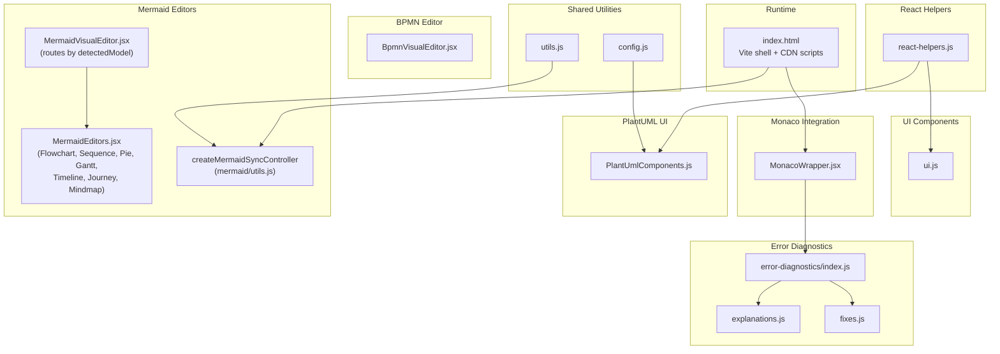
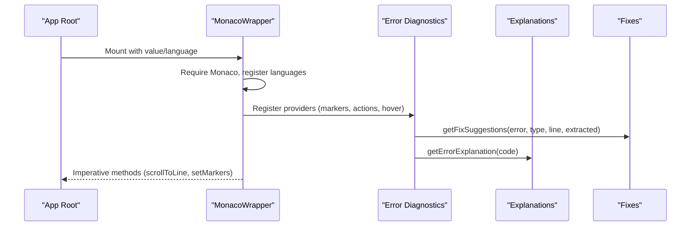
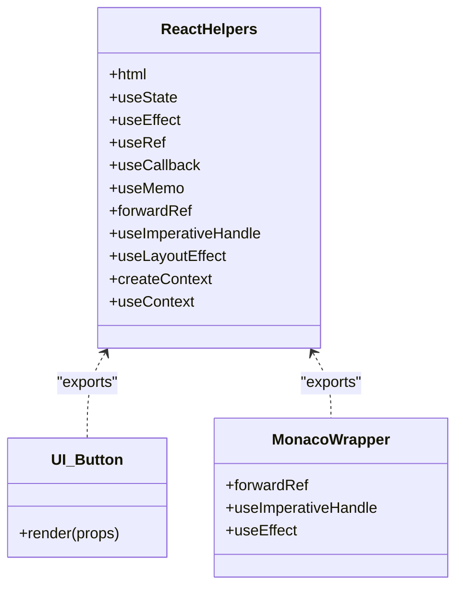
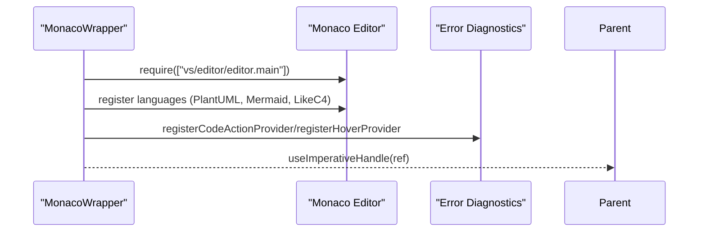
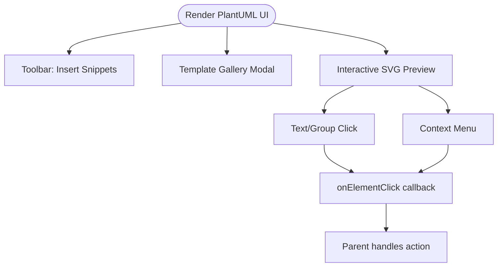
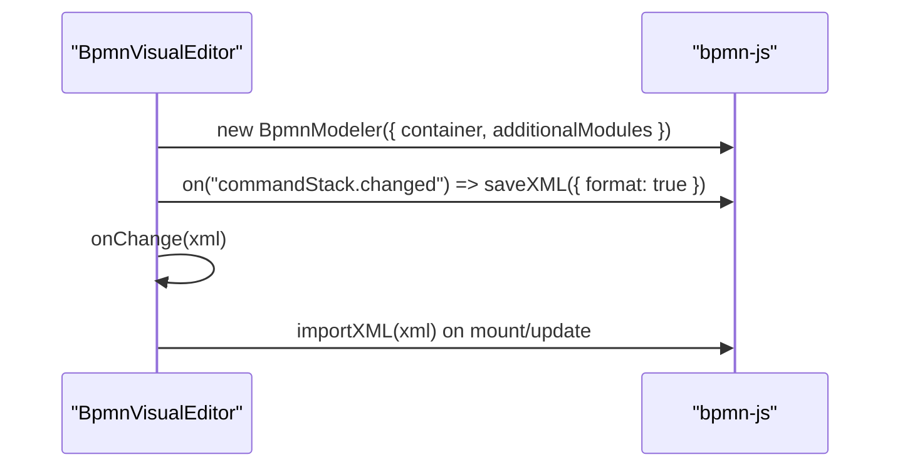
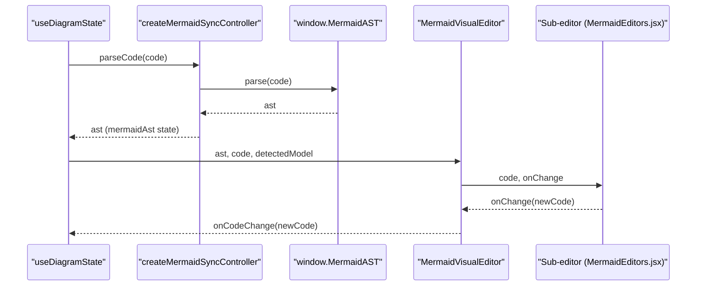
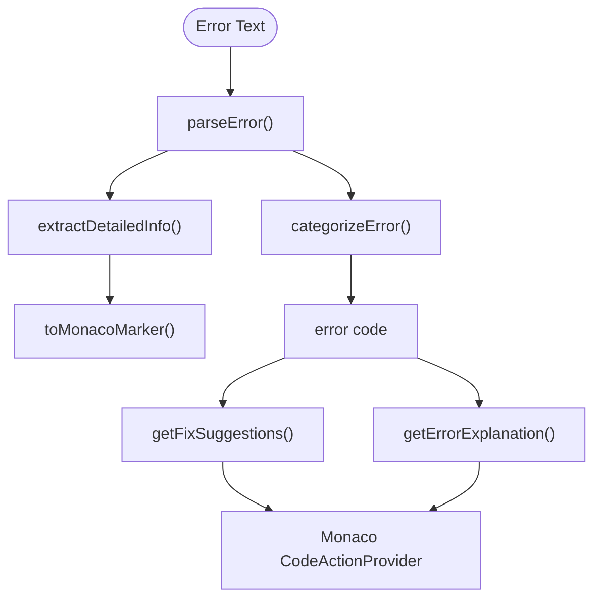
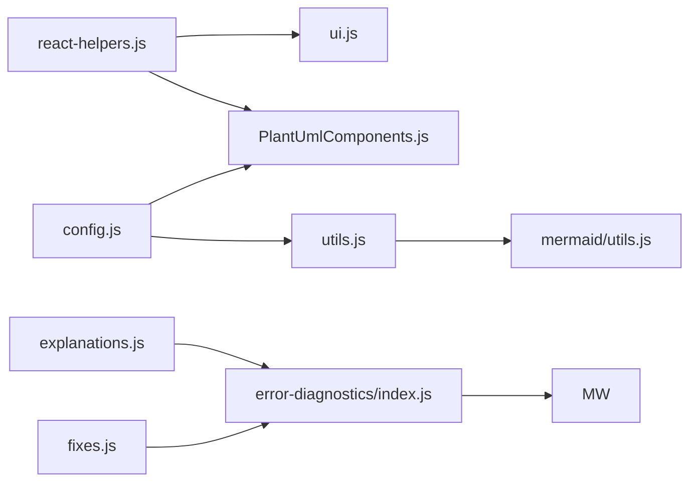

# Component Architecture

<cite>
**Referenced Files in This Document**
- [index.html](file://index.html)
- [react-helpers.js](file://js/react-helpers.js)
- [utils.js](file://js/utils.js)
- [config.js](file://js/config.js)
- [ui.js](file://js/components/ui.js)
- [MonacoWrapper.jsx](file://js/components/editors/MonacoWrapper.jsx)
- [PlantUmlComponents.js](file://js/components/PlantUmlComponents.js)
- [BpmnVisualEditor.jsx](file://js/components/editors/BpmnVisualEditor.jsx)
- [MermaidVisualEditor.jsx](file://js/components/editors/mermaid/MermaidVisualEditor.jsx)
- [MermaidEditors.jsx](file://js/components/editors/mermaid/MermaidEditors.jsx)
- [mermaid/utils.js](file://js/components/editors/mermaid/utils.js)
- [explanations.js](file://js/error-diagnostics/explanations.js)
- [fixes.js](file://js/error-diagnostics/fixes.js)
- [index.js](file://js/error-diagnostics/index.js)
</cite>

## Table of Contents
1. [Introduction](#introduction)
2. [Project Structure](#project-structure)
3. [Core Components](#core-components)
4. [Architecture Overview](#architecture-overview)
5. [Detailed Component Analysis](#detailed-component-analysis)
6. [Dependency Analysis](#dependency-analysis)
7. [Performance Considerations](#performance-considerations)
8. [Troubleshooting Guide](#troubleshooting-guide)
9. [Conclusion](#conclusion)
10. [Appendices](#appendices)

## Introduction
This document describes the React component system and integration patterns used to build a multi-diagram editor supporting Mermaid, PlantUML, BPMN, and other diagram types. It covers component composition patterns (higher-order components, custom hooks, and state management), React helpers for DOM manipulation and lifecycle management, component communication (props, context, and event propagation), integrations with external libraries (Monaco Editor, bpmn-js, Mermaid AST), lifecycle management and memory optimization, reusability patterns, and performance and debugging strategies.

## Project Structure
The application is a single-page app that embeds React components and integrates external diagramming libraries. The structure emphasizes:
- Shared React helpers and utilities
- Reusable UI components
- **Custom Hooks** for state management and logic encapsulation
- Editor-specific components for each diagram type
- Error diagnostics and fix suggestion systems
- Configuration-driven diagram type metadata

**Diagram sources**
- [index.html](file://index.html)
- [react-helpers.js](file://js/react-helpers.js#L1-L39)
- [utils.js](file://js/utils.js#L1-L177)
- [config.js](file://js/config.js#L1-L120)
- [ui.js](file://js/components/ui.js)
- [MonacoWrapper.jsx](file://js/components/editors/MonacoWrapper.jsx)
- [PlantUmlComponents.js](file://js/components/PlantUmlComponents.js)
- [BpmnVisualEditor.jsx](file://js/components/editors/BpmnVisualEditor.jsx)
- [MermaidVisualEditor.jsx](file://js/components/editors/mermaid/MermaidVisualEditor.jsx)
- [MermaidEditors.jsx](file://js/components/editors/mermaid/MermaidEditors.jsx)
- [mermaid/utils.js](file://js/components/editors/mermaid/utils.js)
- [index.js](file://js/error-diagnostics/index.js#L1-L120)

**Section sources**
- [index.html](file://index.html)
- [react-helpers.js](file://js/react-helpers.js#L1-L39)

## Core Components
- React helpers: `react-helpers.js` re-exports the React hooks and an `html` tagged template (built with htm). Only `ui.js` and `PlantUmlComponents.js` still use `html`. The editors under `js/components/editors/` are written in JSX and import React directly.
- Shared UI components: Reusable Button, StatusBadge, Loader, EmptyState, SectionHeader, EditableText.
- Monaco wrapper: A forwardRef-enabled editor that registers diagram-specific languages, error providers, and exposes imperative methods for scrolling, inserting text, and setting markers.
- PlantUML UI: Toolbar, template gallery, context menu, and interactive SVG preview with click and context actions.
- BPMN visual editor: Creates a bpmn-js modeler from the npm package, imports and exports XML, and synchronizes changes back to the code editor.
- Mermaid editors: `MermaidVisualEditor` routes by the detected model name to a sub-editor in `MermaidEditors.jsx`. Unmatched types show a "Universal Mode" message. A sync controller (`createMermaidSyncController` in `mermaid/utils.js`) parses code into an AST for `useDiagramState`.

**Section sources**
- [react-helpers.js](file://js/react-helpers.js#L1-L39)
- [ui.js](file://js/components/ui.js)
- [MonacoWrapper.jsx](file://js/components/editors/MonacoWrapper.jsx)
- [PlantUmlComponents.js](file://js/components/PlantUmlComponents.js)
- [BpmnVisualEditor.jsx](file://js/components/editors/BpmnVisualEditor.jsx)
- [MermaidVisualEditor.jsx](file://js/components/editors/mermaid/MermaidVisualEditor.jsx)
- [MermaidEditors.jsx](file://js/components/editors/mermaid/MermaidEditors.jsx)
- [mermaid/utils.js](file://js/components/editors/mermaid/utils.js)

### Custom Hooks (State Management)
To avoid the "God Component" anti-pattern in `App.jsx`, logic is extracted into domain-specific hooks:
- `useDiagramState`: Manages core state (text, diagram type, view mode), file I/O, and Mermaid AST sync.
- `useRemoteRenderer`: Encapsulates Kroki interactions, loading states, stats, and error markers.
- `useAutoLayout`: Handles BPMN auto-layout logic, missing DI detection, and dialogs. The layout itself comes from `applyBpmnAutoLayout()` in `js/utils.js`, which calls the BPMN pipeline in `js/services/diagram-tools/bpmn-pipeline.js`; that pipeline draws lanes as bands and wraps pools around their processes.
- `useCopilot`: Manages Syntext Smith's panel visibility, and applies a proposal written in another notation by switching the editor's diagram type. Proposals in the same notation are reviewed one change at a time in `DiffReviewPane`, inside the code view.

**Source Files**
- [useDiagramState.js](file://js/hooks/useDiagramState.js)
- [useRemoteRenderer.js](file://js/hooks/useRemoteRenderer.js)
- [useAutoLayout.js](file://js/hooks/useAutoLayout.js)
- [useCopilot.js](file://js/hooks/useCopilot.js)

## Architecture Overview
The system composes React components with external libraries:
- Monaco Editor is initialized asynchronously and registers diagram-specific languages and error providers.
- bpmn-js is imported from npm and mounted into a container for visual editing.
- Mermaid AST is loaded by `index.html` as an ES module (exposed as `window.MermaidAST`) and used to parse Mermaid code into an AST.
- Error diagnostics module parses raw errors, extracts structured positions, and generates quick fixes and hover explanations.

**Diagram sources**
- [MonacoWrapper.jsx](file://js/components/editors/MonacoWrapper.jsx)
- [index.js](file://js/error-diagnostics/index.js#L1-L120)
- [explanations.js](file://js/error-diagnostics/explanations.js#L1-L120)
- [fixes.js](file://js/error-diagnostics/fixes.js#L1-L120)

## Detailed Component Analysis

### React Helpers and Composition Patterns
- Composition via JSX in the editor components, and via htm `html` templates (bound to React.createElement) in `ui.js` and `PlantUmlComponents.js`.
- Hooks used: useState, useEffect, useRef, useCallback, useMemo, forwardRef, useImperativeHandle, useLayoutEffect, createContext, useContext.
- Higher-order composition: Components accept props and render dynamic content; imperative methods are exposed via forwardRef/useImperativeHandle for parent-child orchestration.

**Diagram sources**
- [react-helpers.js](file://js/react-helpers.js#L1-L39)
- [ui.js](file://js/components/ui.js)
- [MonacoWrapper.jsx](file://js/components/editors/MonacoWrapper.jsx)

**Section sources**
- [react-helpers.js](file://js/react-helpers.js#L1-L39)
- [ui.js](file://js/components/ui.js)

### Monaco Editor Integration
Key behaviors:
- AMD loader configuration for Monaco (the loader script comes from `index.html`).
- Registers PlantUML, Mermaid and LikeC4 languages.
- Registers code action provider and hover provider for quick fixes and explanations.
- Exposes imperative methods: scrollToLine, setValue, insertAtCursor, insertAtLocation, findAndSelect, setMarkers, clearMarkers, getModel, getMonaco.

**Diagram sources**
- [MonacoWrapper.jsx](file://js/components/editors/MonacoWrapper.jsx)
- [index.js](file://js/error-diagnostics/index.js)

**Section sources**
- [MonacoWrapper.jsx](file://js/components/editors/MonacoWrapper.jsx)
- [index.js](file://js/error-diagnostics/index.js)

### PlantUML UI Components
- Toolbar: Renders diagram-specific snippets and toggles expand/collapse.
- Template gallery: Modal with template cards to insert prebuilt diagrams.
- Context menu: Handles clicks and context menus on interactive SVG elements.
- Interactive SVG preview: Injects SVG content, attaches event listeners to text and groups, supports click and context actions.

**Diagram sources**
- [PlantUmlComponents.js](file://js/components/PlantUmlComponents.js)

**Section sources**
- [PlantUmlComponents.js](file://js/components/PlantUmlComponents.js)

### BPMN Visual Editor
- Imports `bpmn-js/lib/Modeler` and its CSS from npm, together with `bpmn-js-task-resize` and custom modules (context pad, renderer, lane split, lane transpose).
- Creates a modeler instance, listens to command stack changes, and exports XML to synchronize with the code editor.
- Imports initial XML and handles errors during import, falling back to an empty BPMN template.

**Diagram sources**
- [BpmnVisualEditor.jsx](file://js/components/editors/BpmnVisualEditor.jsx)

**Section sources**
- [BpmnVisualEditor.jsx](file://js/components/editors/BpmnVisualEditor.jsx)

### Mermaid Editors and AST Synchronization
- `MermaidVisualEditor` shows a "Loading visual editor..." spinner until the AST library has loaded. It then routes by the `detectedModel` string (Flowchart, Sequence, Pie, Gantt, Timeline, Journey, Mindmap). Any other type shows the "Universal Mode" panel, which says structure editing is best done in code.
- The sub-editors in `MermaidEditors.jsx` receive only `code` and `onChange`, not the AST. Only `MermaidPieEditor` edits anything today. The other six show a code-only message.
- The Kroki preview is not part of the Mermaid visual editor. `useRemoteRenderer` fetches it for the code view with a 500 ms debounce.
- `createMermaidSyncController` keeps the AST for `useDiagramState`, skips parsing while a visual change is in progress, and can render an AST back to code.

**Diagram sources**
- [MermaidVisualEditor.jsx](file://js/components/editors/mermaid/MermaidVisualEditor.jsx)
- [mermaid/utils.js](file://js/components/editors/mermaid/utils.js)

**Section sources**
- [MermaidVisualEditor.jsx](file://js/components/editors/mermaid/MermaidVisualEditor.jsx)
- [MermaidEditors.jsx](file://js/components/editors/mermaid/MermaidEditors.jsx)
- [mermaid/utils.js](file://js/components/editors/mermaid/utils.js)

### Error Diagnostics and Quick Fixes
- Parses raw error text, extracts line/column/expected/found/near, and categorizes errors.
- Generates Monaco markers and code actions for quick fixes.
- Provides hover explanations with examples and documentation links.

**Diagram sources**
- [index.js](file://js/error-diagnostics/index.js#L27-L153)
- [fixes.js](file://js/error-diagnostics/fixes.js#L611-L656)
- [explanations.js](file://js/error-diagnostics/explanations.js#L237-L271)

**Section sources**
- [index.js](file://js/error-diagnostics/index.js#L1-L120)
- [fixes.js](file://js/error-diagnostics/fixes.js#L1-L120)
- [explanations.js](file://js/error-diagnostics/explanations.js#L1-L120)

## Dependency Analysis
- External libraries:
  - Monaco Editor (AMD loader, languages, providers)
  - bpmn-js (npm package, with its CSS)
  - Mermaid AST (ES module loaded from `index.html`)
  - Pako (compression)
  - Font Awesome (icons)
  - Tailwind (utility classes)
- Internal dependencies:
  - react-helpers.js provides shared React APIs and JSX-like syntax.
  - utils.js provides shared utilities (detectSpecificModel, loadScript, loadCSS, debounce, applyBpmnAutoLayout).
  - config.js centralizes diagram type metadata and snippets/templates.

**Diagram sources**
- [react-helpers.js](file://js/react-helpers.js#L1-L39)
- [utils.js](file://js/utils.js#L1-L177)
- [config.js](file://js/config.js#L1-L120)
- [MonacoWrapper.jsx](file://js/components/editors/MonacoWrapper.jsx)
- [PlantUmlComponents.js](file://js/components/PlantUmlComponents.js)
- [BpmnVisualEditor.jsx](file://js/components/editors/BpmnVisualEditor.jsx)
- [MermaidVisualEditor.jsx](file://js/components/editors/mermaid/MermaidVisualEditor.jsx)
- [index.js](file://js/error-diagnostics/index.js#L1-L120)
- [explanations.js](file://js/error-diagnostics/explanations.js#L1-L120)
- [fixes.js](file://js/error-diagnostics/fixes.js#L1-L120)

**Section sources**
- [react-helpers.js](file://js/react-helpers.js#L1-L39)
- [utils.js](file://js/utils.js#L1-L177)
- [config.js](file://js/config.js#L1-L120)

## Performance Considerations
- Debouncing: `createMermaidSyncController` debounces AST parsing by 300 ms to avoid excessive re-parsing.
- Memory optimization:
  - Monaco editor disposes on unmount.
  - The bpmn-js modeler is destroyed on unmount.
  - `useRemoteRenderer` debounces preview fetches by 500 ms.
- Lazy loading:
  - External scripts and CSS are loaded conditionally and deduplicated.
- Rendering:
  - `MermaidVisualEditor` renders only the sub-editor that matches the detected model.
  - Debounced AST parsing prevents frequent re-parses during typing.

[No sources needed since this section provides general guidance]

## Troubleshooting Guide
- Monaco error providers:
  - Ensure providers are registered once and only when Monaco is available.
  - Use setMarkers/clearMarkers to reflect live diagnostics.
- BPMN import/export:
  - Validate XML before import; handle errors via onError callbacks.
  - The bpmn-js CSS is imported at the top of `BpmnVisualEditor.jsx`, so the bundler includes it with the editor.
- Mermaid AST sync:
  - `parseCode` skips parsing while the change source is `visual`, which prevents loops.
  - `renderToCode` turns an updated AST back into code. The current sub-editors write code directly through `onCodeChange` instead.
- Error parsing:
  - Use parseError to extract structured positions and generate quick fixes.
  - Fallback explanations and fixes are available if module fails to load.

**Section sources**
- [MonacoWrapper.jsx](file://js/components/editors/MonacoWrapper.jsx)
- [BpmnVisualEditor.jsx](file://js/components/editors/BpmnVisualEditor.jsx)
- [mermaid/utils.js](file://js/components/editors/mermaid/utils.js)
- [index.js](file://js/error-diagnostics/index.js#L27-L153)

## Conclusion
The component architecture combines lightweight React helpers with robust integrations against Monaco, bpmn-js, and Mermaid AST. It emphasizes composability, declarative UI, and reactive synchronization between code and visual editors. Error diagnostics and quick fixes improve developer experience, while lifecycle and memory management keep the app responsive and efficient.

[No sources needed since this section summarizes without analyzing specific files]

## Appendices

### Component Communication Patterns
- Props: Components receive data and callbacks (e.g., onChange, onError).
- Imperative handles: Parents call methods on child refs (e.g., MonacoWrapper.scrollToLine).
- Event propagation: Clicks and context menus propagate to parent handlers for navigation and actions.

**Section sources**
- [MonacoWrapper.jsx](file://js/components/editors/MonacoWrapper.jsx)
- [PlantUmlComponents.js](file://js/components/PlantUmlComponents.js)

### Extension Points and Reusability
- Shared UI components promote consistent UX across editors.
- Config-driven diagram metadata enables adding new diagram types with minimal code.
- Modular error diagnostics and fix suggestions enable extending support for new diagram types.

**Section sources**
- [ui.js](file://js/components/ui.js)
- [config.js](file://js/config.js#L1-L120)
- [fixes.js](file://js/error-diagnostics/fixes.js#L1-L120)