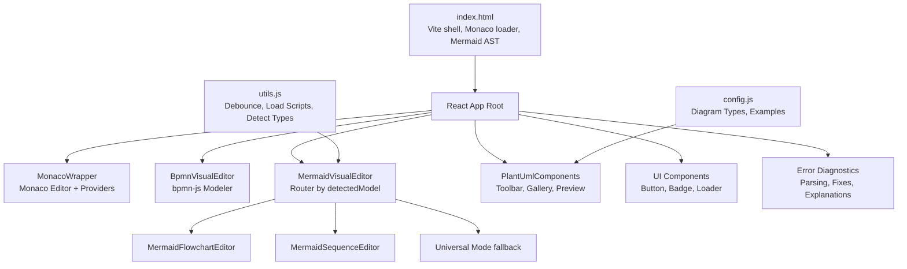
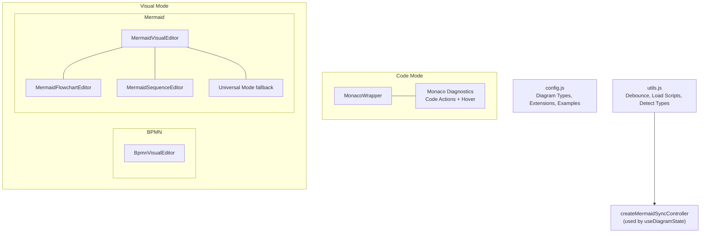
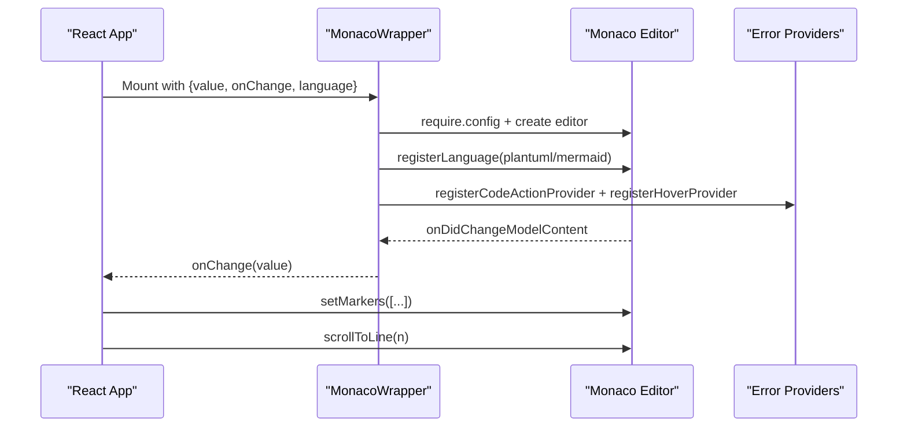
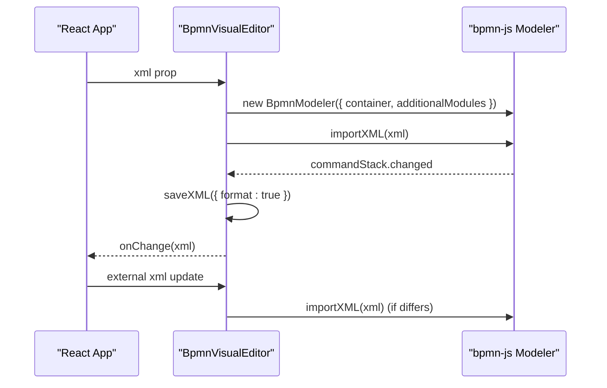
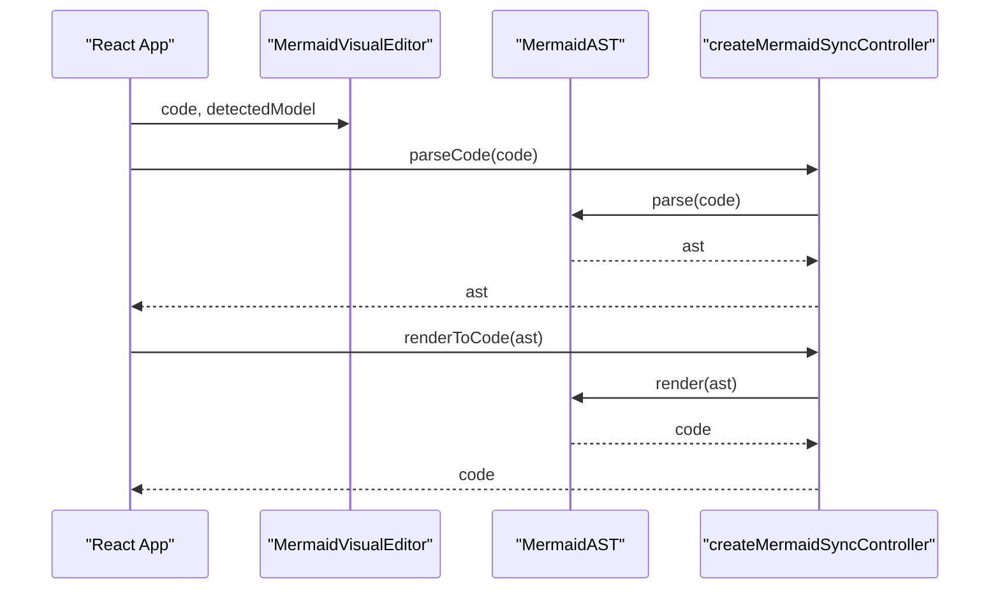
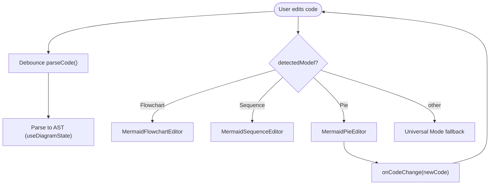
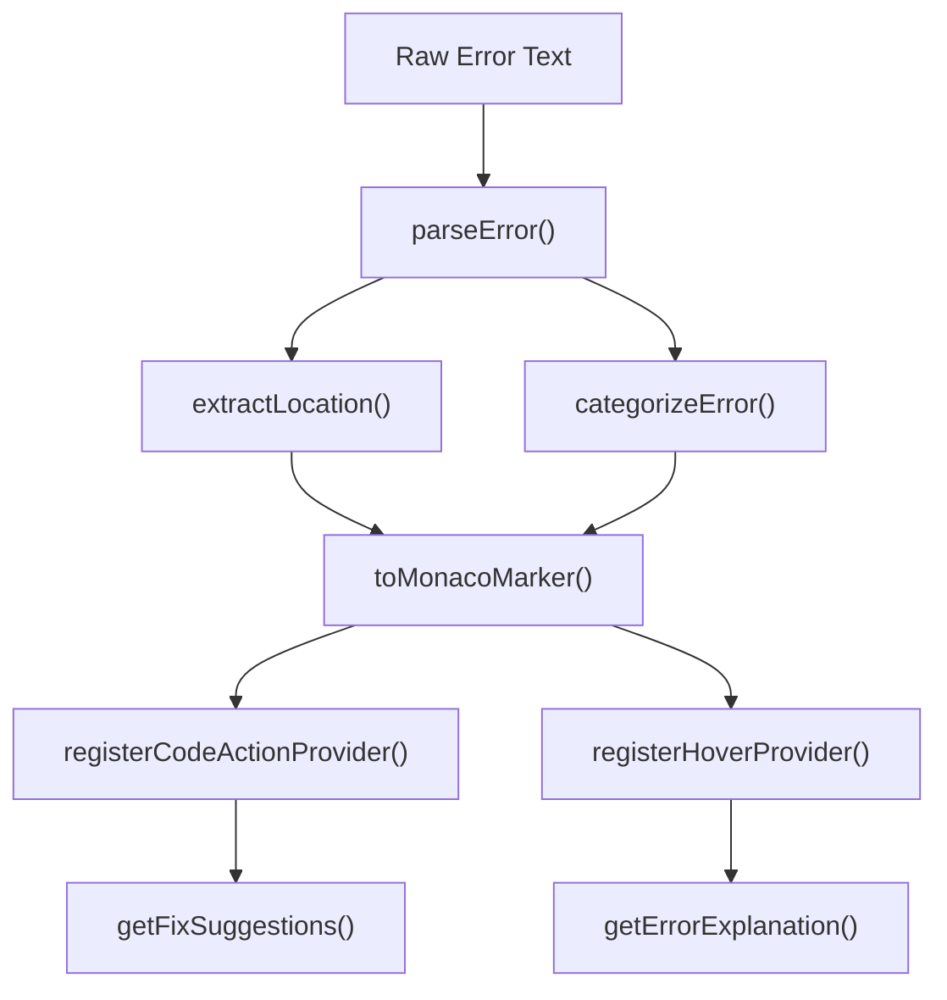
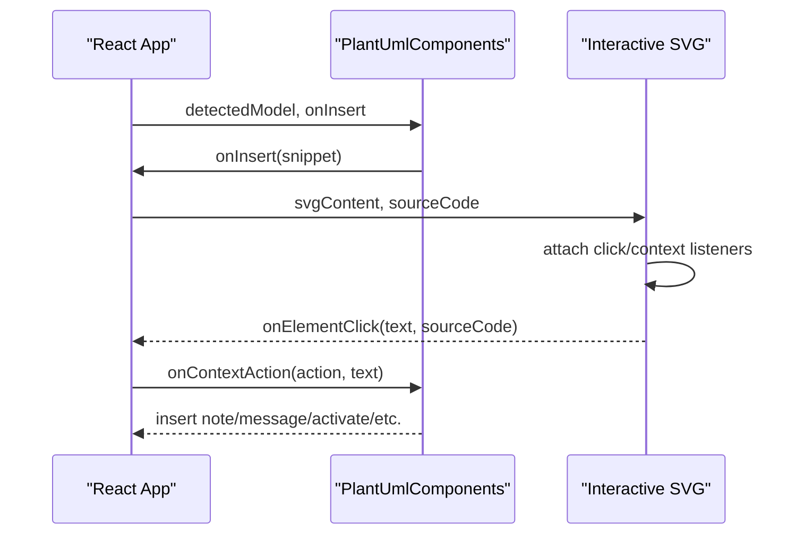
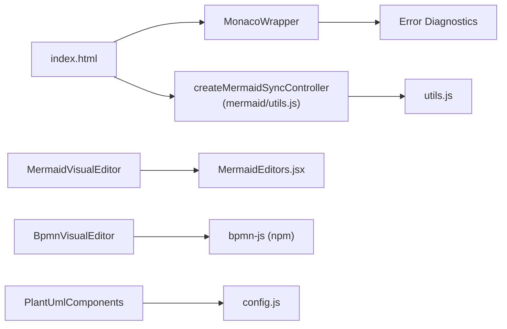

# Editor Architecture

<cite>
**Referenced Files in This Document**
- [index.html](file://index.html)
- [js/config.js](file://js/config.js)
- [js/react-helpers.js](file://js/react-helpers.js)
- [js/utils.js](file://js/utils.js)
- [js/components/editors/MonacoWrapper.jsx](file://js/components/editors/MonacoWrapper.jsx)
- [js/components/PlantUmlComponents.js](file://js/components/PlantUmlComponents.js)
- [js/components/ui.js](file://js/components/ui.js)
- [js/components/editors/BpmnVisualEditor.jsx](file://js/components/editors/BpmnVisualEditor.jsx)
- [js/components/editors/mermaid/MermaidVisualEditor.jsx](file://js/components/editors/mermaid/MermaidVisualEditor.jsx)
- [js/components/editors/mermaid/utils.js](file://js/components/editors/mermaid/utils.js)
- [js/components/editors/mermaid/MermaidEditors.jsx](file://js/components/editors/mermaid/MermaidEditors.jsx)
- [js/error-diagnostics/index.js](file://js/error-diagnostics/index.js)
- [js/error-diagnostics/explanations.js](file://js/error-diagnostics/explanations.js)
- [js/error-diagnostics/fixes.js](file://js/error-diagnostics/fixes.js)
</cite>

## Table of Contents
1. [Introduction](#introduction)
2. [Project Structure](#project-structure)
3. [Core Components](#core-components)
4. [Architecture Overview](#architecture-overview)
5. [Detailed Component Analysis](#detailed-component-analysis)
6. [Dependency Analysis](#dependency-analysis)
7. [Performance Considerations](#performance-considerations)
8. [Troubleshooting Guide](#troubleshooting-guide)
9. [Conclusion](#conclusion)

## Introduction
This document explains the editor architecture and component system used to support multiple diagramming formats. It covers:
- Monaco Editor integration with syntax highlighting, diagnostics, quick fixes, and custom language support
- Visual editors for BPMN (bpmn-js) and Mermaid (AST-based synchronization)
- Bi-directional synchronization between code and visual modes, change detection, debouncing, and state management
- React integration patterns and extension points for custom editors

## Project Structure
The project is organized around modular components and editors:
- Root HTML initializes runtime libraries and mounts the React app
- Configuration defines supported diagram types, examples, and language mappings
- The editors are written in JSX and compiled by Vite; `react-helpers.js` supplies an `html` template for the older `ui.js` and `PlantUmlComponents.js`
- Utilities provide shared functions for model detection, debouncing and BPMN auto-layout
- Components encapsulate Monaco integration, PlantUML tooling, and UI primitives
- Editors implement visual editing for BPMN and Mermaid with AST-driven synchronization

**Diagram sources**
- [index.html](file://index.html)
- [js/config.js](file://js/config.js#L1-L116)
- [js/react-helpers.js](file://js/react-helpers.js#L1-L39)
- [js/utils.js](file://js/utils.js#L1-L177)
- [js/components/editors/MonacoWrapper.jsx](file://js/components/editors/MonacoWrapper.jsx)
- [js/components/PlantUmlComponents.js](file://js/components/PlantUmlComponents.js)
- [js/components/ui.js](file://js/components/ui.js)
- [js/components/editors/BpmnVisualEditor.jsx](file://js/components/editors/BpmnVisualEditor.jsx)
- [js/components/editors/mermaid/MermaidVisualEditor.jsx](file://js/components/editors/mermaid/MermaidVisualEditor.jsx)
- [js/components/editors/mermaid/MermaidEditors.jsx](file://js/components/editors/mermaid/MermaidEditors.jsx)
- [js/error-diagnostics/index.js](file://js/error-diagnostics/index.js#L1-L303)
- [js/error-diagnostics/explanations.js](file://js/error-diagnostics/explanations.js)
- [js/error-diagnostics/fixes.js](file://js/error-diagnostics/fixes.js#L1-L403)

**Section sources**
- [index.html](file://index.html)
- [js/config.js](file://js/config.js#L1-L116)

## Core Components
- MonacoWrapper: A React-forwardRef component that initializes Monaco, registers custom languages (Mermaid, PlantUML, LikeC4), and exposes imperative methods for scrolling, setting/clearing markers, inserting text, finding and selecting text, and retrieving the editor/model. It integrates error providers for hover explanations and quick fixes.
- BpmnVisualEditor: A React component that imports the bpmn-js modeler from npm, adds custom modules, listens to command stack changes to export formatted XML, and synchronizes external XML updates.
- MermaidVisualEditor: A router component that shows a loading spinner until the AST library is ready, then routes by the `detectedModel` string to a sub-editor in `MermaidEditors.jsx`. Unmatched types show a "Universal Mode" message. The Kroki preview belongs to the code view (`useRemoteRenderer`), not to this component.
- createMermaidSyncController: A factory in `mermaid/utils.js` that `useDiagramState` uses to parse code into an AST with debouncing and loop prevention.
- PlantUmlComponents: Toolbar, template gallery, interactive SVG preview, and context menus for PlantUML editing.
- UI Components: Reusable Button, StatusBadge, Loader, EmptyState, SectionHeader, and EditableText.
- Error Diagnostics: Parser for extracting structured error info, fix suggestions, and hover explanations for Monaco.

**Section sources**
- [js/components/editors/MonacoWrapper.jsx](file://js/components/editors/MonacoWrapper.jsx)
- [js/components/editors/BpmnVisualEditor.jsx](file://js/components/editors/BpmnVisualEditor.jsx)
- [js/components/editors/mermaid/MermaidVisualEditor.jsx](file://js/components/editors/mermaid/MermaidVisualEditor.jsx)
- [js/components/PlantUmlComponents.js](file://js/components/PlantUmlComponents.js)
- [js/components/ui.js](file://js/components/ui.js)
- [js/error-diagnostics/index.js](file://js/error-diagnostics/index.js#L1-L303)

## Architecture Overview
The system supports three major editing modes:
- Code mode: powered by Monaco with custom languages and diagnostics
- Visual mode (BPMN): bpmn-js modeler with XML export/import
- Visual mode (Mermaid): AST parsing for the app state, with a router to sub-editors that write code back directly

**Diagram sources**
- [js/components/editors/MonacoWrapper.jsx](file://js/components/editors/MonacoWrapper.jsx)
- [js/components/editors/BpmnVisualEditor.jsx](file://js/components/editors/BpmnVisualEditor.jsx)
- [js/components/editors/mermaid/MermaidVisualEditor.jsx](file://js/components/editors/mermaid/MermaidVisualEditor.jsx)
- [js/components/editors/mermaid/utils.js](file://js/components/editors/mermaid/utils.js)
- [js/components/editors/mermaid/MermaidEditors.jsx](file://js/components/editors/mermaid/MermaidEditors.jsx)
- [js/config.js](file://js/config.js#L1-L116)
- [js/utils.js](file://js/utils.js#L1-L177)

## Detailed Component Analysis

### Monaco Editor Integration
MonacoWrapper integrates Monaco Editor with:
- Custom language registration for PlantUML and Mermaid using Monarch tokens providers
- Error provider registration for code actions and hover explanations
- Imperative methods for editor control and diagnostics
- Change and cursor position callbacks

**Diagram sources**
- [js/components/editors/MonacoWrapper.jsx](file://js/components/editors/MonacoWrapper.jsx)

Key implementation highlights:
- Language registration and configuration for PlantUML and Mermaid
- Error providers for quick fixes and hover explanations
- Exposed imperative methods for markers, scrolling, and text insertion
- Cursor change callback and editor model access

**Section sources**
- [js/components/editors/MonacoWrapper.jsx](file://js/components/editors/MonacoWrapper.jsx)

### Visual Editor: BPMN (bpmn-js)
The BPMN visual editor:
- Imports the bpmn-js modeler and its CSS from npm
- Creates a modeler instance bound to a DOM container, with task resizing and custom modules (context pad, renderer, lane split, lane transpose)
- Listens to command stack changes to export formatted XML and notify parent
- Imports external XML updates safely and handles errors

**Diagram sources**
- [js/components/editors/BpmnVisualEditor.jsx](file://js/components/editors/BpmnVisualEditor.jsx)

**Section sources**
- [js/components/editors/BpmnVisualEditor.jsx](file://js/components/editors/BpmnVisualEditor.jsx)

### Visual Editor: Mermaid (AST-based Synchronization)
The Mermaid visual editor:
- Routes by the `detectedModel` string to a sub-editor in `MermaidEditors.jsx`, or shows the "Universal Mode" message
- Passes the sub-editors only `code` and `onChange`; the AST stays with `useDiagramState`
- Relies on a sync controller (`createMermaidSyncController`) that parses code to an AST with debouncing and loop prevention, and can render an AST back to code

**Diagram sources**
- [js/components/editors/mermaid/MermaidVisualEditor.jsx](file://js/components/editors/mermaid/MermaidVisualEditor.jsx)
- [js/components/editors/mermaid/utils.js](file://js/components/editors/mermaid/utils.js)

Mermaid editors:
- Pie editor: the only working sub-editor. It reads the title and slices with regular expressions, lets the user edit labels and values and add a slice, and writes code back through `onChange`.
- Flowchart editor: shows an "interactive node editing coming soon" note plus the code-only message.
- Sequence, Gantt, Timeline, Journey and Mindmap editors: placeholders that show the code-only message.

**Diagram sources**
- [js/components/editors/mermaid/MermaidVisualEditor.jsx](file://js/components/editors/mermaid/MermaidVisualEditor.jsx)
- [js/components/editors/mermaid/MermaidEditors.jsx](file://js/components/editors/mermaid/MermaidEditors.jsx)
- [js/components/editors/mermaid/utils.js](file://js/components/editors/mermaid/utils.js)

**Section sources**
- [js/components/editors/mermaid/MermaidVisualEditor.jsx](file://js/components/editors/mermaid/MermaidVisualEditor.jsx)
- [js/components/editors/mermaid/utils.js](file://js/components/editors/mermaid/utils.js)
- [js/components/editors/mermaid/MermaidEditors.jsx](file://js/components/editors/mermaid/MermaidEditors.jsx)

### Error Diagnostics and Quick Fixes
The error diagnostics pipeline:
- Parses raw error text to extract line/column and categorize the error
- Converts to Monaco marker format
- Provides quick fixes and hover explanations tailored per diagram type

**Diagram sources**
- [js/error-diagnostics/index.js](file://js/error-diagnostics/index.js#L13-L44)
- [js/error-diagnostics/index.js](file://js/error-diagnostics/index.js#L52-L145)
- [js/error-diagnostics/index.js](file://js/error-diagnostics/index.js#L153-L254)
- [js/error-diagnostics/index.js](file://js/error-diagnostics/index.js#L261-L276)
- [js/error-diagnostics/explanations.js](file://js/error-diagnostics/explanations.js)
- [js/error-diagnostics/fixes.js](file://js/error-diagnostics/fixes.js#L11-L403)

**Section sources**
- [js/error-diagnostics/index.js](file://js/error-diagnostics/index.js#L1-L303)
- [js/error-diagnostics/explanations.js](file://js/error-diagnostics/explanations.js)
- [js/error-diagnostics/fixes.js](file://js/error-diagnostics/fixes.js#L1-L403)

### PlantUML Tooling and Preview
PlantUMLComponents provide:
- Snippet toolbar with dynamic expansion
- Template gallery modal
- Interactive SVG preview with click/context actions
- Context menu for adding notes, messages, activation/deactivation, and navigation

**Diagram sources**
- [js/components/PlantUmlComponents.js](file://js/components/PlantUmlComponents.js#L8-L47)
- [js/components/PlantUmlComponents.js](file://js/components/PlantUmlComponents.js#L153-L248)

**Section sources**
- [js/components/PlantUmlComponents.js](file://js/components/PlantUmlComponents.js)

### React Integration and Extension Points
- React helpers: `react-helpers.js` binds htm to React.createElement and re-exports hooks (used by `ui.js` and `PlantUmlComponents.js`; the editors use JSX)
- UI components: reusable primitives for buttons, badges, loaders, and editable text
- Extension points:
  - Add new diagram types via config.js (language mapping, examples, extensions)
  - Extend MonacoWrapper with new languages and providers
  - Add new Mermaid editors by adding a component to `MermaidEditors.jsx` and a branch in the `MermaidVisualEditor` router
  - Integrate new visual editors by implementing import/export XML/AST and change detection

**Section sources**
- [js/react-helpers.js](file://js/react-helpers.js#L1-L39)
- [js/components/ui.js](file://js/components/ui.js)
- [js/config.js](file://js/config.js#L1-L116)

## Dependency Analysis
- Runtime libraries: Monaco (CDN loader), Mermaid AST (CDN module), Pako, Font Awesome; bpmn-js comes from npm
- Internal dependencies:
  - MonacoWrapper depends on error diagnostics
  - BpmnVisualEditor depends on npm packages (`bpmn-js`, `bpmn-js-task-resize`) and the custom modules in `js/components/editors/bpmn/`
  - The Mermaid sync controller depends on `utils.js` for debouncing and on `window.MermaidAST` for parsing/rendering
  - PlantUmlComponents depend on config for snippets/templates

**Diagram sources**
- [index.html](file://index.html)
- [js/components/editors/MonacoWrapper.jsx](file://js/components/editors/MonacoWrapper.jsx)
- [js/components/editors/BpmnVisualEditor.jsx](file://js/components/editors/BpmnVisualEditor.jsx)
- [js/components/editors/mermaid/MermaidVisualEditor.jsx](file://js/components/editors/mermaid/MermaidVisualEditor.jsx)
- [js/components/editors/mermaid/utils.js](file://js/components/editors/mermaid/utils.js)
- [js/components/PlantUmlComponents.js](file://js/components/PlantUmlComponents.js)
- [js/config.js](file://js/config.js#L1-L116)
- [js/utils.js](file://js/utils.js#L1-L177)

**Section sources**
- [index.html](file://index.html)
- [js/utils.js](file://js/utils.js#L1-L177)

## Performance Considerations
- Debouncing:
  - Mermaid `parseCode` uses a 300ms debounce to avoid excessive AST computations
  - `useRemoteRenderer` debounces preview requests by 500ms
  - General debounce utility is available for throttling expensive operations
- Loading:
  - The Mermaid AST module and the Monaco AMD loader come from CDNs referenced in `index.html`
  - bpmn-js is bundled by Vite from npm
- Memory management:
  - Monaco and bpmn-js instances are disposed on component unmount

**Section sources**
- [js/components/editors/mermaid/utils.js](file://js/components/editors/mermaid/utils.js)
- [js/hooks/useRemoteRenderer.js](file://js/hooks/useRemoteRenderer.js)
- [js/utils.js](file://js/utils.js#L166-L176)

## Troubleshooting Guide
Common issues and resolutions:
- Monaco fails to initialize:
  - Ensure Monaco AMD loader is available and paths are configured
  - Confirm that language registration runs before editor creation
- Error markers not appearing:
  - Verify that markers are attached to the editor model and use the correct owner
  - Check that error parsing extracts line/column correctly
- BPMN visual editor not loading:
  - Ensure XML is valid; import errors go to `onError` and the editor falls back to an empty BPMN template
  - Check the browser console for errors thrown while the modeler is created
- Mermaid AST not loaded:
  - Wait for the Mermaid AST module to be injected globally before attempting parse/render
  - `MermaidVisualEditor` shows "Loading visual editor..." until `astLoaded` is true; the sync controller's `isLoaded` guard checks `window.MermaidAST`
- PlantUML preview not interactive:
  - Ensure SVG content is injected and click/context listeners are attached
  - Verify that element extraction targets text nodes and groups with IDs

**Section sources**
- [js/components/editors/MonacoWrapper.jsx](file://js/components/editors/MonacoWrapper.jsx)
- [js/error-diagnostics/index.js](file://js/error-diagnostics/index.js#L261-L276)
- [js/components/editors/BpmnVisualEditor.jsx](file://js/components/editors/BpmnVisualEditor.jsx)
- [js/components/editors/mermaid/utils.js](file://js/components/editors/mermaid/utils.js)
- [js/components/PlantUmlComponents.js](file://js/components/PlantUmlComponents.js#L158-L213)

## Conclusion
The editor architecture combines Monaco’s powerful code editing with dedicated visual editors for BPMN and Mermaid. It emphasizes:
- Extensible language support and diagnostics
- BPMN visual editing through bpmn-js, and a Mermaid visual editor that currently offers a working pie chart editor and code-only messages for other types
- React-friendly component patterns and a Vite build for performance
- Clear extension points for new diagram types and editors