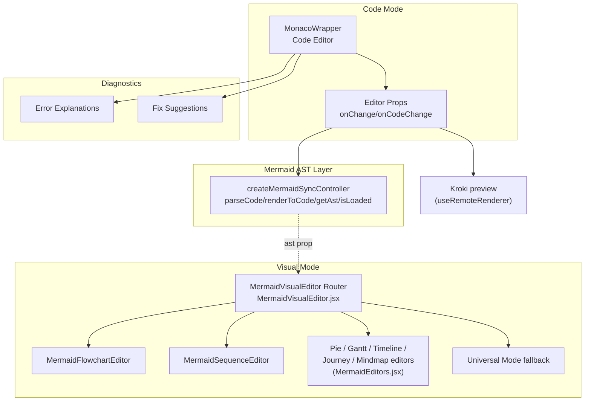
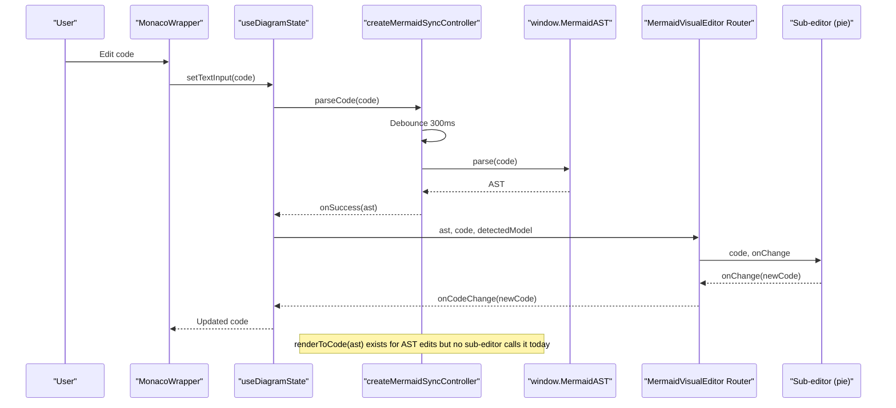
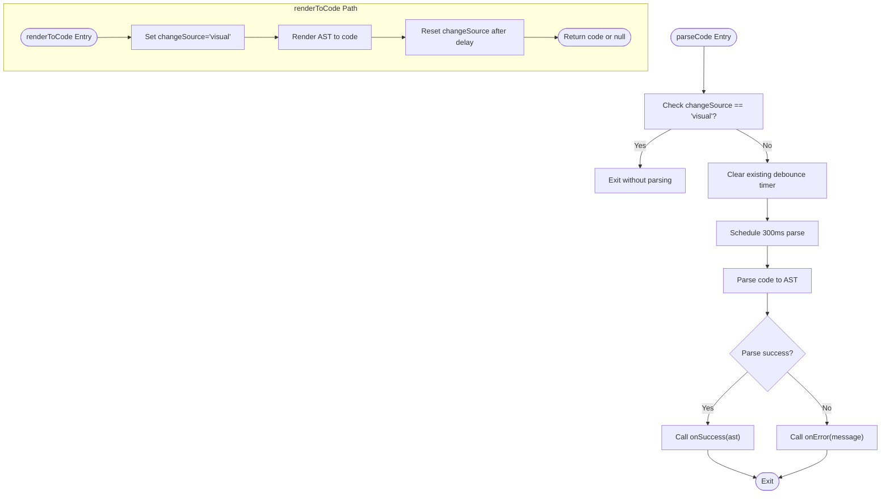
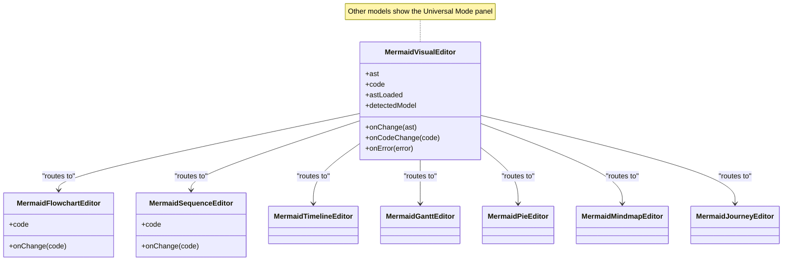
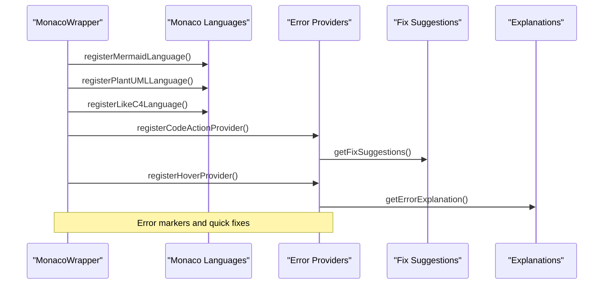
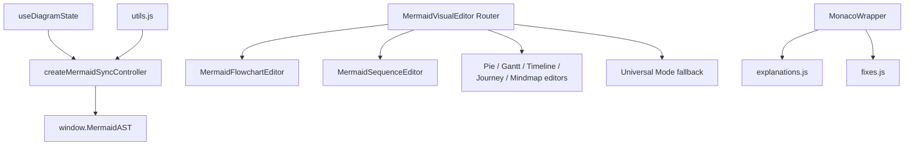

# Synchronization Mechanisms

<cite>
**Referenced Files in This Document**
- [mermaid/utils.js](file://js/components/editors/mermaid/utils.js)
- [MermaidVisualEditor.jsx](file://js/components/editors/mermaid/MermaidVisualEditor.jsx)
- [MermaidEditors.jsx](file://js/components/editors/mermaid/MermaidEditors.jsx)
- [MonacoWrapper.jsx](file://js/components/editors/MonacoWrapper.jsx)
- [explanations.js](file://js/error-diagnostics/explanations.js)
- [fixes.js](file://js/error-diagnostics/fixes.js)
- [react-helpers.js](file://js/react-helpers.js)
- [utils.js](file://js/utils.js)
- [index.html](file://index.html)
</cite>

## Table of Contents
1. [Introduction](#introduction)
2. [Project Structure](#project-structure)
3. [Core Components](#core-components)
4. [Architecture Overview](#architecture-overview)
5. [Detailed Component Analysis](#detailed-component-analysis)
6. [Dependency Analysis](#dependency-analysis)
7. [Performance Considerations](#performance-considerations)
8. [Troubleshooting Guide](#troubleshooting-guide)
9. [Conclusion](#conclusion)

## Introduction
This document explains the bi-directional synchronization mechanisms between code and visual editing modes for Mermaid diagrams. It covers the Mermaid AST processing system, the synchronization controller with debouncing and change-source gating, the way edits flow from the visual editors back to the code, and performance optimizations. It also states which parts of that pipeline the current visual editors use: they write plain code through `onCodeChange` and do not receive the AST.

## Project Structure
The synchronization system spans several modules:
- A Mermaid AST processing controller that parses code into an AST and renders AST back to code.
- A Mermaid visual editor router (`MermaidVisualEditor.jsx`) that selects a sub-editor from the `detectedModel` string.
- Sub-editors in `MermaidEditors.jsx` for flowchart, sequence, pie, Gantt, timeline, journey and mindmap diagrams. Only the pie editor edits anything today; the others show a code-only message.
- A Monaco-based code editor with syntax highlighting, diagnostics, and quick fixes.
- Error diagnostics and fix suggestion systems integrated with Monaco.
- Utilities for debouncing and diagram model detection.

**Diagram sources**
- [mermaid/utils.js](file://js/components/editors/mermaid/utils.js)
- [MermaidVisualEditor.jsx](file://js/components/editors/mermaid/MermaidVisualEditor.jsx)
- [MermaidEditors.jsx](file://js/components/editors/mermaid/MermaidEditors.jsx)
- [MonacoWrapper.jsx](file://js/components/editors/MonacoWrapper.jsx)
- [explanations.js](file://js/error-diagnostics/explanations.js)
- [fixes.js](file://js/error-diagnostics/fixes.js#L11-L403)

**Section sources**
- [mermaid/utils.js](file://js/components/editors/mermaid/utils.js)
- [MermaidVisualEditor.jsx](file://js/components/editors/mermaid/MermaidVisualEditor.jsx)
- [MermaidEditors.jsx](file://js/components/editors/mermaid/MermaidEditors.jsx)
- [MonacoWrapper.jsx](file://js/components/editors/MonacoWrapper.jsx)
- [explanations.js](file://js/error-diagnostics/explanations.js)
- [fixes.js](file://js/error-diagnostics/fixes.js#L1-L403)
- [react-helpers.js](file://js/react-helpers.js#L1-L39)
- [utils.js](file://js/utils.js#L1-L177)
- [index.html](file://index.html)

## Core Components
- createMermaidSyncController (in `mermaid/utils.js`): Central controller for AST parsing, rendering, and preventing sync loops. `useDiagramState` holds one instance.
- MermaidVisualEditor Router: Shows a loading state until the AST library is ready, then routes by the `detectedModel` string. Unmatched types show the "Universal Mode" panel.
- Sub-editors (`MermaidEditors.jsx`): Receive `code` and `onChange` only. The pie editor rewrites the code; the others are placeholders.
- MonacoWrapper: Code editor with language registration, diagnostics, and quick fixes.
- Error Diagnostics: Explanations and fix suggestions for common syntax errors.
- Utilities: Debounce and diagram model detection helpers.

Key responsibilities:
- Parse code to AST (Code → Visual).
- Render AST to code (Visual → Code).
- Debounce rapid changes to avoid infinite loops.
- Check AST readiness (`isLoaded`).
- Provide a visual editor for pie charts, and code-only messages for other types.
- Integrate Monaco diagnostics and quick fixes.

**Section sources**
- [mermaid/utils.js](file://js/components/editors/mermaid/utils.js)
- [MermaidVisualEditor.jsx](file://js/components/editors/mermaid/MermaidVisualEditor.jsx)
- [MermaidEditors.jsx](file://js/components/editors/mermaid/MermaidEditors.jsx)
- [MonacoWrapper.jsx](file://js/components/editors/MonacoWrapper.jsx)
- [explanations.js](file://js/error-diagnostics/explanations.js)
- [fixes.js](file://js/error-diagnostics/fixes.js#L11-L403)
- [utils.js](file://js/utils.js#L14-L177)

## Architecture Overview
The synchronization architecture implements a strict loop prevention mechanism and debounced updates:
- Code changes trigger AST parsing with a debounce timer.
- Visual changes set a change source flag to block code parsing until the next cycle.
- AST rendering to code resets the change source asynchronously.
- The visual editor router selects the sub-editor from the detected model name.
- Monaco diagnostics and quick fixes improve error handling and recovery.

**Diagram sources**
- [mermaid/utils.js](file://js/components/editors/mermaid/utils.js)
- [MermaidVisualEditor.jsx](file://js/components/editors/mermaid/MermaidVisualEditor.jsx)
- [MermaidEditors.jsx](file://js/components/editors/mermaid/MermaidEditors.jsx)
- [MonacoWrapper.jsx](file://js/components/editors/MonacoWrapper.jsx)

## Detailed Component Analysis

### Mermaid AST Processing and Synchronization Controller
The controller encapsulates:
- State: current AST, change source indicator, debounce timer.
- Methods:
  - parseCode(code, onSuccess, onError): Debounced AST parse; prevents re-entry when triggered by visual changes.
  - renderToCode(updatedAst): Renders AST to code; sets changeSource to 'visual' and resets after a short delay.
  - getAst(): Returns the last AST.
  - isLoaded(): Checks availability of MermaidAST library.

Debouncing and loop prevention:
- parseCode clears any pending debounce and schedules a 300ms parse. If `window.MermaidAST` is missing, parseCode reports a simple `{ type: 'root', code, timestamp }` object instead.
- renderToCode sets changeSource to 'visual' and clears it after 50ms to allow subsequent code changes.
- parseCode checks changeSource to skip parsing when triggered by visual changes.
- The pie editor calls `onCodeChange` directly, so it does not set changeSource. Gating applies only to callers of renderToCode, such as the `onChange(ast)` prop in `App.jsx`.

Readiness:
- isLoaded guards against parsing before MermaidAST is ready.
- Diagram model detection (`detectSpecificModel` in `js/utils.js`) is separate from the controller; its result reaches the editor as `detectedModel`.

**Diagram sources**
- [mermaid/utils.js](file://js/components/editors/mermaid/utils.js)

**Section sources**
- [mermaid/utils.js](file://js/components/editors/mermaid/utils.js)

### Visual Editor Router and Sub-editors
The router selects the sub-editor by matching the `detectedModel` string:
- Flowchart: MermaidFlowchartEditor (an "interactive node editing coming soon" note plus the code-only message)
- Sequence: MermaidSequenceEditor (code-only message)
- Pie: MermaidPieEditor (working editor)
- Gantt, Timeline, Journey, Mindmap: placeholders that show the code-only message
- Others: the "Universal Mode" panel inside MermaidVisualEditor (fallback)

The pie editor:
- Reads the title and slices from the code with regular expressions.
- Lets the user edit labels and values and add a slice.
- Writes the new code through `onChange`, which the router wires to `onCodeChange`.

**Diagram sources**
- [MermaidVisualEditor.jsx](file://js/components/editors/mermaid/MermaidVisualEditor.jsx)
- [MermaidEditors.jsx](file://js/components/editors/mermaid/MermaidEditors.jsx)

**Section sources**
- [MermaidVisualEditor.jsx](file://js/components/editors/mermaid/MermaidVisualEditor.jsx)
- [MermaidEditors.jsx](file://js/components/editors/mermaid/MermaidEditors.jsx)

### Code Editor Integration (Monaco)
MonacoWrapper integrates:
- Language registration for Mermaid, PlantUML and LikeC4.
- Error providers for code actions and hover explanations.
- Marker management for syntax errors.
- Cursor position tracking and navigation.

Monaco diagnostics:
- Code action provider suggests fixes for common errors.
- Hover provider displays explanations for error markers.
- Quick fixes are applied with Monaco edits or manual instructions.

**Diagram sources**
- [MonacoWrapper.jsx](file://js/components/editors/MonacoWrapper.jsx)
- [fixes.js](file://js/error-diagnostics/fixes.js#L332-L366)
- [explanations.js](file://js/error-diagnostics/explanations.js#L237-L271)

**Section sources**
- [MonacoWrapper.jsx](file://js/components/editors/MonacoWrapper.jsx)
- [fixes.js](file://js/error-diagnostics/fixes.js#L11-L403)
- [explanations.js](file://js/error-diagnostics/explanations.js)

### Error Diagnostics and Quick Fixes
Error diagnostics provide:
- Human-readable explanations mapped to error codes.
- Pattern-based matching for generic error messages.
- Quick fix suggestions with Monaco-compatible edits.

Integration:
- Monaco registers code actions and hover providers.
- Fix suggestions are applied either automatically (with Monaco edits) or manually.

**Section sources**
- [explanations.js](file://js/error-diagnostics/explanations.js)
- [fixes.js](file://js/error-diagnostics/fixes.js#L11-L403)
- [MonacoWrapper.jsx](file://js/components/editors/MonacoWrapper.jsx)

## Dependency Analysis
The synchronization system exhibits the following dependencies:
- createMermaidSyncController depends on window.MermaidAST for parsing and rendering, and on `utils.js` for debounce.
- MermaidVisualEditor Router depends on the `astLoaded` flag and the `detectedModel` string.
- Sub-editors depend on the code text only.
- MonacoWrapper depends on Monaco editor APIs and error diagnostics modules.
- Utilities provide debounce and diagram model detection.

**Diagram sources**
- [mermaid/utils.js](file://js/components/editors/mermaid/utils.js)
- [MermaidVisualEditor.jsx](file://js/components/editors/mermaid/MermaidVisualEditor.jsx)
- [MermaidEditors.jsx](file://js/components/editors/mermaid/MermaidEditors.jsx)
- [MonacoWrapper.jsx](file://js/components/editors/MonacoWrapper.jsx)
- [explanations.js](file://js/error-diagnostics/explanations.js)
- [fixes.js](file://js/error-diagnostics/fixes.js#L11-L403)
- [utils.js](file://js/utils.js#L14-L177)

**Section sources**
- [mermaid/utils.js](file://js/components/editors/mermaid/utils.js)
- [MermaidVisualEditor.jsx](file://js/components/editors/mermaid/MermaidVisualEditor.jsx)
- [MermaidEditors.jsx](file://js/components/editors/mermaid/MermaidEditors.jsx)
- [MonacoWrapper.jsx](file://js/components/editors/MonacoWrapper.jsx)
- [explanations.js](file://js/error-diagnostics/explanations.js)
- [fixes.js](file://js/error-diagnostics/fixes.js#L11-L403)
- [utils.js](file://js/utils.js#L14-L177)

## Performance Considerations
- Debouncing: parseCode (300 ms) and preview generation in `useRemoteRenderer` (500 ms) use timeouts to reduce redundant work.
- Change source gating: Prevents infinite loops by blocking code parsing when triggered by visual changes.
- Lazy loading: Mermaid AST is loaded asynchronously; the visual editor shows a loading state until ready.
- Efficient rendering: The router renders only the one sub-editor that matches the detected model.

[No sources needed since this section provides general guidance]

## Troubleshooting Guide
Common synchronization issues and debugging techniques:
- Infinite sync loops: Occur when visual changes trigger code parsing and vice versa. The changeSource flag prevents this; renderToCode resets changeSource after 50 ms. The current sub-editors bypass renderToCode, so the gate does not protect them.
- AST not loaded: parseCode falls back to a plain `{ type: 'root', code }` object and logs a warning; ensure the Mermaid AST module is loaded from `index.html` before relying on a real AST.
- Slow updates: Debounce timers smooth out rapid changes; adjust delays if needed.
- Error markers: Monaco markers highlight syntax errors; use hover explanations and quick fixes to resolve issues.
- Preview not updating: Verify the 500 ms debounce in `useRemoteRenderer` and that the code is valid for the selected diagram type.

**Section sources**
- [mermaid/utils.js](file://js/components/editors/mermaid/utils.js)
- [MonacoWrapper.jsx](file://js/components/editors/MonacoWrapper.jsx)
- [explanations.js](file://js/error-diagnostics/explanations.js#L237-L271)
- [fixes.js](file://js/error-diagnostics/fixes.js#L332-L366)

## Conclusion
The synchronization system links the Mermaid code and its visual mode:
- A controlled loop prevention mechanism using changeSource gating and debouncing.
- A modular visual editor router with a working pie editor and placeholders for other diagram types.
- Integrated Monaco diagnostics and quick fixes for improved developer experience.
- Efficient change propagation and performance optimizations.

Today the code view drives every update. The pie editor writes code back directly, and the other diagram types stay code-only until their sub-editors are built.