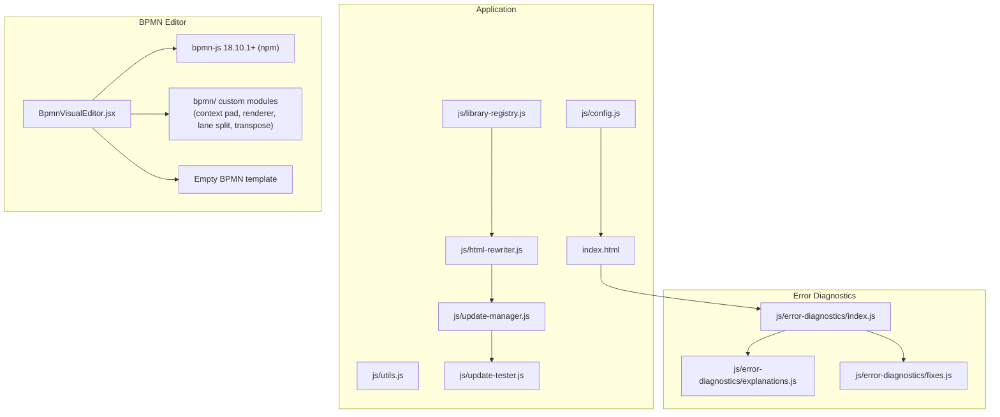
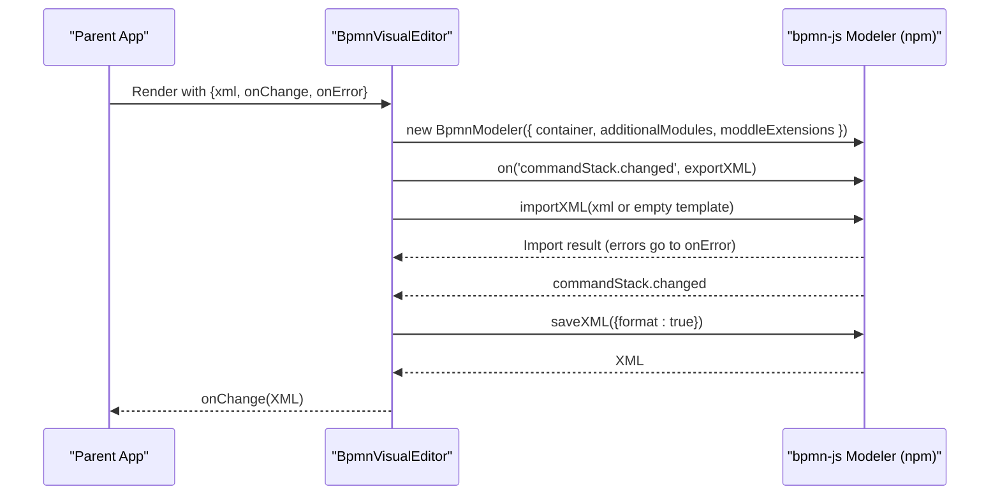
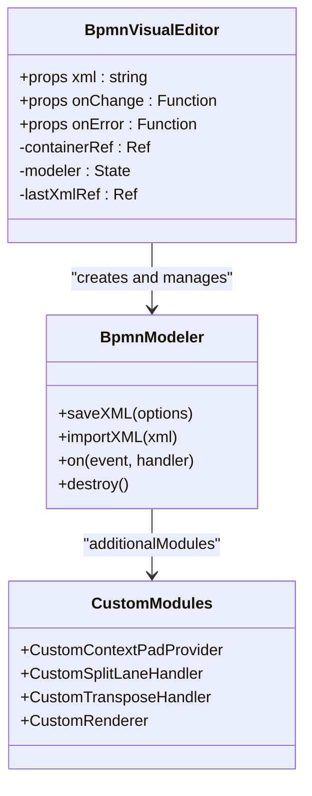
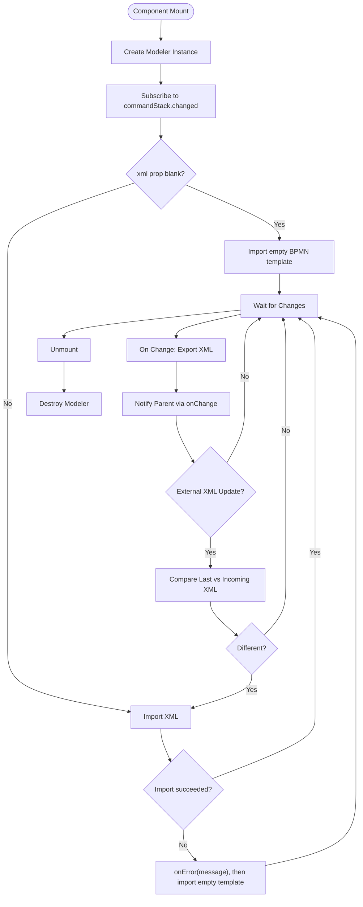
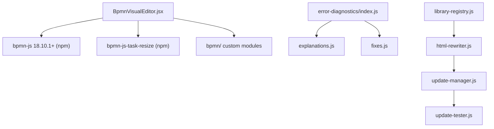

# BPMN Visual Editor

<cite>
**Referenced Files in This Document**
- [BpmnVisualEditor.jsx](file://js/components/editors/BpmnVisualEditor.jsx)
- [index.html](file://index.html)
- [config.js](file://js/config.js)
- [CustomContextPadProvider.js](file://js/components/editors/bpmn/CustomContextPadProvider.js)
- [CustomRenderer.js](file://js/components/editors/bpmn/CustomRenderer.js)
- [CustomSplitLaneHandler.js](file://js/components/editors/bpmn/CustomSplitLaneHandler.js)
- [CustomTransposeHandler.js](file://js/components/editors/bpmn/CustomTransposeHandler.js)
- [utils.js](file://js/utils.js)
- [index.js](file://js/error-diagnostics/index.js)
- [explanations.js](file://js/error-diagnostics/explanations.js)
- [fixes.js](file://js/error-diagnostics/fixes.js)
- [library-registry.js](file://js/library-registry.js)
- [html-rewriter.js](file://js/html-rewriter.js)
- [update-manager.js](file://js/update-manager.js)
- [update-tester.js](file://js/update-tester.js)
</cite>

## Update Summary
**Changes Made**
- The editor imports bpmn-js 18.10.1 or later from npm (`package.json` declares `^18.10.1`). The old CDN `loadScript` loading is gone.
- Custom modules add lane split and transpose actions, a custom renderer and a custom context pad.
- An empty XML string imports a minimal empty BPMN template. The old "Create New Diagram" empty state is gone.

## Table of Contents
1. [Introduction](#introduction)
2. [Project Structure](#project-structure)
3. [Core Components](#core-components)
4. [Architecture Overview](#architecture-overview)
5. [Detailed Component Analysis](#detailed-component-analysis)
6. [Dependency Analysis](#dependency-analysis)
7. [Performance Considerations](#performance-considerations)
8. [Troubleshooting Guide](#troubleshooting-guide)
9. [Conclusion](#conclusion)

## Introduction
This document provides comprehensive documentation for the BPMN visual editor implementation using the bpmn-js library. The editor enables interactive BPMN diagram creation and editing through a visual interface, with seamless synchronization between the visual model and XML code representation. It integrates with a broader diagramming platform that supports multiple diagram types, offering a unified editing experience with error diagnostics and quick-fix suggestions.

The BPMN visual editor is a React component that imports the bpmn-js modeler from npm, initializes a modeler instance, and manages the lifecycle of the visual editor including initialization, change detection, XML import/export, error handling, and cleanup. The modeler is created with task resizing and custom modules for lane splitting, lane transposing, rendering and the context pad.

## Project Structure
The BPMN visual editor resides within a larger diagramming application. The relevant structure for BPMN editing includes:
- Visual editor component: js/components/editors/BpmnVisualEditor.jsx
- Application entry and configuration: index.html
- Custom bpmn-js modules: js/components/editors/bpmn/*
- Shared utilities (including BPMN auto-layout): js/utils.js
- Diagram configuration and examples: js/config.js
- Error diagnostics and fix suggestions: js/error-diagnostics/*
- Library version management: js/library-registry.js
- HTML rewriter for version updates: js/html-rewriter.js
- Update manager infrastructure: js/update-manager.js
- Version testing framework: js/update-tester.js

**Diagram sources**
- [BpmnVisualEditor.jsx](file://js/components/editors/BpmnVisualEditor.jsx)
- [index.html](file://index.html)
- [utils.js](file://js/utils.js#L1-L177)
- [config.js](file://js/config.js#L1-L566)
- [index.js](file://js/error-diagnostics/index.js)
- [explanations.js](file://js/error-diagnostics/explanations.js)
- [fixes.js](file://js/error-diagnostics/fixes.js)
- [library-registry.js](file://js/library-registry.js#L167-L200)
- [html-rewriter.js](file://js/html-rewriter.js#L25-L51)
- [update-manager.js](file://js/update-manager.js#L1-L200)
- [update-tester.js](file://js/update-tester.js#L184-L219)

**Section sources**
- [BpmnVisualEditor.jsx](file://js/components/editors/BpmnVisualEditor.jsx)
- [index.html](file://index.html)
- [utils.js](file://js/utils.js#L1-L177)
- [config.js](file://js/config.js#L1-L566)

## Core Components
The BPMN visual editor is implemented as a React functional component that encapsulates the initialization, lifecycle, and synchronization logic with bpmn-js. Key responsibilities include:
- Importing `bpmn-js/lib/Modeler`, its CSS and `bpmn-js-task-resize` from npm (bpmn-js 18.10.1 or later)
- Creating the modeler with the custom modules and a custom moddle extension (`uni:` prefix, lane `hideTop`, `hideBottom`, `hideLeft` and `hideRight` attributes)
- Listening to command stack changes to export XML back to the parent component
- Handling external XML updates and re-importing when necessary
- Falling back to an empty BPMN template when the XML is blank or fails to import
- Cleaning up the modeler instance on component unmount

The component exposes three props:
- xml: BPMN XML content to import
- onChange: Callback invoked whenever the diagram changes, receiving the exported XML
- onError: Callback invoked on import errors

Initialization flow:
- Create a modeler instance bound to a DOM container (once, on mount)
- Subscribe to commandStack.changed events to export XML
- Import the xml prop (or the empty template when the prop is blank) in a separate effect

Change detection and synchronization:
- On commandStack.changed, export formatted XML, remember it as the last XML, and notify the parent via onChange
- On external XML updates, compare the incoming XML with the last XML and re-import only if they differ

Cleanup:
- Destroy the modeler instance when the component unmounts to free resources

**Section sources**
- [BpmnVisualEditor.jsx](file://js/components/editors/BpmnVisualEditor.jsx)

## Architecture Overview
The BPMN visual editor architecture centers on a React component that creates a bpmn-js modeler and coordinates with the parent application through callbacks for XML import/export and error reporting.

**Diagram sources**
- [BpmnVisualEditor.jsx](file://js/components/editors/BpmnVisualEditor.jsx)

## Detailed Component Analysis

### BpmnVisualEditor Component
The BpmnVisualEditor component is a React functional component that manages the lifecycle of the bpmn-js visual editor. It handles modeler instantiation, change synchronization, and error propagation.

Key implementation patterns:
- Npm imports: Imports the bpmn-js modeler and CSS through the Vite build, so no runtime script loading is needed
- Modeler creation: Initializes bpmn-js with a container, the `resizeTask` module, a custom module bundle and a custom moddle extension
- Change detection: Subscribes to commandStack.changed to export XML and notify parent
- External synchronization: Compares incoming XML with the last XML and re-imports when necessary
- Empty XML fallback: Imports an empty BPMN template when the xml prop is blank
- Cleanup: Destroys the modeler instance on unmount
- Attribution: Shows a small "Powered by bpmn.io" label in the lower right corner

**Diagram sources**
- [BpmnVisualEditor.jsx](file://js/components/editors/BpmnVisualEditor.jsx)
- [CustomContextPadProvider.js](file://js/components/editors/bpmn/CustomContextPadProvider.js)
- [CustomSplitLaneHandler.js](file://js/components/editors/bpmn/CustomSplitLaneHandler.js)
- [CustomTransposeHandler.js](file://js/components/editors/bpmn/CustomTransposeHandler.js)
- [CustomRenderer.js](file://js/components/editors/bpmn/CustomRenderer.js)

**Section sources**
- [BpmnVisualEditor.jsx](file://js/components/editors/BpmnVisualEditor.jsx)

### Empty XML Fallback
When the xml prop is empty or only whitespace, the component imports a built-in empty BPMN template. The template contains:
- A BPMN 2.0 definitions element with the namespace declarations
- A process element with isExecutable="false"
- One startEvent element
- A diagram plane with the start event's bounds

If importing the incoming XML fails, the component reports the error through onError and then imports the same empty template. The editor has no separate empty-state screen or "Create New Diagram" button.

### Element Manipulation
The bpmn-js modeler provides its standard modeling tools for moving elements and connecting them with sequence flows. Users can select and move BPMN elements (tasks, events, gateways), connect elements using the modeling tools, and resize tasks (through `bpmn-js-task-resize`).

The custom modules add lane-specific behaviour:
- `CustomContextPadProvider` adds lane split actions to the context pad.
- `CustomSplitLaneHandler` and `CustomTransposeHandler` register the `custom.lane.split` and `custom.lane.transpose` commands.
- `CustomRenderer` draws lanes using the `uni:` visibility attributes (`hideTop`, `hideBottom`, `hideLeft`, `hideRight`).

The modeler's command stack supports undo and redo, and records each change.

### Command Stack Integration
The component subscribes to the commandStack.changed event to capture all modeling operations. On each change:
- The modeler exports the current diagram as formatted XML
- The parent component receives the updated XML via the onChange callback
- This ensures bidirectional synchronization between the visual editor and the code mode

### XML Import/Export Workflow
Import:
- When the xml prop changes (and on first render), the component imports it into the modeler
- Errors during import are reported via the onError callback, and the editor then imports the empty template

Export:
- On commandStack.changed, the component saves the current diagram as XML with formatting
- The formatted XML is sent to the parent component through onChange

External Updates:
- When the xml prop changes externally, the component compares it with the last XML
- If they differ, it re-imports the new XML into the modeler

**Diagram sources**
- [BpmnVisualEditor.jsx](file://js/components/editors/BpmnVisualEditor.jsx)

**Section sources**
- [BpmnVisualEditor.jsx](file://js/components/editors/BpmnVisualEditor.jsx)

### Properties and Validation
`BpmnVisualEditor.jsx` does not include a properties panel. Users edit names directly on the canvas and edit other attributes in the XML code view. The modeler reports malformed XML through importXML errors, which the component sends to onError.

## Dependency Analysis
The BPMN visual editor depends on several modules and external resources:
- bpmn-js library (npm, `^18.10.1`): Provides the visual modeling capabilities
- bpmn-js-task-resize (npm): Adds task resizing
- Custom modules in `js/components/editors/bpmn/`: Lane split, lane transpose, renderer and context pad
- React: Enables component-based architecture (the file uses JSX)
- Error diagnostics: Used by the app for error parsing and fix suggestions
- Library registry: Still lists bpmn-js under CDN tracking, although the editor imports the npm package
- HTML rewriter: Handles version replacement in HTML content
- Update manager: Orchestrates library update workflow
- Update tester: Tests library compatibility and functionality

**Diagram sources**
- [BpmnVisualEditor.jsx](file://js/components/editors/BpmnVisualEditor.jsx)
- [index.js](file://js/error-diagnostics/index.js)
- [explanations.js](file://js/error-diagnostics/explanations.js)
- [fixes.js](file://js/error-diagnostics/fixes.js)
- [library-registry.js](file://js/library-registry.js#L167-L200)
- [html-rewriter.js](file://js/html-rewriter.js#L25-L51)
- [update-manager.js](file://js/update-manager.js#L1-L200)
- [update-tester.js](file://js/update-tester.js#L184-L219)

**Section sources**
- [BpmnVisualEditor.jsx](file://js/components/editors/BpmnVisualEditor.jsx)
- [index.js](file://js/error-diagnostics/index.js)

## Performance Considerations
- Bundle size: bpmn-js is bundled by Vite with the app, so the editor needs no network fetch for the modeler itself. The bundle grows by the size of the library.
- Memory management: The modeler instance is destroyed on component unmount to prevent memory leaks. Ensure proper cleanup in complex applications with frequent editor mounts/unmounts.
- Change frequency: Frequent command stack changes trigger XML exports. Debouncing or throttling can reduce unnecessary re-renders in the parent component.
- Rendering: Large BPMN diagrams may impact rendering performance. Consider optimizing diagram complexity.

## Troubleshooting Guide
Common issues and resolutions:
- Import errors: XML import failures typically indicate malformed BPMN XML. The component reports the message through onError and then imports the empty template. Use the error diagnostics to identify the problematic element or tag.
- Change detection delays: If XML updates seem delayed, verify that commandStack.changed events are firing and that the onChange callback is properly implemented.
- Editor does not refresh after a code edit: The component skips re-importing when the incoming XML equals the last XML it saw, so check that the code change actually altered the XML text.
- Modeler fails to construct: Check the browser console for errors thrown during `new BpmnModeler(...)`, for example from the custom modules.

Integration with error diagnostics:
- The application includes comprehensive error parsing and fix suggestion systems. When BPMN errors occur, the system extracts line/column information and provides actionable suggestions for corrections.

## Conclusion
The BPMN visual editor provides a React-based solution for creating and editing BPMN diagrams using the bpmn-js library (version 18.10.1 or later, imported from npm). Its architecture emphasizes npm-bundled modeling, XML synchronization through the command stack, and an empty-template fallback when the XML is blank or invalid. Custom modules add lane splitting, lane transposing and custom lane rendering. The integration with error diagnostics enhances the editing experience by providing immediate feedback and automated fixes for common syntax issues.

The project also keeps a library registry and update infrastructure for its CDN-loaded libraries. That registry still lists bpmn-js under CDN tracking, although the editor imports the npm package.
