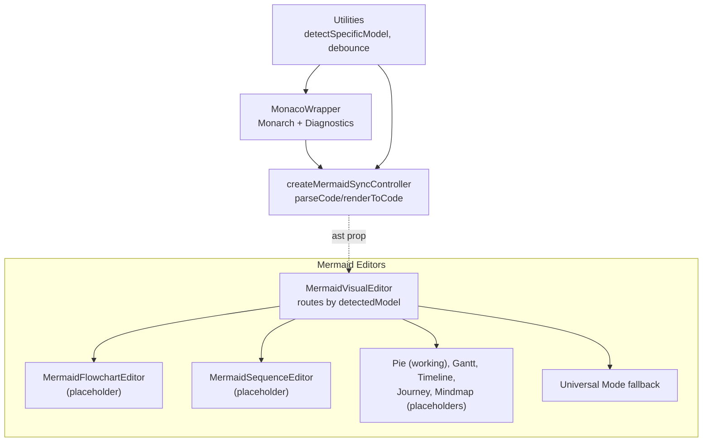
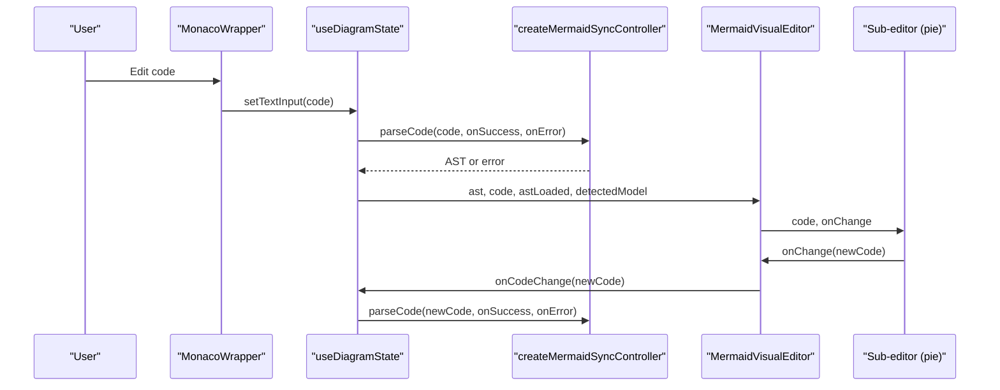
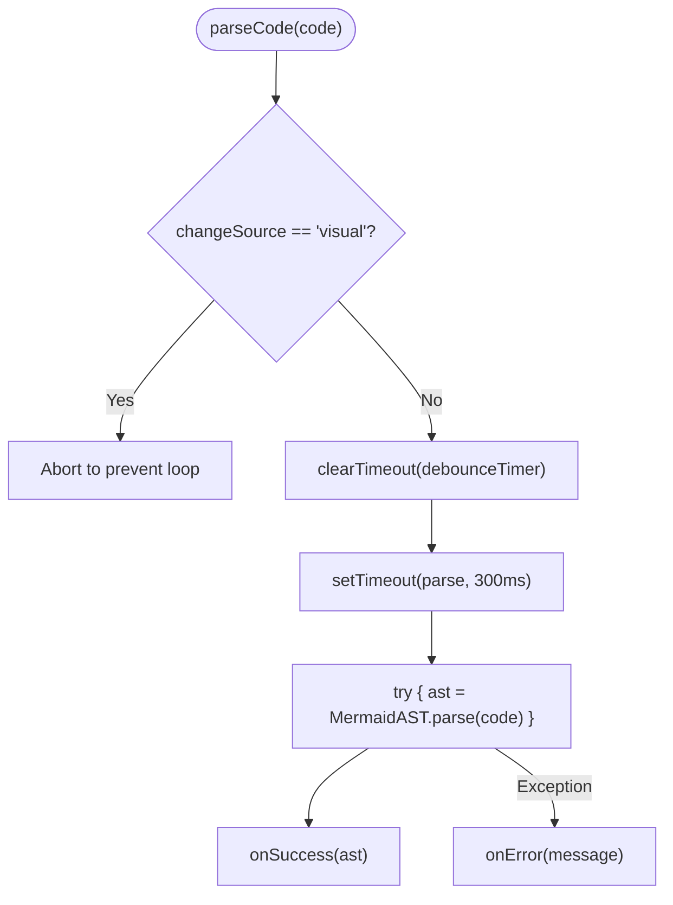
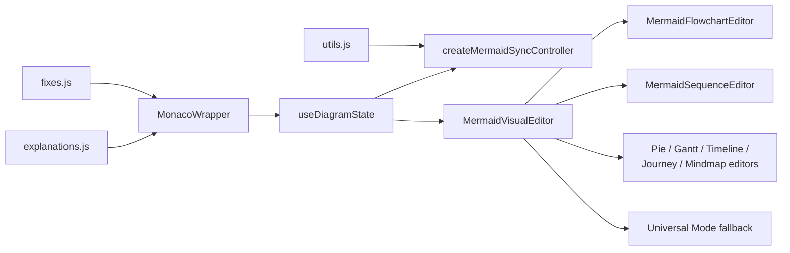

# Mermaid Visual Editor

<cite>
**Referenced Files in This Document**
- [mermaid/utils.js](file://js/components/editors/mermaid/utils.js)
- [MermaidVisualEditor.jsx](file://js/components/editors/mermaid/MermaidVisualEditor.jsx)
- [MermaidEditors.jsx](file://js/components/editors/mermaid/MermaidEditors.jsx)
- [MonacoWrapper.jsx](file://js/components/editors/MonacoWrapper.jsx)
- [index.html](file://index.html)
- [utils.js](file://js/utils.js)
- [config.js](file://js/config.js)
- [explanations.js](file://js/error-diagnostics/explanations.js)
- [fixes.js](file://js/error-diagnostics/fixes.js)
- [react-helpers.js](file://js/react-helpers.js)
</cite>

## Table of Contents
1. [Introduction](#introduction)
2. [Project Structure](#project-structure)
3. [Core Components](#core-components)
4. [Architecture Overview](#architecture-overview)
5. [Detailed Component Analysis](#detailed-component-analysis)
6. [Dependency Analysis](#dependency-analysis)
7. [Performance Considerations](#performance-considerations)
8. [Troubleshooting Guide](#troubleshooting-guide)
9. [Conclusion](#conclusion)

## Introduction
This document describes the Mermaid visual editor system. It explains how `createMermaidSyncController` parses Mermaid code into an AST for the app state, how `MermaidVisualEditor` routes each diagram type to a sub-editor, and what each sub-editor does today. It also covers debounce mechanisms, error prevention strategies, and integration with the Monaco code editor.

## Project Structure
The Mermaid visual editor is organized as a modular React-based system:
- `createMermaidSyncController` (in `mermaid/utils.js`) provides AST parsing, rendering, and change-source tracking to prevent sync loops. `useDiagramState` holds one instance.
- A router component (`MermaidVisualEditor.jsx`) selects a sub-editor from the detected model name.
- Sub-editors in `MermaidEditors.jsx` cover flowchart, sequence, pie, Gantt, timeline, journey and mindmap diagrams. Only the pie editor edits anything; the others show a code-only message.
- Any other diagram type shows the "Universal Mode" panel inside `MermaidVisualEditor`.
- MonacoWrapper integrates Monaco with Mermaid/PlantUML syntax and error diagnostics.
- Utilities and configuration support model detection and debounce.

**Diagram sources**
- [MermaidVisualEditor.jsx](file://js/components/editors/mermaid/MermaidVisualEditor.jsx)
- [mermaid/utils.js](file://js/components/editors/mermaid/utils.js)
- [MermaidEditors.jsx](file://js/components/editors/mermaid/MermaidEditors.jsx)
- [MonacoWrapper.jsx](file://js/components/editors/MonacoWrapper.jsx)
- [utils.js](file://js/utils.js#L14-L177)

**Section sources**
- [MermaidVisualEditor.jsx](file://js/components/editors/mermaid/MermaidVisualEditor.jsx)
- [mermaid/utils.js](file://js/components/editors/mermaid/utils.js)
- [MermaidEditors.jsx](file://js/components/editors/mermaid/MermaidEditors.jsx)
- [MonacoWrapper.jsx](file://js/components/editors/MonacoWrapper.jsx)
- [utils.js](file://js/utils.js#L14-L177)

## Core Components
- createMermaidSyncController: Central AST manager with parseCode, renderToCode, getAst and isLoaded, and loop prevention via changeSource tracking and debouncing.
- MermaidVisualEditor: Router that shows a "Loading visual editor..." state until the AST library is ready, then routes by the `detectedModel` string. It wraps the result in an `EditorToolbar` titled `<model> Editor` ("Visual Mode (Beta)").
- MermaidFlowchartEditor: Shows an "interactive node editing coming soon" note plus the code-only message.
- MermaidSequenceEditor: Placeholder that shows the code-only message.
- MermaidPieEditor: The working editor. It reads the slices with regular expressions, lets the user edit labels and values, add a slice or remove a slice, and writes code back through `onChange`.
- MermaidGanttEditor, MermaidTimelineEditor, MermaidJourneyEditor, MermaidMindmapEditor: Placeholders that show the code-only message.
- Universal Mode fallback: A panel inside `MermaidVisualEditor` for any other diagram type. The panel says structure editing is best done in code.
- MonacoWrapper: Monaco integration with Mermaid/PlantUML Monarch tokens, error providers, and quick fixes.

**Section sources**
- [mermaid/utils.js](file://js/components/editors/mermaid/utils.js)
- [MermaidVisualEditor.jsx](file://js/components/editors/mermaid/MermaidVisualEditor.jsx)
- [MermaidEditors.jsx](file://js/components/editors/mermaid/MermaidEditors.jsx)
- [MonacoWrapper.jsx](file://js/components/editors/MonacoWrapper.jsx)

## Architecture Overview
The system uses a reactive architecture:
- Monaco emits onChange events; `useDiagramState` updates the text and asks the controller to parse the code to an AST.
- `MermaidVisualEditor` receives `ast`, `code` and `detectedModel`, and passes only `code` and `onChange` to the sub-editor.
- The sub-editor writes new code through `onChange`, which the router wires to `onCodeChange`.
- The Kroki preview is separate: `useRemoteRenderer` fetches it for the code view with a 500 ms debounce.
- Debounce prevents excessive re-parsing; changeSource guards against infinite loops for callers of renderToCode.

**Diagram sources**
- [mermaid/utils.js](file://js/components/editors/mermaid/utils.js)
- [MermaidVisualEditor.jsx](file://js/components/editors/mermaid/MermaidVisualEditor.jsx)
- [MonacoWrapper.jsx](file://js/components/editors/MonacoWrapper.jsx)

## Detailed Component Analysis

### createMermaidSyncController
Responsibilities:
- Parse code to AST with debouncing and loop prevention.
- Render AST back to code with changeSource tracking.
- Expose the last AST (`getAst`) and the library loading state (`isLoaded`).

Change detection and loop prevention:
- changeSource tracks whether the last change originated from code or visual.
- Debounce timer ensures rapid successive edits coalesce into a single parse.

**Diagram sources**
- [mermaid/utils.js](file://js/components/editors/mermaid/utils.js)

**Section sources**
- [mermaid/utils.js](file://js/components/editors/mermaid/utils.js)

### Mermaid Visual Editor Router
Responsibilities:
- Show a loading state while MermaidAST loads (`astLoaded` is false).
- Route to a sub-editor by matching `detectedModel` (Flowchart, Sequence, Pie, Gantt, Timeline, Journey, Mindmap).
- Show the "Universal Mode" panel for any other model.
- Pass each sub-editor `code` and `onChange` (wired to `onCodeChange`). The AST is not passed on.

The router does not generate previews. The Kroki preview belongs to the code view and `useRemoteRenderer`.

**Section sources**
- [MermaidVisualEditor.jsx](file://js/components/editors/mermaid/MermaidVisualEditor.jsx)

### MermaidFlowchartEditor
`MermaidFlowchartEditor` shows an "interactive node editing coming soon" note and the code-only message. The component takes `code` and `onChange` but does not read or change either.

**Section sources**
- [MermaidEditors.jsx](file://js/components/editors/mermaid/MermaidEditors.jsx)

### MermaidSequenceEditor
`MermaidSequenceEditor` returns the code-only message.

**Section sources**
- [MermaidEditors.jsx](file://js/components/editors/mermaid/MermaidEditors.jsx)

### MermaidPieEditor and the other data-chart editors
Responsibilities:
- Pie: read the title and slices with regular expressions, edit labels and values, add or remove a slice, and rebuild the `pie` code through `onChange`.
- Gantt, Timeline, Journey, Mindmap: placeholders that return the code-only message.

**Section sources**
- [MermaidEditors.jsx](file://js/components/editors/mermaid/MermaidEditors.jsx)

### Universal Mode fallback
Responsibilities:
- Show a "Universal Mode" panel for diagram types without a sub-editor.
- Tell the user that structure editing is best done in code.

**Section sources**
- [MermaidVisualEditor.jsx](file://js/components/editors/mermaid/MermaidVisualEditor.jsx)

### Monaco Integration
Responsibilities:
- Register Mermaid and PlantUML Monarch tokens.
- Provide error diagnostics: hover explanations and quick fixes.
- Expose imperative methods: scrollToLine, setValue, insertAtCursor, insertAtLocation, findAndSelect, setMarkers, clearMarkers.

Error diagnostics:
- Code action provider suggests fixes mapped to error codes.
- Hover provider surfaces human-readable explanations.

**Section sources**
- [MonacoWrapper.jsx](file://js/components/editors/MonacoWrapper.jsx)
- [explanations.js](file://js/error-diagnostics/explanations.js#L12-L87)
- [fixes.js](file://js/error-diagnostics/fixes.js#L32-L92)

## Dependency Analysis
Key dependencies and relationships:
- `useDiagramState` depends on createMermaidSyncController for the AST, and passes the AST and `detectedModel` to MermaidVisualEditor.
- Sub-editors depend on code passed down by the router and call `onChange` to propagate changes.
- MonacoWrapper depends on error-diagnostics for markers and fixes.
- Utilities support model detection and debounce.

**Diagram sources**
- [MermaidVisualEditor.jsx](file://js/components/editors/mermaid/MermaidVisualEditor.jsx)
- [mermaid/utils.js](file://js/components/editors/mermaid/utils.js)
- [MonacoWrapper.jsx](file://js/components/editors/MonacoWrapper.jsx)
- [utils.js](file://js/utils.js#L14-L177)
- [config.js](file://js/config.js#L6-L116)
- [explanations.js](file://js/error-diagnostics/explanations.js#L12-L87)
- [fixes.js](file://js/error-diagnostics/fixes.js#L32-L92)

**Section sources**
- [MermaidVisualEditor.jsx](file://js/components/editors/mermaid/MermaidVisualEditor.jsx)
- [mermaid/utils.js](file://js/components/editors/mermaid/utils.js)
- [MonacoWrapper.jsx](file://js/components/editors/MonacoWrapper.jsx)
- [utils.js](file://js/utils.js#L14-L177)
- [config.js](file://js/config.js#L6-L116)
- [explanations.js](file://js/error-diagnostics/explanations.js#L12-L87)
- [fixes.js](file://js/error-diagnostics/fixes.js#L32-L92)

## Performance Considerations
- Debounce parsing: The controller debounces parseCode to reduce CPU usage during rapid edits.
- Debounced preview: `useRemoteRenderer` debounces preview requests to Kroki by 500 ms to limit network overhead.
- Efficient rendering: The router renders only the sub-editor that matches the detected model.

[No sources needed since this section provides general guidance]

## Troubleshooting Guide
Common issues and resolutions:
- Infinite sync loops: Ensure changeSource is respected in renderToCode and parseCode. The pie editor writes code through `onCodeChange` and does not set changeSource.
- Missing MermaidAST: Check that the Mermaid AST module is loaded before parsing. The visual editor shows "Loading visual editor..." until `astLoaded` is true.
- Invalid Mermaid syntax: Use Monaco’s quick fixes and hover explanations to identify missing brackets, arrows, or diagram declarations.
- Slow responsiveness: Verify debounce timers are configured appropriately and not overridden by excessive re-renders.

Integration tips:
- Use MonacoWrapper’s setMarkers to surface errors directly in the editor.
- Leverage getFixSuggestions and getErrorExplanation for contextual help.
- Check that `detectedModel` contains the expected name (for example "Pie"), because the router matches on that string.

**Section sources**
- [mermaid/utils.js](file://js/components/editors/mermaid/utils.js)
- [MonacoWrapper.jsx](file://js/components/editors/MonacoWrapper.jsx)
- [explanations.js](file://js/error-diagnostics/explanations.js#L12-L87)
- [fixes.js](file://js/error-diagnostics/fixes.js#L32-L92)

## Conclusion
The Mermaid visual editor system combines AST parsing for the app state, an editor router, and Monaco integration. `createMermaidSyncController` safeguards against sync loops and optimizes performance via debouncing. The router offers a working pie chart editor today, and code-only messages for the other diagram types, while Monaco’s diagnostics improve error prevention and resolution. Further sub-editors can be added to `MermaidEditors.jsx` as the visual mode grows.
