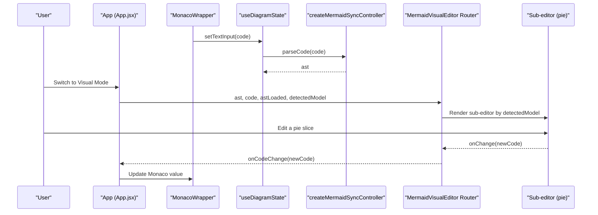
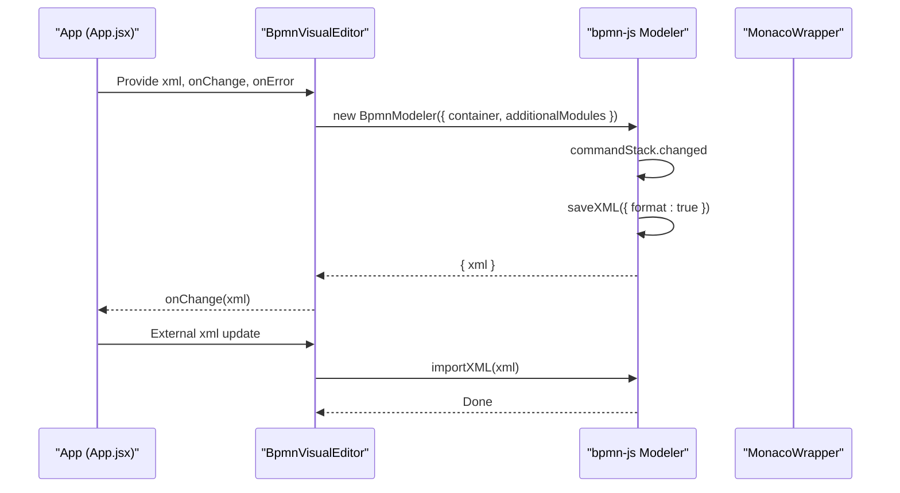
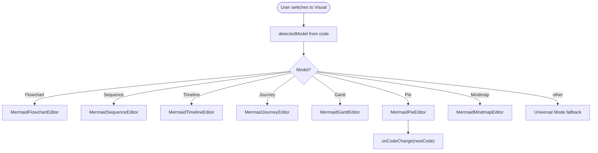
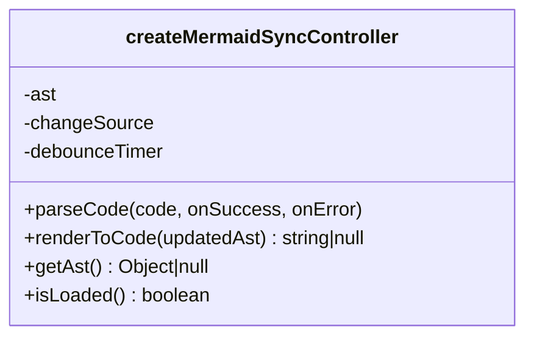
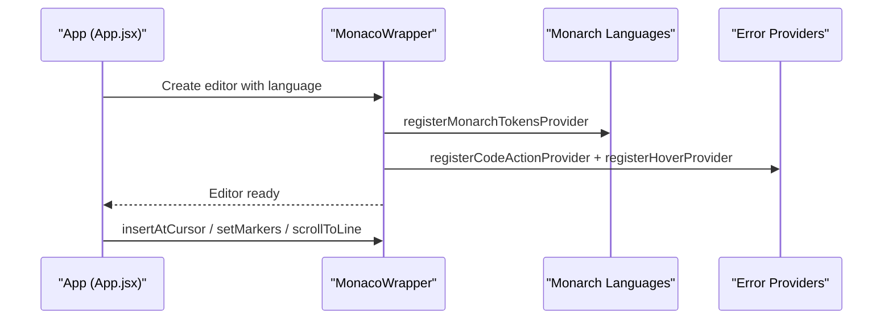
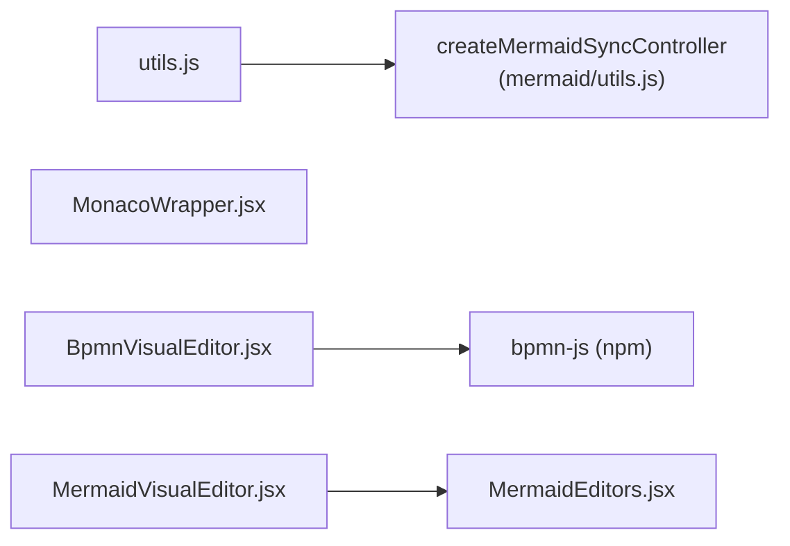

# Visual Editors

<cite>
**Referenced Files in This Document**
- [index.html](file://index.html)
- [BpmnVisualEditor.jsx](file://js/components/editors/BpmnVisualEditor.jsx)
- [MermaidVisualEditor.jsx](file://js/components/editors/mermaid/MermaidVisualEditor.jsx)
- [mermaid/utils.js](file://js/components/editors/mermaid/utils.js)
- [MermaidEditors.jsx](file://js/components/editors/mermaid/MermaidEditors.jsx)
- [MonacoWrapper.jsx](file://js/components/editors/MonacoWrapper.jsx)
- [utils.js](file://js/utils.js)
- [config.js](file://js/config.js)
- [C4VisualEditor.jsx](file://js/components/editors/c4/C4VisualEditor.jsx)
</cite>

## Table of Contents
1. [Introduction](#introduction)
2. [Project Structure](#project-structure)
3. [Core Components](#core-components)
4. [Architecture Overview](#architecture-overview)
5. [Detailed Component Analysis](#detailed-component-analysis)
6. [Dependency Analysis](#dependency-analysis)
7. [Performance Considerations](#performance-considerations)
8. [Troubleshooting Guide](#troubleshooting-guide)
9. [Conclusion](#conclusion)

## Introduction
This document explains the visual editor implementations for BPMN and Mermaid within the Universal Diagram Editor. It covers:
- BPMN visual editing powered by bpmn-js (an npm package), including the standard modeler palette, element manipulation, and custom context pad, renderer, lane split and lane transpose modules.
- Mermaid visual editing: a router that sends each diagram type to a sub-editor. Today only the pie chart editor edits anything; other types show a code-only message or the "Universal Mode" panel. The AST is parsed in the app state but the sub-editors do not use it.
- Lifecycle management: initialization, event handling, state persistence, and cleanup.
- Differences between visual and code editing modes and how they integrate with the code editor.

## Project Structure
The visual editors are integrated into a single-page application with:
- A code editor (Monaco) for text-based editing.
- A visual editor for BPMN and Mermaid (plus Excalidraw, Vega and C4 editors, which this page does not cover).
- A specialized C4 visual editor using React Flow.
- A preview pane for rendered diagrams.
- A toolbar and template gallery for diagram snippets and templates.

```mermaid
graph TB
subgraph "UI Shell"
App["App (App.jsx)"]
Header["Header Controls"]
ViewToggle["View Mode Toggle<br/>Code / Visual"]
end
subgraph "Code Editing"
Monaco["MonacoWrapper (Monaco Editor)"]
Toolbar["Diagram Toolbars<br/>PlantUML / Mermaid"]
Templates["Template Gallery Modal"]
end
subgraph "Visual Editing"
BPMN["BpmnVisualEditor (bpmn-js)"]
C4["C4VisualEditor (React Flow)"]
MermaidRouter["MermaidVisualEditor Router"]
MermaidGeneric["Universal Mode fallback"]
MermaidFlow["MermaidFlowchartEditor"]
MermaidSeq["MermaidSequenceEditor"]
MermaidData["Pie (working) / Gantt / Timeline /<br/>Journey / Mindmap (placeholders)"]
end
subgraph "Preview"
Preview["Preview Panel"]
end
App --> Header
App --> ViewToggle
ViewToggle --> Monaco
ViewToggle --> BPMN
ViewToggle --> MermaidRouter
Monaco --> Preview
MermaidRouter --> MermaidGeneric
MermaidRouter --> MermaidFlow
MermaidRouter --> MermaidSeq
MermaidRouter --> MermaidData
BPMN --> Preview
ViewToggle --> C4
C4 --> Monaco

```

**Diagram sources**
- [index.html](file://index.html)
- [BpmnVisualEditor.jsx](file://js/components/editors/BpmnVisualEditor.jsx)
- [MermaidVisualEditor.jsx](file://js/components/editors/mermaid/MermaidVisualEditor.jsx)
- [MermaidEditors.jsx](file://js/components/editors/mermaid/MermaidEditors.jsx)

**Section sources**
- [index.html](file://index.html)

## Core Components
- BpmnVisualEditor: Creates a bpmn-js modeler (imported from npm), listens for changes, and synchronizes XML back to the code editor. Handles initial import and external updates.
- MermaidVisualEditor: Routes by the `detectedModel` string to a sub-editor, or shows the "Universal Mode" panel. The Kroki preview belongs to the code view, not to this component.
- createMermaidSyncController: A factory in `mermaid/utils.js` that provides AST parsing and rendering back to code, and prevents sync loops. `useDiagramState` holds one instance.
- Mermaid sub-editors (`MermaidEditors.jsx`): Components for flowchart, sequence, pie, Gantt, timeline, journey and mindmap diagrams. The pie editor works; the others are placeholders.
- MonacoWrapper: Integrates Monaco Editor with custom language support, error diagnostics, quick fixes, and hover explanations.

**Section sources**
- [BpmnVisualEditor.jsx](file://js/components/editors/BpmnVisualEditor.jsx)
- [MermaidVisualEditor.jsx](file://js/components/editors/mermaid/MermaidVisualEditor.jsx)
- [mermaid/utils.js](file://js/components/editors/mermaid/utils.js)
- [MermaidEditors.jsx](file://js/components/editors/mermaid/MermaidEditors.jsx)
- [MonacoWrapper.jsx](file://js/components/editors/MonacoWrapper.jsx)

## Architecture Overview
The application supports two editing modes:
- Code mode: Uses Monaco editor with syntax highlighting and diagnostics.
- Visual mode: Uses bpmn-js for BPMN and the Mermaid router with its sub-editors for Mermaid.



**Diagram sources**
- [MermaidVisualEditor.jsx](file://js/components/editors/mermaid/MermaidVisualEditor.jsx)
- [mermaid/utils.js](file://js/components/editors/mermaid/utils.js)
- [MermaidEditors.jsx](file://js/components/editors/mermaid/MermaidEditors.jsx)

## Detailed Component Analysis

### BPMN Visual Editor (bpmn-js)
- Initialization: Imports `bpmn-js/lib/Modeler` and its CSS from npm, then creates a modeler instance bound to a DOM container. The modeler uses task resizing (`bpmn-js-task-resize`), a custom `uni:` moddle extension for lane visibility, and custom context pad, renderer, lane split and lane transpose modules.
- Change synchronization: Subscribes to command stack changes and exports formatted XML to notify the code editor.
- Error handling: Reports import errors via the onError callback and falls back to an empty BPMN template. Export errors are logged to the console.
- External updates: Imports XML from the code editor when it changes, avoiding redundant imports.
- Cleanup: Destroys the modeler instance on component unmount.



**Diagram sources**
- [BpmnVisualEditor.jsx](file://js/components/editors/BpmnVisualEditor.jsx)

**Section sources**
- [BpmnVisualEditor.jsx](file://js/components/editors/BpmnVisualEditor.jsx)

### Mermaid Visual Editor (router and sub-editors)
- Routing: Matches the `detectedModel` string (Flowchart, Sequence, Pie, Gantt, Timeline, Journey, Mindmap) and renders the matching sub-editor. Any other model shows the "Universal Mode" panel, which says structure editing is best done in code.
- Loading: Shows a "Loading visual editor..." spinner until `astLoaded` is true.
- Toolbar: Wraps the sub-editor in an `EditorToolbar` titled `<model> Editor` with the sub-title "Visual Mode (Beta)".
- AST synchronization: `useDiagramState` uses a controller to parse code into an AST, with loop prevention and debounce. The sub-editors receive only `code` and `onChange`.



**Diagram sources**
- [MermaidVisualEditor.jsx](file://js/components/editors/mermaid/MermaidVisualEditor.jsx)

**Section sources**
- [MermaidVisualEditor.jsx](file://js/components/editors/mermaid/MermaidVisualEditor.jsx)

### createMermaidSyncController
- Purpose: Centralizes AST parsing and rendering to prevent infinite sync loops and to debounce rapid changes.
- Methods:
  - parseCode: Debounces parsing (300 ms) and reports the AST when MermaidAST is available; otherwise reports a simple `{ type: 'root', code, timestamp }` object.
  - renderToCode: Marks change source as visual, renders AST to code, and resets source after 50 ms.
  - getAst: Returns the last AST.
  - isLoaded: Checks availability of MermaidAST.



**Diagram sources**
- [mermaid/utils.js](file://js/components/editors/mermaid/utils.js)

**Section sources**
- [mermaid/utils.js](file://js/components/editors/mermaid/utils.js)

### Mermaid Flowchart Editor
- Shows an "interactive node editing coming soon" note.
- Shows the code-only message, which tells the user to edit in the code editor.
- Does not read the code or edit nodes and edges.

**Section sources**
- [MermaidEditors.jsx](file://js/components/editors/mermaid/MermaidEditors.jsx)

### Mermaid Sequence Editor
- Placeholder that shows the code-only message.

**Section sources**
- [MermaidEditors.jsx](file://js/components/editors/mermaid/MermaidEditors.jsx)

### Mermaid Pie Editor and the other data-chart editors
- Pie: Reads the title and slices from the code with regular expressions, edits labels and values, adds or removes a slice, and writes the rebuilt `pie` code through `onChange`.
- Gantt, Timeline, Journey, Mindmap: Placeholders that show the code-only message.

**Section sources**
- [MermaidEditors.jsx](file://js/components/editors/mermaid/MermaidEditors.jsx)

### Universal Mode fallback
- Shows a "Universal Mode" panel for diagram types without a sub-editor.
- Says that structure editing is best done in code.

**Section sources**
- [MermaidVisualEditor.jsx](file://js/components/editors/mermaid/MermaidVisualEditor.jsx)

### MonacoWrapper Integration
- Registers PlantUML, Mermaid and LikeC4 Monarch grammars.
- Provides error diagnostics, quick fixes, and hover explanations.
- Exposes imperative methods for scrolling to line, setting markers, inserting text, finding and selecting text, and getting the editor model.



**Diagram sources**
- [MonacoWrapper.jsx](file://js/components/editors/MonacoWrapper.jsx)

**Section sources**
- [MonacoWrapper.jsx](file://js/components/editors/MonacoWrapper.jsx)

## Dependency Analysis
- External libraries:
  - bpmn-js for BPMN editing (npm package).
  - MermaidAST for Mermaid AST parsing and rendering (loaded from a CDN in `index.html`).
  - Monaco Editor for code editing and diagnostics (CDN loader).
  - Kroki for diagram preview generation (code view).
- Internal dependencies:
  - MermaidVisualEditor routes to sub-editors by the `detectedModel` string.
  - createMermaidSyncController parses code into the AST held by `useDiagramState`.
  - Utilities for model detection, debouncing and BPMN auto-layout.



**Diagram sources**
- [utils.js](file://js/utils.js#L116-L146)
- [config.js](file://js/config.js#L1-L116)
- [MonacoWrapper.jsx](file://js/components/editors/MonacoWrapper.jsx)
- [BpmnVisualEditor.jsx](file://js/components/editors/BpmnVisualEditor.jsx)
- [MermaidVisualEditor.jsx](file://js/components/editors/mermaid/MermaidVisualEditor.jsx)
- [mermaid/utils.js](file://js/components/editors/mermaid/utils.js)
- [MermaidEditors.jsx](file://js/components/editors/mermaid/MermaidEditors.jsx)

**Section sources**
- [utils.js](file://js/utils.js#L116-L146)
- [config.js](file://js/config.js#L1-L116)

## Performance Considerations
- Debouncing: Mermaid AST parsing is debounced (300 ms) to avoid excessive re-renders during rapid typing.
- Preview throttling: Preview requests in `useRemoteRenderer` are delayed by 500 ms to reduce network load.
- Memory management: The bpmn-js modeler is destroyed on unmount.
- Bundling: bpmn-js is bundled by Vite; MermaidAST and Monaco load from CDNs.

[No sources needed since this section provides general guidance]

## Troubleshooting Guide
- BPMN import errors: Errors are reported via the onError callback, and the editor falls back to an empty BPMN template. Ensure valid BPMN XML is provided.
- Mermaid AST not loaded: The visual editor shows "Loading visual editor..." until `astLoaded` is true, and the sync controller reports a simple placeholder object if `window.MermaidAST` is missing.
- Monaco diagnostics: Quick fixes and hover explanations are provided for syntax errors. Use the lightbulb actions and hover tooltips to resolve issues.
- Preview failures: Errors are captured and displayed in the preview panel. Use the “Go to line” action to jump to the problematic line.

**Section sources**
- [BpmnVisualEditor.jsx](file://js/components/editors/BpmnVisualEditor.jsx)
- [mermaid/utils.js](file://js/components/editors/mermaid/utils.js)
- [MonacoWrapper.jsx](file://js/components/editors/MonacoWrapper.jsx)

## Conclusion
The visual editors provide a seamless dual-mode editing experience:
- Code mode offers robust syntax highlighting, diagnostics, and quick fixes.
- Visual mode delivers bpmn-js modeling for BPMN, and a Mermaid router with a working pie chart editor. The other Mermaid types are code-only until their sub-editors are built.
The architecture cleanly separates concerns, enabling future enhancements such as further Mermaid sub-editors and improved BPMN modeling capabilities.