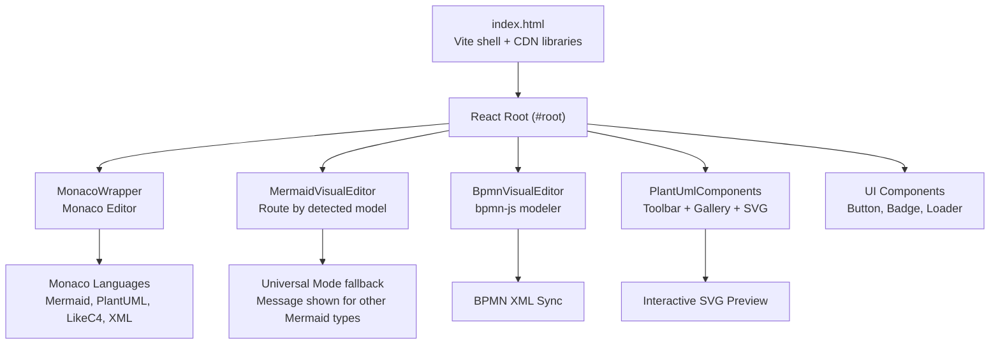
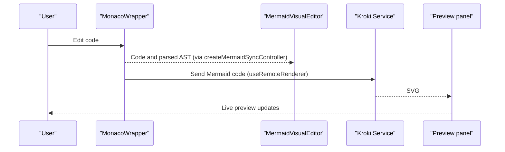
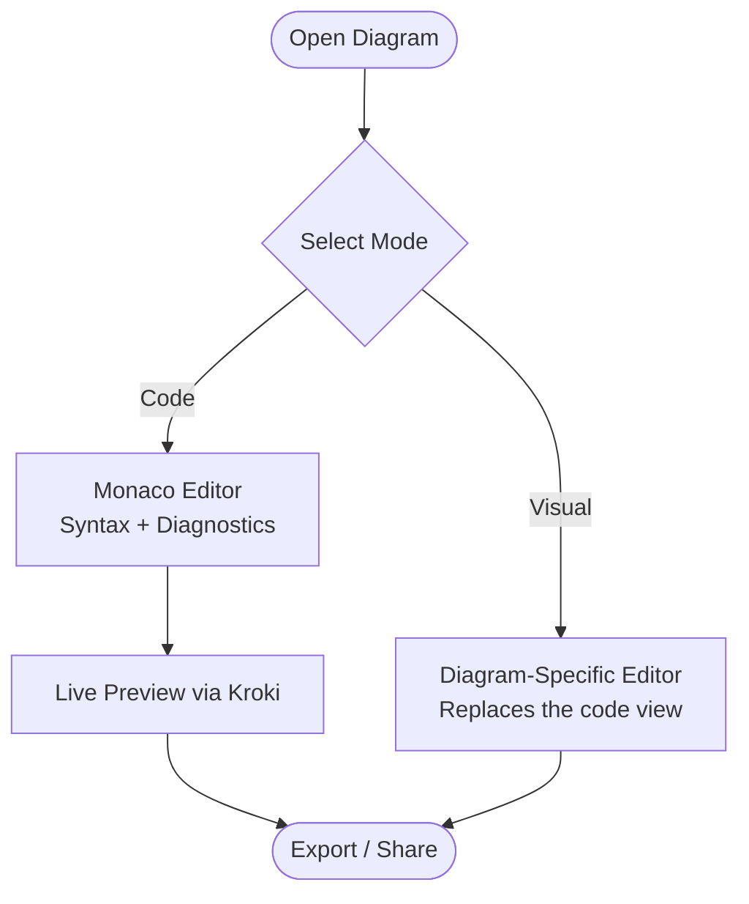
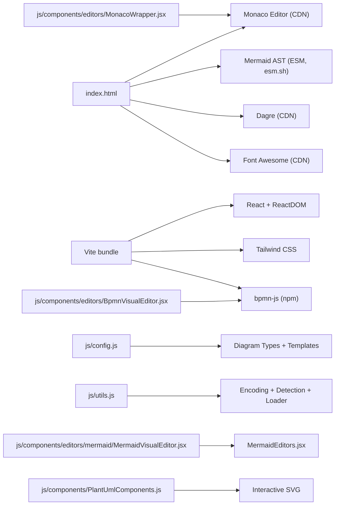

# Getting Started

<cite>
**Referenced Files in This Document**
- [index.html](file://index.html)
- [js/config.js](file://js/config.js)
- [js/utils.js](file://js/utils.js)
- [js/react-helpers.js](file://js/react-helpers.js)
- [js/components/ui.js](file://js/components/ui.js)
- [js/components/editors/MonacoWrapper.jsx](file://js/components/editors/MonacoWrapper.jsx)
- [js/components/PlantUmlComponents.js](file://js/components/PlantUmlComponents.js)
- [js/components/editors/BpmnVisualEditor.jsx](file://js/components/editors/BpmnVisualEditor.jsx)
- [js/components/editors/mermaid/MermaidVisualEditor.jsx](file://js/components/editors/mermaid/MermaidVisualEditor.jsx)
- [js/components/editors/mermaid/utils.js](file://js/components/editors/mermaid/utils.js)
- [js/error-diagnostics/index.js](file://js/error-diagnostics/index.js)
- [styles.css](file://styles.css)
</cite>

## Table of Contents
1. [Introduction](#introduction)
2. [Project Structure](#project-structure)
3. [Core Components](#core-components)
4. [Architecture Overview](#architecture-overview)
5. [Detailed Component Analysis](#detailed-component-analysis)
6. [Dependency Analysis](#dependency-analysis)
7. [Performance Considerations](#performance-considerations)
8. [Troubleshooting Guide](#troubleshooting-guide)
9. [Conclusion](#conclusion)
10. [Appendices](#appendices)

## Introduction
Welcome to the Universal Diagram Generator. This single-page application lets you create diagrams in multiple formats (BPMN, Mermaid, PlantUML, and more) using a dual-mode editing experience: code and visual. It is built with Vite and React. Monaco Editor and the Mermaid AST library load from CDNs, bpmn-js comes from npm, and previews render through the Kroki service.

Key capabilities:
- Choose a diagram type and start editing in either code or visual mode
- Use templates and snippet toolbars to accelerate creation
- See live previews in the code view and receive contextual error diagnostics
- Export and share your diagrams

## Project Structure
The application is a Vite project. `index.html` is a short shell that loads a few CDN libraries and the entry module `js/index.jsx`, which mounts the React app into a root element. Diagram types, templates and editors live in separate modules.

**Diagram sources**
- [index.html](file://index.html)
- [js/components/editors/MonacoWrapper.jsx](file://js/components/editors/MonacoWrapper.jsx)
- [js/components/editors/mermaid/MermaidVisualEditor.jsx](file://js/components/editors/mermaid/MermaidVisualEditor.jsx)
- [js/components/editors/BpmnVisualEditor.jsx](file://js/components/editors/BpmnVisualEditor.jsx)
- [js/components/PlantUmlComponents.js](file://js/components/PlantUmlComponents.js)
- [js/components/ui.js](file://js/components/ui.js)

**Section sources**
- [index.html](file://index.html)

## Core Components
- Diagram type registry and templates: centralized configuration for supported diagram types, file extensions, default examples, and template galleries.
- Monaco editor wrapper: provides syntax highlighting, error diagnostics, quick fixes, and hover explanations for Mermaid, PlantUML, and BPMN.
- Mermaid visual editor: routes to a sub-editor by detected diagram model. Only the pie chart editor edits the diagram today. The flowchart editor shows a "coming soon" note, and the other sub-editors show a code-only message. Other Mermaid types show a "Universal Mode" message that points back to the code view.
- BPMN visual editor: integrates the npm bpmn-js modeler, with custom lane and context-pad behaviour, and syncs XML back to code.
- PlantUML components: snippet toolbar, template gallery, and interactive SVG preview with context menus.
- UI primitives: reusable buttons, badges, loaders, empty states, and editable text.

**Section sources**
- [js/config.js](file://js/config.js#L1-L116)
- [js/components/editors/MonacoWrapper.jsx](file://js/components/editors/MonacoWrapper.jsx)
- [js/components/editors/mermaid/MermaidVisualEditor.jsx](file://js/components/editors/mermaid/MermaidVisualEditor.jsx)
- [js/components/editors/BpmnVisualEditor.jsx](file://js/components/editors/BpmnVisualEditor.jsx)
- [js/components/PlantUmlComponents.js](file://js/components/PlantUmlComponents.js)
- [js/components/ui.js](file://js/components/ui.js)

## Architecture Overview
The app initializes React and mounts the root component. The main layout splits into:
- Code view: the Monaco editor on the left and the live preview (SVG via Kroki) beside it
- Visual view (the "Design" button): the visual editor for the current type fills the editor area (BPMN, Mermaid, Excalidraw, C4, Vega)
- Right: the Syntext Smith AI copilot sidebar, which opens from the header button
- Template gallery: a modal opened from the Templates button

**Diagram sources**
- [js/components/editors/MonacoWrapper.jsx](file://js/components/editors/MonacoWrapper.jsx)
- [js/components/editors/mermaid/MermaidVisualEditor.jsx](file://js/components/editors/mermaid/MermaidVisualEditor.jsx)
- [js/components/editors/mermaid/utils.js](file://js/components/editors/mermaid/utils.js)

## Detailed Component Analysis

### Installation and Setup (Local Development)
- The application is a single-page app built with Vite. Opening `index.html` directly from disk does not work, because the app needs the Vite build.
- Libraries loaded from CDNs in `index.html`:
  - Monaco Editor (AMD loader)
  - Mermaid AST (ES module from `esm.sh`)
  - pako, Dagre, SheetJS and Font Awesome
- Libraries installed from npm and bundled by Vite: React, bpmn-js, Excalidraw, LikeC4 and the others listed in `package.json`.
- To run locally:
  - Run `npm install`
  - Run `npm run dev` and open the address that Vite prints
  - Run `npm run build` followed by `npm run preview` to try the production build

Notes:
- Some features rely on external services (e.g., Mermaid AST and Kroki preview). Ensure network access is available.
- The app uses ES modules; ensure your browser supports them.

**Section sources**
- [index.html](file://index.html)

### First Diagram Tutorial: Selecting a Type and Creating Your First Diagram
Step-by-step for beginners:
1. Choose a diagram type from the type registry:
   - Types include BPMN, Mermaid, PlantUML, and many others.
   - Each type has associated file extensions and default examples.
2. Start with a template:
   - Use the Templates button to open the template gallery and pick a ready-made diagram.
   - Or paste a Mermaid example from the type registry.
3. Dual-mode editing:
   - Code mode: edit the diagram source directly in Monaco.
   - Visual mode (the "Design" button): for BPMN, use the bpmn-js visual editor; for Mermaid, the visual editor routes to a sub-editor by diagram type, and only the pie chart sub-editor edits the diagram.
4. Live preview:
   - In Code mode, the app sends the diagram code to the Kroki service and shows the SVG in the preview panel.
   - In the preview panel, clicking an element highlights it, double-clicking offers a rename, and right-clicking opens a menu of snippets (PlantUML and Mermaid).
5. Basic editing:
   - Use the snippet toolbar (PlantUML and Mermaid) to insert common blocks (e.g., participants, arrows, notes).
   - Use the template gallery to apply complete structures quickly.

Next steps:
- Explore Mermaid diagram types (flowchart, sequence, class, state, ER, Gantt, pie, mindmap, journey, gitgraph).
- Learn PlantUML diagram families (sequence, class, activity, state, component, use case, deployment, ER, WBS).
- Try BPMN visual editing for process flows.

**Section sources**
- [js/config.js](file://js/config.js#L6-L116)
- [js/components/PlantUmlComponents.js](file://js/components/PlantUmlComponents.js#L52-L95)
- [js/components/editors/mermaid/MermaidVisualEditor.jsx](file://js/components/editors/mermaid/MermaidVisualEditor.jsx)

### Dual-Mode Editing: Code and Visual Modes
- Code mode (Monaco):
  - Syntax highlighting for Mermaid, PlantUML, LikeC4 and BPMN (XML).
  - Error diagnostics with quick fixes and hover explanations.
  - Cursor-based navigation and line highlighting for errors.
- Visual mode:
  - BPMN: bpmn-js modeler with real-time XML sync.
  - Mermaid: routing by detected diagram model. The pie chart sub-editor edits labels and values; the other sub-editors and the Universal Mode fallback ask you to edit in code.
  - PlantUML: no visual editor. The preview panel in Code mode supports click-to-select, rename and context menus.

**Diagram sources**
- [js/components/editors/MonacoWrapper.jsx](file://js/components/editors/MonacoWrapper.jsx)
- [js/components/editors/mermaid/MermaidVisualEditor.jsx](file://js/components/editors/mermaid/MermaidVisualEditor.jsx)
- [js/components/editors/BpmnVisualEditor.jsx](file://js/components/editors/BpmnVisualEditor.jsx)

**Section sources**
- [js/components/editors/MonacoWrapper.jsx](file://js/components/editors/MonacoWrapper.jsx)
- [js/components/editors/BpmnVisualEditor.jsx](file://js/components/editors/BpmnVisualEditor.jsx)
- [js/components/editors/mermaid/MermaidVisualEditor.jsx](file://js/components/editors/mermaid/MermaidVisualEditor.jsx)

### Creating Your First Diagram: Step-by-Step

#### BPMN
- Steps:
  1. Select BPMN type.
  2. Paste the default BPMN example from the type registry.
  3. Switch to Visual mode to edit with bpmn-js.
  4. The visual editor syncs XML back to code automatically.
- Tips:
  - Use the palette to add elements.
  - If the XML fails to import, the editor reports the error and falls back to an empty diagram.

**Section sources**
- [js/config.js](file://js/config.js#L13-L56)
- [js/components/editors/BpmnVisualEditor.jsx](file://js/components/editors/BpmnVisualEditor.jsx)

#### Mermaid Flowchart
- Steps:
  1. Select Mermaid type.
  2. Paste a flowchart example from the type registry.
  3. In Visual mode, the Mermaid visual editor detects the diagram type and shows the flowchart editor, which is a "coming soon" note for now. Keep editing the flowchart in Code mode.
  4. In Code mode, the live preview updates as you type.
- Tips:
  - Use the snippet toolbar for nodes, decisions, and arrows.
  - For a pie chart, Visual mode lets you edit labels and values and add a slice.

**Section sources**
- [js/config.js](file://js/config.js#L58-L68)
- [js/components/editors/mermaid/MermaidVisualEditor.jsx](file://js/components/editors/mermaid/MermaidVisualEditor.jsx)

#### PlantUML Sequence Diagram
- Steps:
  1. Select PlantUML type.
  2. Open the template gallery and choose a sequence diagram template.
  3. Stay in Code mode and use the SVG preview beside the editor.
  4. Right-click in the preview to insert snippets such as notes or messages, and click an element to select its text in the code.
- Tips:
  - Use the snippet toolbar to insert participants, arrows, and activation/deactivation.
  - The interactive preview highlights the element you click.

**Section sources**
- [js/config.js](file://js/config.js#L70-L80)
- [js/components/PlantUmlComponents.js](file://js/components/PlantUmlComponents.js#L8-L47)
- [js/components/PlantUmlComponents.js](file://js/components/PlantUmlComponents.js)

### Navigation, Toolbars, and Export
- Navigation:
  - Use the Monaco editor’s cursor and line numbers to jump to errors.
  - In the PlantUML preview panel, click on SVG elements to select the matching text in the code.
- Toolbars:
  - PlantUML snippet toolbar: insert common blocks quickly.
  - Template gallery: choose a complete diagram structure.
- Export:
  - The app renders SVG previews via Kroki. You can copy the SVG or take a screenshot.
  - For BPMN, the visual editor exports XML that you can save or share.

**Section sources**
- [js/components/editors/MonacoWrapper.jsx](file://js/components/editors/MonacoWrapper.jsx)
- [js/components/PlantUmlComponents.js](file://js/components/PlantUmlComponents.js#L52-L95)
- [js/components/editors/mermaid/MermaidVisualEditor.jsx](file://js/components/editors/mermaid/MermaidVisualEditor.jsx)

### Browser Compatibility and Initial Configuration
- Browser compatibility:
  - Requires modern browsers with support for ES modules, fetch, and DOM APIs.
  - Monaco Editor loads from a CDN; bpmn-js is bundled by Vite.
- Initial configuration:
  - Diagram types and defaults are defined centrally.
  - The app registers language configurations and error providers for Monaco.
  - Tailwind CSS is built by Vite and PostCSS (see `tailwind.config.js`), with custom colours and fonts.

**Section sources**
- [index.html](file://index.html)
- [js/config.js](file://js/config.js#L1-L116)
- [js/components/editors/MonacoWrapper.jsx](file://js/components/editors/MonacoWrapper.jsx)

### Locking and Read-Only Mode
- Purpose: Prevent accidental edits during presentation or review.
- Usage:
  - Click the **Lock** icon in the header to enable Read-Only mode.
  - When locked:
    - The code editor becomes read-only.
    - Snippet toolbars (PlantUML, Mermaid) are hidden.
    - The visual editors receive the read-only flag, but the code does not yet apply it inside them, so only the code editor and toolbars lock.
  - Click **Unlock** to resume editing.
- Visual Feedback:
  - The lock button turns red and displays "Locked".
  - The editor background may shift slightly to indicate the state.

**Section sources**
- [js/App.jsx](file://js/App.jsx)
- [js/components/editors/MonacoWrapper.jsx](file://js/components/editors/MonacoWrapper.jsx)

## Dependency Analysis
The application relies on a mix of CDN-hosted libraries, npm packages bundled by Vite, and modular JavaScript modules.

**Diagram sources**
- [index.html](file://index.html#L8-L31)
- [js/config.js](file://js/config.js#L1-L116)
- [js/utils.js](file://js/utils.js#L1-L177)
- [js/components/editors/MonacoWrapper.jsx](file://js/components/editors/MonacoWrapper.jsx)
- [js/components/editors/mermaid/MermaidVisualEditor.jsx](file://js/components/editors/mermaid/MermaidVisualEditor.jsx)
- [js/components/editors/BpmnVisualEditor.jsx](file://js/components/editors/BpmnVisualEditor.jsx)
- [js/components/PlantUmlComponents.js](file://js/components/PlantUmlComponents.js)

**Section sources**
- [index.html](file://index.html#L8-L31)
- [js/utils.js](file://js/utils.js#L116-L146)

## Performance Considerations
- Monaco Editor:
  - Uses minimap and folding to reduce redraw overhead.
- Mermaid sync:
  - Debounces AST parsing by 300 ms while you type in the code editor.
- Visual editors:
  - The bpmn-js modeler is created when the BPMN editor mounts and destroyed on unmount.
- Network:
  - Uses compression for diagram source payloads to Kroki.

[No sources needed since this section provides general guidance]

## Troubleshooting Guide
Common issues and resolutions:
- Monaco editor not loading:
  - Ensure the Monaco AMD loader path is correct and the CDN is reachable.
  - Confirm that the editor container is present in the DOM.
- Mermaid AST not available:
  - The Mermaid AST library is loaded as an ES module from `esm.sh`. The visual editor shows "Loading visual editor..." until the library loads.
  - If the loading message stays on screen, check network access to `esm.sh` and reload the page.
- PlantUML preview not updating:
  - Check the preview panel for an error message, and check network access to the Kroki service.
  - Right-click in the preview to trigger context actions.
- Error diagnostics not appearing:
  - Ensure error providers are registered for the active language.
  - Check that the Monaco model markers are being set.

**Section sources**
- [js/components/editors/MonacoWrapper.jsx](file://js/components/editors/MonacoWrapper.jsx)
- [js/components/editors/mermaid/MermaidVisualEditor.jsx](file://js/components/editors/mermaid/MermaidVisualEditor.jsx)
- [js/components/PlantUmlComponents.js](file://js/components/PlantUmlComponents.js)

## Conclusion
You now have everything needed to start creating diagrams with the Universal Diagram Generator. Choose a type, use templates and snippets, toggle between code and visual modes, and leverage live previews and error diagnostics. Explore advanced features like BPMN visual editing, the Mermaid pie chart editor, and the PlantUML interactive SVG preview to deepen your workflow.

[No sources needed since this section summarizes without analyzing specific files]

## Appendices

### Appendix A: Supported Diagram Types and Extensions
- BPMN: .bpmn, .xml
- Mermaid: .mmd, .mermaid
- PlantUML: .puml, .plantuml, .wsd
- Others include C4 PlantUML, Excalidraw, Ditaa, BlockDiag, Bytefield, ERD, GraphViz, Nomnoml, Pikchr, Structurizr, Svgbob, Vega, Vega-Lite, Wavedrom, Wireviz

**Section sources**
- [js/config.js](file://js/config.js#L6-L116)

### Appendix B: Key Utilities and Helpers
- Encoding for Kroki: compresses and base64-url-encodes diagram source.
- Type detection: infers diagram type from file extension and content.
- Script/CSS loaders: `loadScript` and `loadCSS` helpers for dynamic AMD-compatible script loading and CSS injection (defined in `js/utils.js`).
- Debounce: throttles expensive operations.

**Section sources**
- [js/utils.js](file://js/utils.js#L14-L41)
- [js/utils.js](file://js/utils.js#L116-L146)
- [js/utils.js](file://js/utils.js#L166-L177)

### Appendix C: Styles and Theming
- Tailwind CSS is built by Vite and PostCSS with custom colours and fonts.
- Monaco-specific overrides and interactive SVG preview styles are included.
- Component-specific styles for modals, toolbars, and overlays.

**Section sources**
- [index.html](file://index.html#L32-L48)
- [styles.css](file://styles.css#L1-L370)