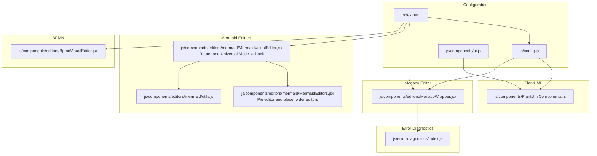
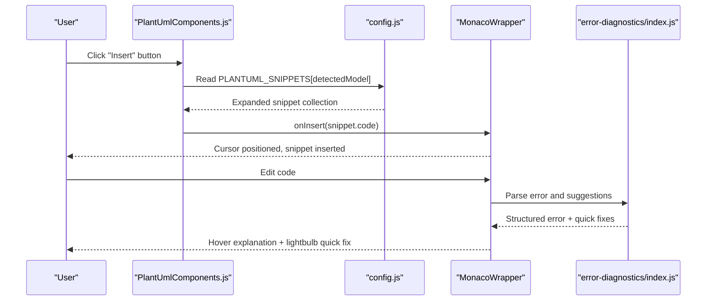
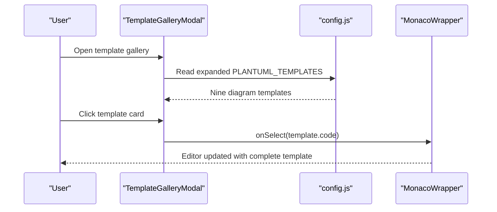
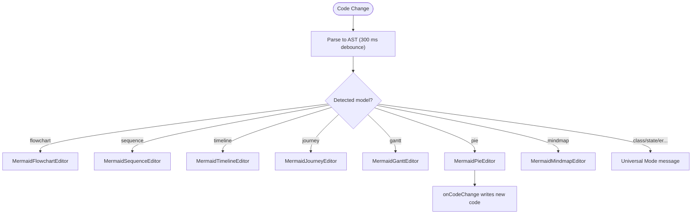
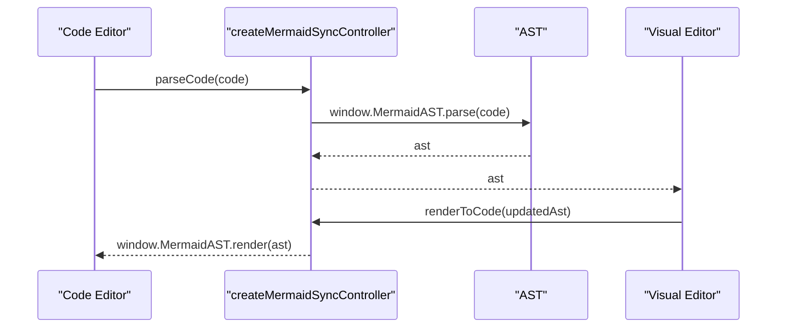
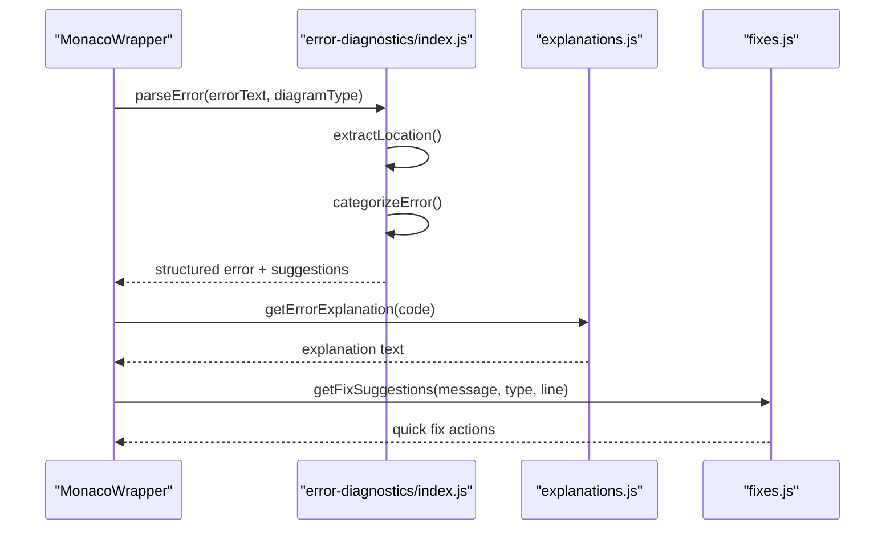
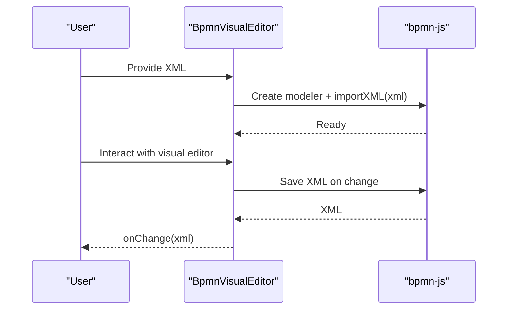
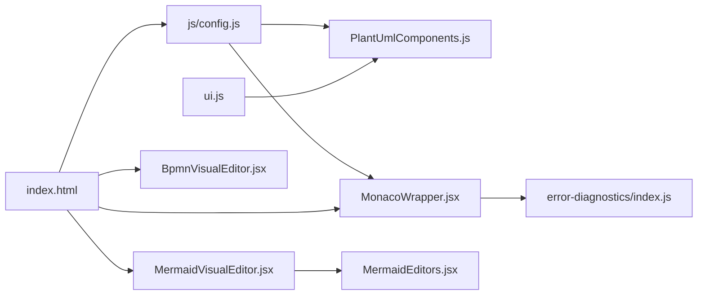

# Template System and Snippets

<cite>
**Referenced Files in This Document**
- [index.html](file://index.html)
- [js/config.js](file://js/config.js)
- [js/utils.js](file://js/utils.js)
- [js/components/PlantUmlComponents.js](file://js/components/PlantUmlComponents.js)
- [js/components/editors/MonacoWrapper.jsx](file://js/components/editors/MonacoWrapper.jsx)
- [js/components/editors/mermaid/MermaidVisualEditor.jsx](file://js/components/editors/mermaid/MermaidVisualEditor.jsx)
- [js/components/editors/mermaid/MermaidEditors.jsx](file://js/components/editors/mermaid/MermaidEditors.jsx)
- [js/components/editors/mermaid/utils.js](file://js/components/editors/mermaid/utils.js)
- [js/components/editors/BpmnVisualEditor.jsx](file://js/components/editors/BpmnVisualEditor.jsx)
- [js/error-diagnostics/index.js](file://js/error-diagnostics/index.js)
- [js/components/ui.js](file://js/components/ui.js)
</cite>

## Update Summary
**Changes Made**
- Added comprehensive quick-start templates for nine diagram types (flowcharts, sequence diagrams, class diagrams, state diagrams, ER diagrams, Gantt charts, pie charts, mindmaps, user journey maps)
- Enhanced PlantUML template gallery with expanded template collection
- Improved empty state management with dedicated UI components
- Added new Mermaid template categories including git graphs and quadrant charts

## Table of Contents
1. [Introduction](#introduction)
2. [Project Structure](#project-structure)
3. [Core Components](#core-components)
4. [Architecture Overview](#architecture-overview)
5. [Detailed Component Analysis](#detailed-component-analysis)
6. [Dependency Analysis](#dependency-analysis)
7. [Performance Considerations](#performance-considerations)
8. [Troubleshooting Guide](#troubleshooting-guide)
9. [Conclusion](#conclusion)

## Introduction
This document explains the template system and snippet functionality for diagram creation. It covers:
- The enhanced template gallery for PlantUML with expanded template collection and quick-start templates
- The comprehensive snippet system for rapid insertion of diagram elements across PlantUML and Mermaid
- How templates and snippets integrate with editors and the Monaco-based code editor
- Practical workflows for inserting templates/snippets, customizing diagrams, and managing empty states
- New quick-start templates for nine diagram types including flowcharts, sequence diagrams, class diagrams, state diagrams, ER diagrams, Gantt charts, pie charts, mindmaps, and user journey maps

## Project Structure
The application is a single-page React application with embedded JSX. Key areas related to templates and snippets:
- Configuration and constants (templates, snippets, diagram types) are defined centrally
- Editor components provide visual and code editing experiences
- Monaco integration adds syntax highlighting, diagnostics, and quick fixes
- Error diagnostics module parses and explains errors with actionable suggestions
- Empty state management provides user-friendly placeholders for various scenarios

**Diagram sources**
- [js/config.js](file://js/config.js#L1-L566)
- [index.html](file://index.html)
- [js/components/PlantUmlToolbar.jsx](file://js/components/PlantUmlToolbar.jsx)
- [js/components/PlantUmlComponents.js](file://js/components/PlantUmlComponents.js)
- [js/components/editors/mermaid/MermaidVisualEditor.jsx](file://js/components/editors/mermaid/MermaidVisualEditor.jsx)
- [js/components/editors/mermaid/MermaidEditors.jsx](file://js/components/editors/mermaid/MermaidEditors.jsx)
- [js/components/editors/mermaid/utils.js](file://js/components/editors/mermaid/utils.js)
- [js/components/editors/MonacoWrapper.jsx](file://js/components/editors/MonacoWrapper.jsx)
- [js/components/editors/BpmnVisualEditor.jsx](file://js/components/editors/BpmnVisualEditor.jsx)
- [js/error-diagnostics/index.js](file://js/error-diagnostics/index.js#L1-L303)
- [js/components/ui.js](file://js/components/ui.js#L83-L119)

**Section sources**
- [js/config.js](file://js/config.js#L1-L566)
- [index.html](file://index.html)

## Core Components
- Enhanced template gallery and snippet insertion for PlantUML:
  - Expanded PlantUML template collection with comprehensive diagram types including:
    - Standard UML: Sequence, Class, Use Case, Activity, State, Component, Deployment, Timing
    - Data/Structure: ER Diagrams, JSON Data, YAML Data
    - Project Management: Gantt Charts, Mind Maps, Work Breakdown Structures (WBS)
    - Network Architecture: Network Diagrams (nwdiag)
  - Comprehensive Mermaid template gallery with quick-start templates for all supported diagram types including:
    - Standard UML: Class, Sequence, State, ER
    - Flow & Process: Flowchart, User Journey, Gantt, Timeline
    - Data Viz: Pie Chart, Quadrant Chart, Git Graph
    - Structure/System: Mindmap, Requirement, C4
  - Dynamic snippet toolbar that adapts to detected model with expandable snippet categories
  - Template gallery modal with responsive grid layout displaying categorized templates with icons and descriptions
- Mermaid visual editors:
  - Router selects the sub-editor by detected diagram model (flowchart, sequence, pie, Gantt, timeline, journey, mindmap)
  - Only the pie chart editor edits the diagram. The flowchart editor shows a "coming soon" note, and the sequence, Gantt, timeline, journey and mindmap editors show a code-only message
  - Other diagram types (class, state, ER, git graph, quadrant and so on) show the "Universal Mode" message inside `MermaidVisualEditor`, which points the user back to the code view
- Monaco editor integration:
  - Syntax highlighting for PlantUML and Mermaid with enhanced error diagnostics
  - Error diagnostics with hover explanations and quick fixes for all diagram types
- BPMN visual editor:
  - Visual editing powered by bpmn-js with XML export/import
- Empty state management:
  - `ui.js` defines an EmptyState component for placeholders; the current editors do not yet render it

**Section sources**
- [js/components/PlantUmlComponents.js](file://js/components/PlantUmlComponents.js)
- [js/components/editors/mermaid/MermaidVisualEditor.jsx](file://js/components/editors/mermaid/MermaidVisualEditor.jsx)
- [js/components/editors/mermaid/MermaidEditors.jsx](file://js/components/editors/mermaid/MermaidEditors.jsx)
- [js/components/editors/MonacoWrapper.jsx](file://js/components/editors/MonacoWrapper.jsx)
- [js/components/editors/BpmnVisualEditor.jsx](file://js/components/editors/BpmnVisualEditor.jsx)
- [js/components/ui.js](file://js/components/ui.js#L83-L119)

## Architecture Overview
The template and snippet system centers around configuration-driven data and enhanced editor components:
- Configuration defines diagram types, templates, and snippets with expanded PlantUML and Mermaid template collections
- PlantUML components provide an enhanced toolbar with context-aware snippet loading:
  - Exclusive loading of relevant snippets (e.g., Sequence snippets only for sequence diagrams)
  - Minimal common set (Notes, Titles) appended to all views
  - Fallback "Basic UML" set for undetected or generic diagram types
- Mermaid editors parse code into an AST and route to sub-editors by detected diagram model, with comprehensive template support
- Monaco provides language support and diagnostics for PlantUML, Mermaid, and BPMN with enhanced error handling
- Error diagnostics module parses errors and generates actionable suggestions for all diagram types
- The EmptyState component in `ui.js` provides placeholders for empty content

**Diagram sources**
- [js/components/PlantUmlComponents.js](file://js/components/PlantUmlComponents.js#L8-L47)
- [js/config.js](file://js/config.js#L118-L192)
- [js/components/editors/MonacoWrapper.jsx](file://js/components/editors/MonacoWrapper.jsx)
- [js/error-diagnostics/index.js](file://js/error-diagnostics/index.js#L13-L44)

## Detailed Component Analysis

### Enhanced PlantUML Template Gallery and Snippet System
- Expanded template collection:
  - Nine diagram types: sequence diagrams, class diagrams, use case diagrams, activity diagrams, state diagrams, component diagrams, mind maps, ER diagrams, and deployment diagrams
  - Each template includes comprehensive examples with proper syntax and structure
  - Responsive grid layout with icons, titles, and descriptions for easy selection
- Enhanced snippet toolbar:
  - Dynamically selects category based on detected model with expanded snippet collections
  - Expandable interface showing up to six snippets initially, with option to show more
  - Improved visual feedback with hover effects and transition animations
- Template gallery modal:
  - Grid layout of templates with consistent styling and responsive design
  - Selecting a template injects complete code into the editor with proper formatting

**Diagram sources**
- [js/components/PlantUmlComponents.js](file://js/components/PlantUmlComponents.js#L52-L95)
- [js/config.js](file://js/config.js#L194-L565)
- [js/components/editors/MonacoWrapper.jsx](file://js/components/editors/MonacoWrapper.jsx)

**Section sources**
- [js/components/PlantUmlComponents.js](file://js/components/PlantUmlComponents.js#L8-L95)
- [js/config.js](file://js/config.js#L118-L565)
- [js/components/editors/MonacoWrapper.jsx](file://js/components/editors/MonacoWrapper.jsx)

### Comprehensive Mermaid Template System
- Enhanced template gallery:
  - Nine diagram types: flowcharts, sequence diagrams, class diagrams, state diagrams, ER diagrams, Gantt charts, pie charts, mindmaps, and user journey maps
  - Additional support for git graphs and quadrant charts for specialized use cases
  - Each template includes complete Mermaid syntax with proper formatting and examples
- Template integration:
  - Dynamic template selection based on diagram type detection
  - Unified template gallery interface supporting both PlantUML and Mermaid templates
  - Consistent styling and user experience across all template types

**Section sources**
- [index.html](file://index.html)

### Mermaid Visual Editor Routing and Editors
- Router:
  - `MermaidVisualEditor` shows a loading spinner until the Mermaid AST library has loaded
  - Then `MermaidVisualEditor` picks a sub-editor from the detected diagram model string and passes only `code` and `onChange` (the sub-editors do not receive the AST)
  - Types without a sub-editor fall through to the "Universal Mode" message
- Sub-editors in `MermaidEditors.jsx`:
  - Pie chart editor: reads the title and the `"label" : value` slices from the code, lets the user edit labels and values and add a slice, and writes the new code back
  - Flowchart editor: a "coming soon" note followed by the code-only message
  - Sequence, Gantt, timeline, journey and mindmap editors: the code-only message (`VisualEditingNotAvailable`)
- Universal Mode fallback:
  - A message inside `MermaidVisualEditor`: "Visual editing for this diagram type is generic. Structure editing is best done via code."
  - The Mermaid visual editor shows no preview or AST view of its own; the preview panel in the code view renders the diagram

**Diagram sources**
- [js/components/editors/mermaid/MermaidVisualEditor.jsx](file://js/components/editors/mermaid/MermaidVisualEditor.jsx)
- [js/components/editors/mermaid/MermaidEditors.jsx](file://js/components/editors/mermaid/MermaidEditors.jsx)

**Section sources**
- [js/components/editors/mermaid/MermaidVisualEditor.jsx](file://js/components/editors/mermaid/MermaidVisualEditor.jsx)
- [js/components/editors/mermaid/MermaidEditors.jsx](file://js/components/editors/mermaid/MermaidEditors.jsx)

### Mermaid Sync Controller
- Synchronization (`createMermaidSyncController`):
  - parseCode: converts code to an AST with a 300 ms debounce, and skips parsing while a visual edit is being written back
  - renderToCode: converts an AST back to code and marks the change as visual for 50 ms to prevent loops
  - The sub-editors do not receive the AST and write code directly, so only `App.jsx` calls renderToCode
- Type detection:
  - `detectSpecificModel` in `js/utils.js` produces the `detectedModel` string that the router uses

**Diagram sources**
- [js/components/editors/mermaid/utils.js](file://js/components/editors/mermaid/utils.js)

**Section sources**
- [js/components/editors/mermaid/utils.js](file://js/components/editors/mermaid/utils.js)

### Enhanced Monaco Editor Integration and Error Diagnostics
- Language registration:
  - PlantUML, Mermaid and LikeC4 Monarch tokenizers with expanded syntax support
  - Comments, brackets, auto-closing pairs configured with enhanced error detection
- Error providers:
  - Code action provider: quick fixes for common errors across all diagram types
  - Hover provider: detailed explanations for error markers with improved user guidance
- Error diagnostics:
  - parseError: extracts line/column, assigns error code, builds suggestions with enhanced context
  - toMonacoMarker/toMonacoCodeAction: convert to Monaco-compatible formats with improved formatting

**Diagram sources**
- [js/components/editors/MonacoWrapper.jsx](file://js/components/editors/MonacoWrapper.jsx)
- [js/error-diagnostics/index.js](file://js/error-diagnostics/index.js#L13-L44)

**Section sources**
- [js/components/editors/MonacoWrapper.jsx](file://js/components/editors/MonacoWrapper.jsx)
- [js/error-diagnostics/index.js](file://js/error-diagnostics/index.js#L13-L303)

### BPMN Visual Editor
- Uses the npm `bpmn-js` modeler, plus task resizing and custom lane, context-pad and renderer modules, to provide a visual modeling experience
- Imports initial XML (an empty diagram if the import fails) and exports XML on changes
- Destroys the modeler when the editor unmounts

**Diagram sources**
- [js/components/editors/BpmnVisualEditor.jsx](file://js/components/editors/BpmnVisualEditor.jsx)

**Section sources**
- [js/components/editors/BpmnVisualEditor.jsx](file://js/components/editors/BpmnVisualEditor.jsx)

### Enhanced Empty State Management
- Dedicated EmptyState component:
  - Flexible placeholder system with customizable icon, title, and description
  - Consistent styling with Tailwind CSS classes for visual consistency
  - Support for child components allowing rich empty state content
- Integration across components:
  - The current Mermaid sub-editors do not render EmptyState; the code-only and Universal Mode messages in `MermaidEditors.jsx` and `MermaidVisualEditor.jsx` play that role

**Section sources**
- [js/components/ui.js](file://js/components/ui.js#L83-L119)

## Dependency Analysis
- Central configuration:
  - Templates and snippets are defined in configuration files with expanded collections and consumed by components
  - Enhanced template galleries support both PlantUML and Mermaid with unified interface
- Editor routing:
  - Mermaid router depends on the `detectedModel` string from `detectSpecificModel`
- Monaco integration:
  - Components depend on Monaco APIs for language support and diagnostics with enhanced error handling
- Error handling:
  - Error diagnostics module is used by Monaco providers with improved context awareness
- Empty state management:
  - `ui.js` defines the EmptyState component; no editor renders it yet

**Diagram sources**
- [js/config.js](file://js/config.js#L1-L566)
- [index.html](file://index.html)
- [js/components/PlantUmlComponents.js](file://js/components/PlantUmlComponents.js)
- [js/components/editors/MonacoWrapper.jsx](file://js/components/editors/MonacoWrapper.jsx)
- [js/components/editors/mermaid/MermaidVisualEditor.jsx](file://js/components/editors/mermaid/MermaidVisualEditor.jsx)
- [js/components/editors/mermaid/MermaidEditors.jsx](file://js/components/editors/mermaid/MermaidEditors.jsx)
- [js/components/editors/BpmnVisualEditor.jsx](file://js/components/editors/BpmnVisualEditor.jsx)
- [js/error-diagnostics/index.js](file://js/error-diagnostics/index.js#L1-L303)
- [js/components/ui.js](file://js/components/ui.js#L83-L119)

**Section sources**
- [js/config.js](file://js/config.js#L1-L566)
- [index.html](file://index.html)

## Performance Considerations
- Debouncing:
  - Mermaid AST parsing is debounced to avoid excessive re-renders with enhanced performance monitoring
- Lazy loading:
  - The Mermaid AST library loads from a CDN, and the bpmn-js modeler is created only when the BPMN editor mounts
- Efficient rendering:
  - The preview panel renders SVG through `useRemoteRenderer`; the visual editors do not render previews
- Monaco optimizations:
  - Minimap, folding, and lightbulb are enabled for better UX without heavy overhead

## Troubleshooting Guide
Common issues and resolutions:
- Missing closing brackets or parentheses:
  - Quick fixes suggest adding missing delimiters with enhanced context awareness
- Missing PlantUML directives:
  - Suggestions add missing @startuml or @enduml with improved template insertion
- Unknown diagram type or unexpected tokens:
  - Hover explanations describe the issue and provide examples with enhanced error context
- Error localization:
  - Error diagnostics extract line/column and highlight the problematic region with improved precision
- Template loading issues:
  - Templates are static data in `js/config.js`, so they load with the app

Practical steps:
- Use the lightbulb quick fix to apply suggested corrections with enhanced error context
- Hover over error markers to read explanations with improved clarity
- Use the error diagnostics module to programmatically parse and present errors
- Leverage the expanded template gallery for quick-start solutions

**Section sources**
- [js/error-diagnostics/index.js](file://js/error-diagnostics/index.js#L13-L303)
- [js/components/editors/MonacoWrapper.jsx](file://js/components/editors/MonacoWrapper.jsx)
- [js/components/ui.js](file://js/components/ui.js#L83-L119)

## Conclusion
The enhanced template and snippet system provides comprehensive diagram authoring capabilities:
- Expanded PlantUML templates with nine diagram types streamline creation with contextual insertion
- Comprehensive Mermaid template gallery offers quick-start solutions for all supported diagram types including flowcharts, sequence diagrams, class diagrams, state diagrams, ER diagrams, Gantt charts, pie charts, mindmaps, and user journey maps
- Enhanced snippet system provides dynamic insertion capabilities with adaptive toolbar and expanded snippet collections
- The Mermaid visual editor routes to a pie chart editor that edits the code, shows placeholders for other chart types, and falls back to a Universal Mode message
- Monaco integration delivers robust syntax highlighting, diagnostics, and quick fixes with enhanced error context
- Error diagnostics improve developer experience with actionable insights
- The EmptyState component in `ui.js` is available for placeholders, though no editor uses it yet